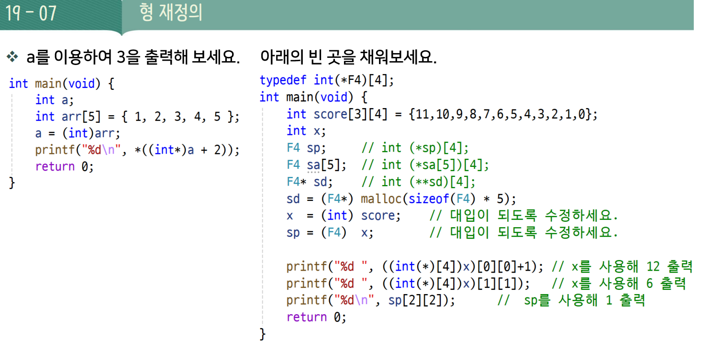
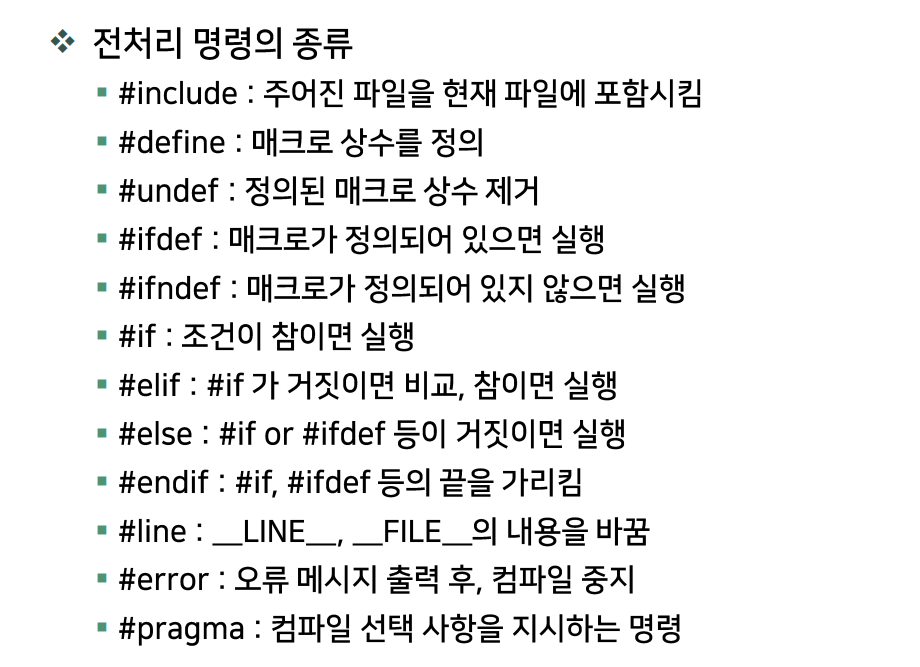
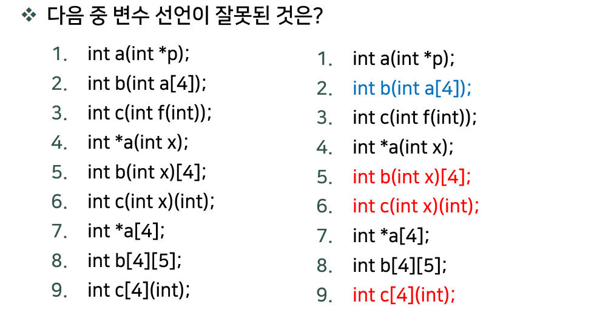

# DAY 10 — 형 재정의와 매크로

## 1. 형 재정의 — `typedef`

`typedef`는 **기존 자료형에 별칭을 붙이는 문법**이다. 복잡한 배열 포인터나 함수 포인터 선언을 간단하게 표현할 수 있다.



```c
typedef int (*F4)[4];

F4 sp;    // int (*sp)[4];    → int 4개짜리 배열을 가리키는 포인터
F4 sa[5]; // int (*sa[5])[4]; → 위 포인터 5개를 담는 배열
F4 *sd;   // int (**sd)[4];   → 위 포인터를 가리키는 포인터
```

**별칭이 가리키는 자료형 전체를 하나의 단위로 읽는다.** `F4` 자체가 포인터형이므로 `F4 *sd`에는 포인터 단계가 하나 더 붙는다.

### 주소와 포인터의 형변환

임베디드에서는 장치의 특정 주소를 사용하는 경우가 있다. 포인터형과 형변환을 정확히 지정하면 어떤 대상을 가리키는지 분명하게 표현할 수 있다.

```c
int (*a)[4];      // int 4개짜리 배열을 가리킴
char *(*b)[2];    // char * 2개짜리 배열을 가리킴
int (*c)(void);   // 매개변수 없이 int를 반환하는 함수를 가리킴

a = (int (*)[4])0x1000;
b = (char *(*)[2])0x2000;
c = (int (*)(void))0x3000;

printf("%p %p\n", (void *)a, (void *)b);
```

- `a = 0x1000;`처럼 정수를 바로 대입하는 것은 올바른 포인터 대입이 아니다. 형변환으로 목적 포인터형을 명시한다.
- 위 주소는 **형변환 문법을 보여주는 예시**다. 형변환한다고 해당 주소에 배열이나 함수가 생기지는 않는다.
- 현재 64비트 환경에서는 포인터가 8바이트, `unsigned int`는 4바이트다. 주소를 `(unsigned int)`로 바꾸면 일부가 잘릴 수 있다. 객체 포인터의 주소 출력에는 **`%p`와 `(void *)`**를 사용한다.
- 슬라이드처럼 주소를 `int`에 저장하는 방식도 같은 문제가 있다. `score`를 가리키려면 `F4 sp = score;`처럼 포인터로 직접 받으면 된다.

## 2. 전처리 지시자

전처리는 본격적인 컴파일 전에 파일 포함, 매크로 치환, 조건부 컴파일 등을 처리하는 과정이다. **`typedef`는 C 선언이며 전처리 지시자가 아니다.**



| 지시자 | 역할 |
| --- | --- |
| `#include` | 다른 파일의 내용을 포함 |
| `#define` / `#undef` | 매크로 정의 / 해제 |
| `#if` / `#elif` / `#else` / `#endif` | 조건에 따라 컴파일할 코드 선택 |
| `#ifdef` / `#ifndef` | 매크로가 정의되어 있는지 / 없는지 검사 |
| `#line` | 이후 코드의 논리적인 줄 번호와 파일 이름 변경 |
| `#error` | 오류 메시지를 내고 컴파일 실패 처리 |
| `#pragma` | 컴파일러별 기능이나 설정 지정 |

`#ifdef X`는 **X가 정의되어 있는지**를 검사한다. X의 값이 0이어도 정의되어 있으면 참이다. `#if X`는 **X를 치환한 조건식의 값**을 검사한다.

## 3. 매크로와 연산자 우선순위

매크로는 일반 함수 호출과 달리 **전처리 과정에서 코드를 치환**한다.

```c
#define SUMXY x+y
#define MUL1(x, y) x*y
#define MUL2(x, y) ((x)*(y))

int main(void) {
    int x = 10, y = 20;
    int a = 100, b = 200;

    printf("x+y=%d\n", SUMXY);
    printf("a+b=%d\n", SUMXY); // 이름이 a+b여도 실제 식은 x+y
    printf("%d\n", 30 / MUL1(2, 5));
    printf("%d\n", 30 / MUL2(2, 5));
    printf("%d\n", 3 / 2 * 5);

    return 0;
}
```

| 표현 | 치환 후 계산 | 결과 |
| --- | --- | --- |
| `SUMXY` | `x+y` | 30 |
| `30 / MUL1(2, 5)` | `30 / 2 * 5` | 75 |
| `30 / MUL2(2, 5)` | `30 / ((2)*(5))` | 3 |
| `3 / 2 * 5` | 정수 나눗셈으로 `1 * 5` | 5 |

**함수형 매크로는 매개변수 각각과 전체 수식을 괄호로 감싼다.**

여러 줄로 작성하려면 이어지는 줄의 끝에 **백슬래시 `\`**를 붙인다. `\` 바로 뒤에서 줄을 바꾼다.

```c
#define MUL2(x, y) \
    ((x) * (y))
```

### 절댓값·최솟값·최댓값

```c
#define ABS(x)    ((x) >= 0 ? (x) : -(x))
#define MIN(x,y)  ((x) < (y) ? (x) : (y))
#define MAX(x,y)  ((x) > (y) ? (x) : (y))
```

- `ABS(x)` : 절댓값
- `MIN(x, y)` : 두 값 중 작은 값
- `MAX(x, y)` : 두 값 중 큰 값

**`ABS(i++)`, `MIN(a++, b++)`처럼 값을 변경하는 식은 인자로 넣지 않는다.** 치환된 코드에서 인자가 여러 번 평가되어 의도와 다르게 동작할 수 있다.

## 4. 매크로 연산자 — `#`, `##`, `#@`

### `#` — 문자열화

매크로 매개변수 앞에 붙이면 **전달한 코드의 표기 자체를 문자열로 바꾼다.** 변수에 저장된 값을 문자열로 바꾸는 기능은 아니다. [GCC 문서](https://gcc.gnu.org/onlinedocs/cpp/Stringizing.html)

```c
#define ToString(x) #x
#define printINT(x) printf(#x " is %d\n", (x))

int s = 10;
puts(ToString(I am a boy)); // I am a boy
printINT(s);               // s is 10
```

`printINT(s)`는 다음과 같이 바뀐다. 나란히 놓인 문자열 리터럴은 하나로 이어진다.

```c
printf("s" " is %d\n", (s));
```

### `##` — 토큰 결합

양쪽 토큰을 붙여 **하나의 유효한 토큰**을 만든다. 변수나 함수 이름 등을 만들 수 있다. [GCC 문서](https://gcc.gnu.org/onlinedocs/cpp/Concatenation.html)

```c
#define Add(a, b, c) (Add##a((b), (c)))

Add(1, 4, 6); // (Add1((4), (6))) → Add1 함수 호출
Add(3, 2, 5); // (Add3((2), (5))) → Add3 함수 호출

int x = 1;
Add(x, 2, 3); // Addx 호출로 치환됨. 변수 x의 값 1을 읽는 것이 아님!
```

호출하려면 해당 이름의 함수가 선언·정의되어 있어야 한다.

```c
#define concat(x, i) printf("%s is %d\n", #i, (x##i))

int ca = 7, cb = 9;
concat(c, a); // a is 7  → 실제로 읽는 변수는 ca
concat(c, b); // b is 9  → 실제로 읽는 변수는 cb
```

`#i`는 인자를 문자열로 바꾸고, `x##i`는 실제로 읽을 변수 이름을 만든다. 원래 예제의 `cocnat`은 `concat`으로 표기를 다듬었다.

### `#@` — 문자화 (MSVC 전용)

`#@`는 인자를 작은따옴표로 감싸 **문자 상수**로 바꾸는 Microsoft 확장이다. **표준 C 연산자가 아니므로 현재 사용하는 GCC에서는 사용할 수 없다.** [Microsoft 문서](https://learn.microsoft.com/en-us/cpp/preprocessor/charizing-operator-hash-at?view=msvc-170)

```c
// MSVC 전용 예제
#define printCHAR(x) printf("%c is %c\n", #@x, (x))

int c = 'a';
printCHAR(c); // c is a  (#@c → 'c')
```

GCC에서는 이름을 문자열로 출력하면 같은 표시를 만들 수 있다.

```c
#define printCHAR(x) printf(#x " is %c\n", (x))
```

| 연산자 | 예시 | 치환 결과 |
| --- | --- | --- |
| `#` | `#x`에 `c` 전달 | `"c"` — 문자열 |
| `##` | `x##i`에 `c`, `a` 전달 | `ca` — 하나의 토큰 |
| `#@` | `#@x`에 `c` 전달 | `'c'` — 문자 상수, MSVC 전용 |

> 추가 확인: `fseek` — 파일 위치 이동 함수


## 5. `assert()` 매크로 사용

`assert(조건식)`은 **개발 중 반드시 참이어야 하는 조건을 확인하는 매크로**다. 연산자가 아니며, `<assert.h>`를 포함해 사용한다.

| 조건식 | 동작 (`NDEBUG`가 정의되지 않은 경우) |
| --- | --- |
| 참 | 다음 코드 실행 |
| 거짓 | 실패한 조건과 파일·줄 번호 등의 진단 메시지를 출력하고 프로그램 비정상 종료 |

```c
#include <stdio.h>
#include <assert.h>

int main(void) {
    int x;
    printf("Enter an integer value: ");
    if (scanf("%d", &x) != 1) return 1;

    assert(x >= 0); // 이 실습에서는 x가 음수가 아니라고 가정
    printf("You entered %d.\n", x);
    return 0;
}
```

입력값이 `5`이면 그대로 출력하고, `-1`이면 `assert`에서 종료된다.

### `NDEBUG`로 검사 끄기

```c
#define NDEBUG    // assert 검사를 끌 때 정의
#include <assert.h>
```

**`NDEBUG`는 `<assert.h>`를 포함하기 전에 정의해야 한다.** 기존 예제처럼 헤더를 포함한 뒤 정의하면 이미 정의된 `assert`의 동작은 바뀌지 않는다. 검사를 다시 켜려면 정의를 제거하고 다시 빌드한다. [GNU C Library 문서](https://www.gnu.org/software/libc/manual/html_node/Consistency-Checking.html)

- `NDEBUG`가 정의되면 **조건식 자체를 평가하지 않는다.** `assert(i++ > 0)`처럼 필요한 동작을 안에 넣지 않는다.
- 디버깅 중 내부 조건을 확인할 때 유용하다. 사용자 입력 오류처럼 **항상 처리해야 하는 상황은 `if`로 검사**한다.

## 6. 선언 구분하기 — 시험 확인



각 항목은 **서로 독립된 선언**으로 판단한다. 함수 선언과 변수 선언을 먼저 구분한 뒤, 배열·포인터·함수의 관계를 읽는다.

| 번호 | 선언 | 판단 및 의미 |
| --- | --- | --- |
| 1 | `int a(int *p);` | 가능 — `int *`를 받아 `int`를 반환하는 함수 |
| 2 | `int b(int a[4]);` | 가능 — 매개변수의 `int a[4]`는 `int *a`로 조정됨 |
| 3 | `int c(int f(int));` | 가능 — 매개변수의 함수 선언은 `int (*f)(int)`로 조정됨 |
| 4 | `int *a(int x);` | 가능 — `int`를 받아 `int *`를 반환하는 함수 |
| 5 | `int b(int x)[4];` | **불가능 — 함수는 배열을 직접 반환할 수 없음** |
| 6 | `int c(int x)(int);` | **불가능 — 함수는 함수를 직접 반환할 수 없음** |
| 7 | `int *a[4];` | 가능 — `int *` 4개를 담는 포인터 배열 |
| 8 | `int b[4][5];` | 가능 — `int` 5개짜리 배열 4개로 구성된 2차원 배열 |
| 9 | `int c[4](int);` | **불가능 — 함수 자체를 배열의 원소로 담을 수 없음** |

### 잘못된 선언은 포인터를 이용해 수정

```c
int (*b(int x))[4];   // 5번 수정: int 4개짜리 배열을 가리키는 포인터 반환
int (*c(int x))(int); // 6번 수정: int를 받아 int를 반환하는 함수의 포인터 반환
int (*c[4])(int);     // 9번 수정: 함수 포인터 4개를 담는 배열
```

**함수는 배열·함수 자체를 반환할 수 없지만, 이를 가리키는 포인터는 반환할 수 있다. 함수도 포인터로 만들면 배열에 담을 수 있다.**
