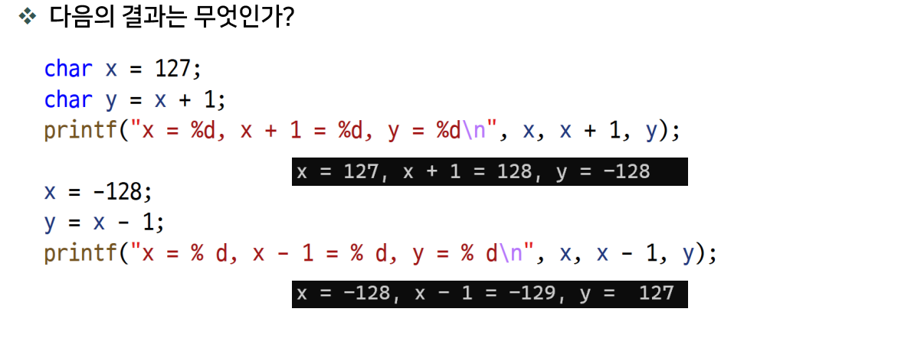
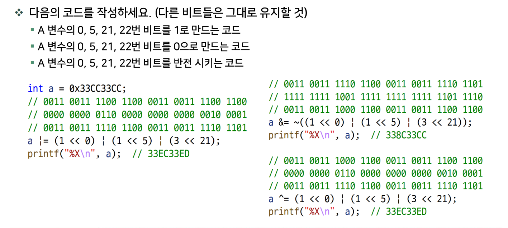
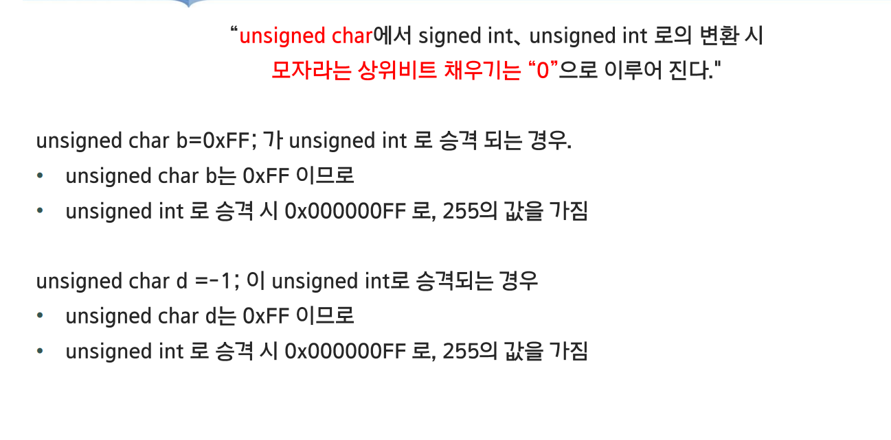
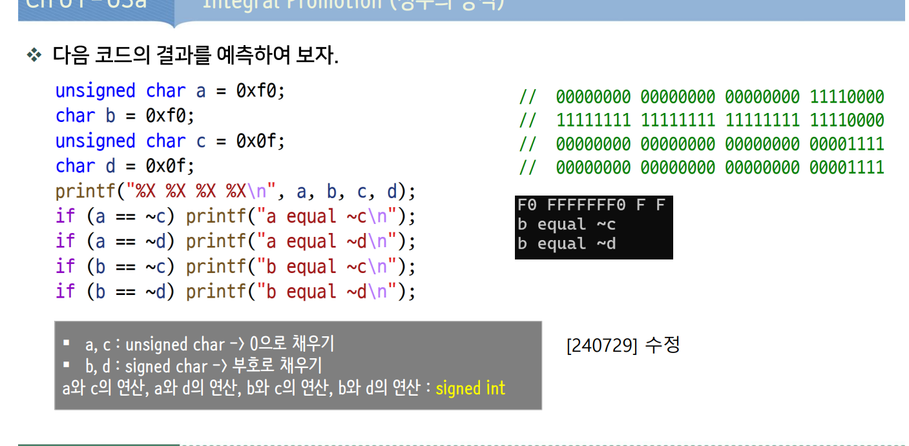
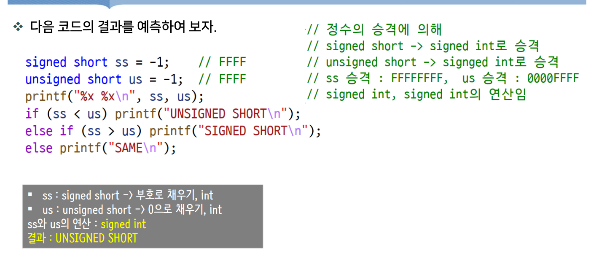
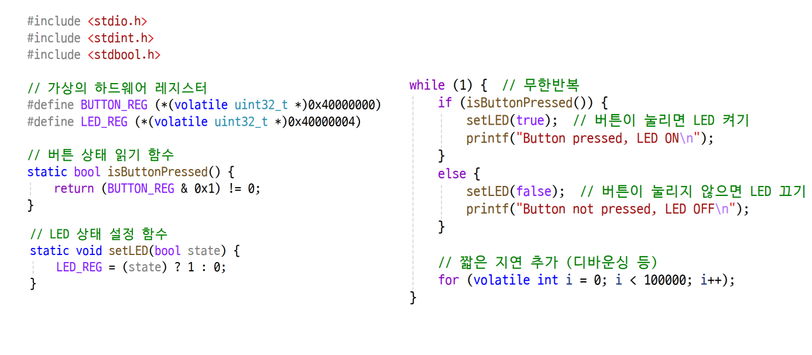

# DAY 02 — C 연산자와 제어 흐름

## 01-10J 특정 비트 연산

비트 위치는 **오른쪽 끝을 0번**으로 센다. `1U << bitPosition`으로 해당 위치만 1인 마스크를 만든다.

| 동작 | 연산자 | 의미 |
| --- | --- | --- |
| 설정 | `\|` (OR) | 해당 비트를 1로 설정 |
| 해제 | `& ~` (AND와 NOT) | 해당 비트를 0으로 설정 |
| 반전 | `^` (XOR) | 해당 비트를 0 ↔ 1로 변경 |

`~`는 모든 비트를 뒤집고, `1U`는 부호 없는 정수 상수이다.

```c
#include <stdio.h>

// 특정 비트를 해제
unsigned int clearBit(unsigned int num, int bitPosition) {
    return num & ~(1U << bitPosition);
}

// 특정 비트를 설정
unsigned int setBit(unsigned int num, int bitPosition) {
    return num | (1U << bitPosition);
}

// 특정 비트를 반전
unsigned int toggleBit(unsigned int num, int bitPosition) {
    return num ^ (1U << bitPosition);
}

int main(void) {
    unsigned int num = 0xAU; // 2진수 1010
    num = setBit(num, 2); 
    printf("num=%X\n", num);
    num = clearBit(num, 1);
    printf("num=%X\n", num);
    num = toggleBit(num, 3);
    printf("num=%X\n", num);

    return 0;
}
```

## 01-10 특정 위치부터 여러 비트 연산

시작 위치 `s`부터 연속된 `n`개의 비트를 조작한다.

1. `(1U << n) - 1U`로 하위 `n`개 비트가 1인 값을 만든다.
2. 이를 `s`만큼 왼쪽으로 이동해 마스크를 만든다.
3. 설정은 OR, 해제는 AND와 NOT, 반전은 XOR을 사용한다.

예를 들어 `s = 2`, `n = 3`이면 마스크는 `0001 1100`이다. **C에서 `^`는 거듭제곱이 아니라 XOR이다.**

```c
#include <stdio.h>

 
//특정 위치부터 특정 개수의 비트를 설정
unsigned int setBits(unsigned int num, int s, int n) {
    return num | (((1U << n) - 1U) << s);
}

//특정 위치부터 특정 개수의 비트를 해제
unsigned int clearBits(unsigned int num, int s, int n) {
    return num & ~(((1U << n) - 1U) << s);
}

//특정 위치부터 특정 개수의 비트를 반전
unsigned int toggleBits(unsigned int num, int s, int n) {
    return num ^ (((1U << n) - 1U) << s);
}

int main(void) {
    unsigned int num = 0xAAU; // 2진수 1010 1010
    num = setBits(num, 2, 3);
    printf("num=%X\n",num);
    num = clearBits(num, 4, 2);
    printf("num=%X\n",num);
    num = toggleBits(num, 1, 5);
    printf("num=%X\n",num);

    return 0;
}
```

`%X`는 대문자 16진수 출력이다. 첫 예제는 E → C → 4, 두 번째 예제는 BE → 8E → B0 순서로 출력된다.

### 사용 조건

- 단일 비트 위치는 0 이상이고 `unsigned int`의 비트 폭보다 작아야 한다.
- 위 여러 비트 연산식은 `s >= 0`, `1 <= n < 비트 폭`, `s < 비트 폭`, `s + n <= 비트 폭`인 범위에서 사용한다.
- 두 코드 블록은 각각 독립적으로 실행한다.

## 01-10Q 비트를 2진수로 출력하기

값을 오른쪽으로 이동한 뒤 `& 1U`로 마지막 비트만 추출하면, 각 비트를 0 또는 1로 출력할 수 있다.
### 01-10Q BitCheck 함수
```c
static unsigned int isBitSet(unsigned int num,int bitPosition){
    return (num>>bitPosition) & 1U;
}
```

```c
#include <stdio.h>
#include <limits.h>

void printBits(unsigned int num) {
    for (int i = sizeof(num) * CHAR_BIT - 1; i >= 0; --i) {
        printf("%u", (num >> i) & 1U);
    }
    putchar('\n');
}

int main(void) {
    unsigned int num = 10U;
    printBits(num);
    return 0;
}
```

`unsigned int`가 32비트인 환경의 출력:

```text
00000000000000000000000000001010
```

### 반복문 해석

| 코드 | 의미 |
| --- | --- |
| `sizeof(num)` | `num`의 크기를 바이트 단위로 구함. 보통 4바이트 |
| `CHAR_BIT` | 한 바이트의 비트 수. `<limits.h>`에 정의되며 보통 8 |
| `sizeof(num) * CHAR_BIT` | 저장 공간의 전체 비트 수. 4 × 8이면 32 |
| `- 1` | 비트 위치는 0부터 세므로 가장 높은 위치는 31 |
| `i >= 0` | 0번 비트까지 출력하고 종료 |
| `--i` | 다음에는 한 칸 낮은 위치의 비트를 확인 |

따라서 32비트 환경에서는 `i`가 **31 → 30 → … → 1 → 0** 순서로 바뀌며, 왼쪽의 높은 비트부터 출력한다. 마지막에는 `i`가 -1이 되어 반복이 끝나므로 여기서는 부호 있는 `int`를 사용한다.

### `(num >> i) & 1U` 해석

1. `num >> i`: 확인할 i번 비트를 맨 오른쪽인 0번 위치로 옮긴다.
2. `& 1U`: 맨 오른쪽 비트만 남기고 나머지는 모두 0으로 만든다.
3. `printf("%u", ...)`: 추출한 0 또는 1을 줄바꿈 없이 이어서 출력한다.

`num = 10`일 때 하위 4비트만 따라가면 다음과 같다.

| `i` | `num >> i`의 하위 4비트 | `& 0001` 결과 | 출력 |
| --- | --- | --- | --- |
| 3 | `0001` | `0001` | 1 |
| 2 | `0010` | `0000` | 0 |
| 1 | `0101` | `0001` | 1 |
| 0 | `1010` | `0000` | 0 |

따라서 `1010`이 출력된다. `num >> i`는 계산한 값을 사용할 뿐, 원래 `num`을 바꾸지는 않는다. 반복문 뒤의 `putchar('\n')`은 모든 비트를 출력한 뒤 한 번 줄바꿈한다.

하위 8비트만 확인하려면 반복문의 시작을 `int i = 7`로 바꾼다. 이 예제도 앞의 코드 블록들과 독립적으로 실행한다.


## 01-11 데이터 타입


**연산할 때의 자료형과 결과를 저장하는 자료형을 구분한다.** 사진처럼 `char`가 부호 있는 8비트, `int`가 32비트인 환경을 기준으로 설명한다.

### 1. 연산 전: char → int 정수 승격

```c
char x = 127;
char y = x + 1;
```

`x`에 저장된 127은 `0111 1111`이다. `x + 1`을 계산하기 전에 `x`의 값이 `int`로 **정수 승격**된다. 정수 상수 `1`도 `int`이므로 덧셈은 `int`로 수행된다.

```text
x에 저장 (char)       0111 1111                           → 127
승격한 값 (int)       00000000 00000000 00000000 01111111 → 127
1을 더한 결과 (int)   00000000 00000000 00000000 10000000 → 128
```

128은 `int` 범위 안에 있으므로 정상적으로 계산된다. **x 변수 자체가 4바이트로 바뀌는 것은 아니다.** 연산에 쓰이는 값만 변환되며, `x`는 여전히 `char`이고 값도 127이다.

### 2. 대입할 때: int → char 변환

계산 결과 128을 `char y`에 저장할 때 `char`로 변환된다. 부호 있는 8비트 `char`의 범위는 **-128 ~ 127**이므로 128은 범위를 벗어난다.

사진의 환경에서는 하위 8비트에 해당하는 `1000 0000`이 저장되고, 이것이 -128로 해석된다.

```text
계산 결과 (int)   00000000 00000000 00000000 10000000 → 128
y에 저장 (char)                              10000000 → -128
```

즉, 덧셈에서 바로 -128이 된 것이 아니라 **int로 128을 계산한 뒤, char에 저장하는 변환 과정에서 값이 달라진 것**이다.

### 3. 음수의 연산과 부호 확장

```c
x = -128;
y = x - 1;
```

이번에도 `x`의 값이 `int`로 승격된다. 2의 보수 표현에서 음수는 값이 유지되도록 높은 쪽 비트를 1로 채워 확장한다. 이를 **부호 확장**이라고 한다. 앞의 양수 127은 높은 쪽이 0으로 채워졌다.

```text
x에 저장 (char)       1000 0000                           → -128
승격한 값 (int)       11111111 11111111 11111111 10000000 → -128
1을 뺀 결과 (int)     11111111 11111111 11111111 01111111 → -129
y에 저장 (char)                                01111111 → 127
```

`-129`는 `int`로 계산할 수 있지만 부호 있는 8비트 `char`에는 들어가지 않는다. 사진의 환경에서는 `y`에 저장하면서 127이 된다.

### 4. printf에 전달할 때: 다시 int로 승격

`printf("%d", y)`에 `y`를 전달할 때도 `char` 값이 `int`로 승격된다. 이 환경에서는 `%d`에 맞는 `int`로 전달되는 것이다.

다만 **저장하면서 달라진 값이 원래 계산 결과로 복구되지는 않는다.** `y`에 -128이 저장되었다면 승격 후에도 -128이며, 128로 돌아오지 않는다.

| 단계 | 자료형 | `x = 127`, `x + 1` | `x = -128`, `x - 1` |
| --- | --- | --- | --- |
| `x`에 저장 | `char` | 127 | -128 |
| 연산 전에 승격 | `int` | 127 | -128 |
| 연산 결과 | `int` | 128 | -129 |
| `y`에 대입하며 변환 | `char` | -128 | 127 |
| `y`를 printf에 전달 | `int` | -128 | 127 |

> 일반 `char`의 부호 유무는 구현에 따라 다르다. 위 범위 초과 변환 결과도 모든 C 환경에서 같다고 가정하면 안 된다. 이 설명은 사진의 실행 환경을 기준으로 하며, 계산 결과를 유지하려면 결과를 표현할 수 있는 더 큰 자료형에 저장한다.

## 01-11b `/`와 `%` 연산자 활용

정수의 `/`는 몫을, `%`는 나머지를 구한다. 이를 이용하면 각 자릿수를 분리할 수 있다. 아래 코드는 **0 ~ 9999의 정수 입력**을 기준으로 한다.

```c
#include <stdio.h>

int main(void) {
    int a;
    if (scanf_s("%d", &a) != 1) {
        return 1;
    }

    int a1 = a / 1000;      // 천의 자리
    int a2 = a / 100 % 10;  // 백의 자리
    int a3 = a / 10 % 10;   // 십의 자리
    int a4 = a % 10;        // 일의 자리
    printf("%d %d %d %d\n", a1, a2, a3, a4);
    return 0;
}
```

예를 들어 1234에서 `1234 / 100`은 12이고, `12 % 10`은 2이므로 백의 자리를 얻는다. `/`와 `%`는 우선순위가 같고 왼쪽부터 묶이므로 `a / 100 % 10`은 `(a / 100) % 10`이다.

`scanf_s`는 현재 MSVC 환경에서 사용하는 입력 함수이다. 나누는 값이 0이면 정수의 `/`, `%` 연산을 할 수 없다.

### 복합 대입과 연속 대입

```c
int a, b = 30;
a = b -= 5;
```

`-=`는 빼고 다시 저장하는 **복합 대입 연산자**이다. 위 식은 `a = (b -= 5)`로 묶인다.

1. `b -= 5`로 `b`가 30에서 25가 된다.
2. 대입식의 값도 대입 후 값인 25이므로 `a`에도 25가 저장된다.

이 예시는 `a = (b = b - 5)`와 같은 결과이며, 최종적으로 **a와 b 모두 25**이다. C에서 `=`는 같다는 비교가 아니라 대입이고, 비교에는 `==`를 사용한다.

## 01-11f 비트 연산자



### 21번과 22번 비트를 함께 선택하기

`3U`는 2진수로 `11`이다. 이를 왼쪽으로 21칸 이동하면 원래 0번·1번 위치의 1이 각각 21번·22번 위치로 이동한다.

```c
3U << 21
// (1U << 21) | (1U << 22)와 같은 마스크
```

**`<<`의 왼쪽은 이동할 값, 오른쪽은 이동할 칸 수**이다. `21U << 3`은 숫자 21을 3칸 옮기는 다른 계산이다.

사진의 0번·5번·21번·22번 비트를 선택하는 마스크는 다음과 같다. 아래는 32비트 `unsigned int` 환경을 기준으로 한다.

```c
unsigned int mask = (1U << 0) | (1U << 5) | (3U << 21);
```

| 동작 | 식 | 선택하지 않은 비트 |
| --- | --- | --- |
| 1로 설정 | `a |= mask;` | 유지 |
| 0으로 해제 | `a &= ~mask;` | 유지 |
| 반전 | `a ^= mask;` | 유지 |

사진은 동일한 `a`에 설정 → 해제 → 반전을 순서대로 적용한 예시이다. 비트 조작에서는 `a`도 `unsigned int`로 선언하면 부호 없는 자료형으로 일관되게 계산할 수 있다.

## 01-02 정수의 승격



### 확장할 때 채우는 비트

아래는 8비트 문자형과 32비트 `int`, 2의 보수 표현을 기준으로 한다. 값의 범위를 모두 표현할 수 있는 더 큰 정수형으로 변환할 때는 **원래 값을 유지**한다.

| 원래 자료형과 값 | 8비트 표현 | int로 확장한 표현 | 값 |
| --- | --- | --- | --- |
| `unsigned char`, 255 | `11111111` | `00000000 00000000 00000000 11111111` | 255 |
| `signed char`, -1 | `11111111` | `11111111 11111111 11111111 11111111` | -1 |
| `signed char`, 15 | `00001111` | `00000000 00000000 00000000 00001111` | 15 |

- **부호 없는 값:** 높은 쪽을 0으로 채운다(제로 확장).
- **부호 있는 값:** 부호 비트로 채운다(부호 확장). 양수와 0은 0, 음수는 1로 채운다.

`unsigned char d = -1;`은 8비트 환경에서 **저장할 때 이미 255로 변환**된다. 이후 `int`로 승격하거나 `unsigned int`로 변환해도 값은 255이다.

> `unsigned char`가 연산할 때 무조건 `unsigned int`로 승격되는 것은 아니다. `int`가 원래 자료형의 모든 값을 표현할 수 있으면 `int`로 승격된다. 일반적인 8비트 `unsigned char`와 32비트 `int` 환경에서는 `int`로 승격된다.

### 정수 승격 후 NOT 연산하기



사진은 일반 `char`가 부호 있는 8비트이며, `char b = 0xF0;`에 -16이 저장되는 환경이다.

| 변수 | 저장된 값 | int 승격 후 비트 표현 |
| --- | --- | --- |
| `unsigned char a = 0xF0;` | 240 | `00000000 00000000 00000000 11110000` |
| `char b = 0xF0;` | -16 | `11111111 11111111 11111111 11110000` |
| `unsigned char c = 0x0F;` | 15 | `00000000 00000000 00000000 00001111` |
| `char d = 0x0F;` | 15 | `00000000 00000000 00000000 00001111` |

**`~`도 먼저 정수 승격한 뒤 적용된다.** 따라서 `~c`는 8비트만 뒤집은 240이 아니라, 32비트 `int` 전체를 뒤집은 -16이다. `~d`도 동일하다.

```text
c 또는 d 승격: 00000000 00000000 00000000 00001111 → 15
NOT 적용:      11111111 11111111 11111111 11110000 → -16
```

그래서 사진의 비교에서 `a == ~c`, `a == ~d`는 거짓이고, **`b == ~c`, `b == ~d`는 참**이다. 비교도 이 환경에서는 모두 `int` 값으로 이루어진다.

하위 8비트의 반전 값 240이 필요하면 `(unsigned char)~c`처럼 다시 변환하거나, `(~c) & 0xFFU`로 하위 8비트만 남긴다.

사진처럼 `%X`로 비트를 확인할 때는 `(unsigned int)b`처럼 명시적으로 변환해 서식과 자료형을 맞춘다. 예를 들어 `printf("%X\n", (unsigned int)b);`는 이 32비트 환경에서 `FFFFFFF0`을 출력한다.




## 02-1 Control Statement

**제어문(Control Statement)**은 조건에 따라 실행할 코드를 선택하거나 실행 흐름을 바꾸는 문장이다. 여기서는 `if`, `else`, `return`을 이용한 조건 분기를 연습한다.

조건식은 **0이면 거짓, 0이 아니면 참**으로 판단한다. `if`, `else`를 무조건 줄이기보다 조건의 의미와 검사 순서가 명확한 코드를 작성한다. 삼항 연산자로 바꾼다고 반드시 더 빨라지는 것은 아니다.

### 1. 홀짝 판단: 나머지, 비트 연산, 조건 연산자

아래 비트 연산 설명은 현재 사용하는 2의 보수 정수 환경을 기준으로 한다.

| 방법 | 판단 기준 |
| --- | --- |
| `n % 2 == 0` | 2로 나눈 나머지가 0이면 짝수 |
| `n & 1U` | 최하위 비트가 1이면 홀수, 0이면 짝수 |
| `조건 ? 참일 때 값 : 거짓일 때 값` | 조건에 따라 둘 중 하나의 값을 선택 |

```c
#include <stdio.h>

int main(void) {
    int n;
    if (scanf_s("%d", &n) != 1) return 1;

    // 나머지 연산으로 판단
    if (n % 2 == 0) {
        printf("even.\n");
    } else {
        printf("odd.\n");
    }

    // 최하위 비트로 판단
    if (n & 1U) {
        printf("odd.\n");
    } else {
        printf("even.\n");
    }

    // 조건 연산자(삼항 연산자)로 출력할 문자열 선택
    printf("%s\n", (n & 1U) ? "odd" : "even");
    return 0;
}
```

`n & 1 == 0`은 `n & (1 == 0)`으로 묶이므로 잘못된 판단이다. 짝수인지 비교하려면 **`(n & 1U) == 0U`**처럼 괄호를 사용한다. 현재 환경의 홀짝 판단에는 `(n & 1) == 0`도 사용할 수 있다.

### 2. 2·3·5의 배수 판단과 조기 반환

```c
#include <stdio.h>

int check(int n) {
    if (n % 2 == 0) return 2;
    if (n % 3 == 0) return 3;
    if (n % 5 == 0) return 5;
    return 0;
}

int main(void) {
    int n;
    if (scanf_s("%d", &n) != 1) return 1;

    printf("result: %d\n", check(n));
    return 0;
}
```

`return`을 실행하면 함수가 즉시 끝난다. 따라서 `else`가 없어도 **처음 만족한 조건의 값 하나만 반환**한다.

| 입력 | 반환값 | 이유 |
| --- | --- | --- |
| 6 | 2 | 2와 3의 배수지만 2를 먼저 검사 |
| 9 | 3 | 2의 배수가 아니고 3의 배수 |
| 25 | 5 | 2·3의 배수가 아니고 5의 배수 |
| 7 | 0 | 어느 조건에도 해당하지 않음 |
| 0 | 2 | `0 % 2`가 0이므로 첫 조건에서 반환 |

3·5의 배수 여부는 최하위 비트 하나로 판별할 수 없다. `~(n % 3) & 1U`는 나머지가 2일 때도 참이므로 사용할 수 없다. 나머지 전체가 0인지 확인하는 `n % 3 == 0` 또는 `!(n % 3)`을 사용한다.

기존의 `printf(check(n));`는 정수 반환값을 문자열 주소처럼 전달하므로 잘못된 호출이다. 정수 출력에는 `printf("%d", check(n));`처럼 서식을 지정한다.

### 3. 점수에 따라 출력할 문자열 선택하기

`check()`가 점수에 따라 배열 인덱스 0·1·2를 반환하고, `result[check(score)]`로 해당 문자열을 선택한다. 입력은 0~100인 경우를 기준으로 한다.

```c
#include <stdio.h>

int check(int s){
    if(s>=70) return 0;
    if(s>=60) return 1;
    return 2;
}

int main(void){
    char* result[] = {"합격입니다.","재시험보세요","불합격입니다."};
    int score;

    printf("점수(0~100)입력해주세요:");
    scanf_s("%d",&score);

    printf("%s \n감사합니다.",result[check(score)]);


    return 0;
}
```

| 점수 | 반환 인덱스 | 출력 |
| --- | --- | --- |
| 70~100 | 0 | 합격입니다. |
| 60~69 | 1 | 재시험보세요 |
| 0~59 | 2 | 불합격입니다. |

`return`하면 함수가 종료되므로 높은 점수부터 검사한다. `result`는 문자열 주소를 담는 포인터 배열이며, 선택한 문자열은 `%s`로 출력한다. 문자열을 수정하지 않으므로 선언은 `const char *result[]`를 권장한다.

### switch문 간단 실습

`switch`는 정수형 식의 값과 일치하는 `case`부터 실행한다. `case`에는 정수 상수식을 사용하며, `score >= 90` 같은 범위 조건을 직접 적는 방식은 아니다.

아래는 **0~100점 입력**을 기준으로 `score / 10`의 몫으로 등급을 구한다.

```c
#include <stdio.h>

int main(void) {
    int score;
    if (scanf_s("%d", &score) != 1) return 1;
    if (score < 0 || score > 100) return 1;

    const char *c;
    switch (score / 10) {
        case 10:
        case 9:
            c = "A";
            break;
        case 8:
            c = "B";
            break;
        case 7:
            c = "C";
            break;
        case 6:
            c = "D";
            break;
        default:
            c = "F";
            break;
    }
    printf("%s\n", c);
    return 0;
}
```

| 점수 | `score / 10` | 등급 |
| --- | --- | --- |
| 90~100 | 9 또는 10 | A |
| 80~89 | 8 | B |
| 70~79 | 7 | C |
| 60~69 | 6 | D |
| 0~59 | 0~5 | F |

- `case 10:`과 `case 9:`는 같은 처리 코드를 공유한다.
- `break`는 `switch`를 빠져나간다. 없으면 다음 `case`의 코드도 이어서 실행된다.
- `default`는 일치하는 `case`가 없을 때 실행된다.

### while문 실습

`while`은 **조건을 먼저 검사**하고, `do-while`은 **본문을 한 번 실행한 뒤 조건을 검사**한다. 아래 두 반복문은 각각 10보다 큰 값이 입력되면 입력을 반복한다.

```c
#include <stdio.h>

int main(void) {
    int a1, a2;

    while (scanf_s("%d", &a1) == 1 && a1 > 10) {
        // 입력과 조건 검사를 반복하며, 본문에서는 할 일이 없다.
    }

    do {
        if (scanf_s("%d", &a2) != 1) return 1;
    } while (a2 > 10);

    return 0;
}
```

`scanf_s`는 **입력에 성공해 값을 대입한 항목 수**를 반환한다. `%d` 하나라면 성공 시 1, 숫자로 변환할 수 없는 입력이면 0, 첫 변환 전에 입력이 끝나면 `EOF`를 반환한다. 따라서 단순히 참·거짓으로 쓰기보다 `== 1`로 성공 여부를 확인한다.

`&&`는 왼쪽이 거짓이면 오른쪽을 평가하지 않는다. 위 `while`에서는 입력에 성공했을 때만 `a1 > 10`을 검사한다. 첫 입력은 조건식 안에서 받으므로, 이 예제의 `while`도 입력은 최소 한 번 시도한다.

기존의 `while (조건);`은 세미콜론 하나가 빈 본문인 형태이다. 의도한 경우에는 가능하지만, 실수와 구분하기 쉽도록 `{}`와 주석으로 표현했다.

**코드가 짧거나 조건식에 연산이 적다고 반드시 더 빠른 것은 아니다.** 여기서는 입력 처리 비용이 크므로 속도 차이를 단정하기보다 입력 성공 여부와 반복 종료 조건을 명확히 작성한다.

### 반복문 활용

