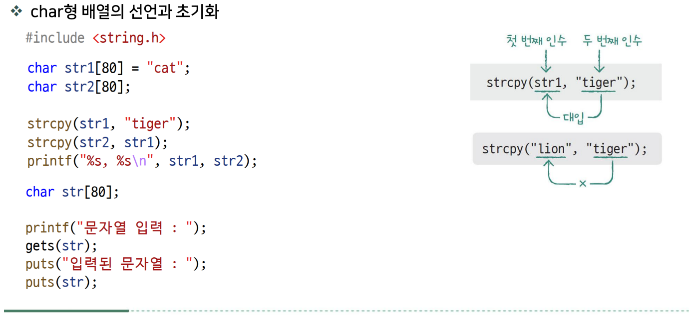
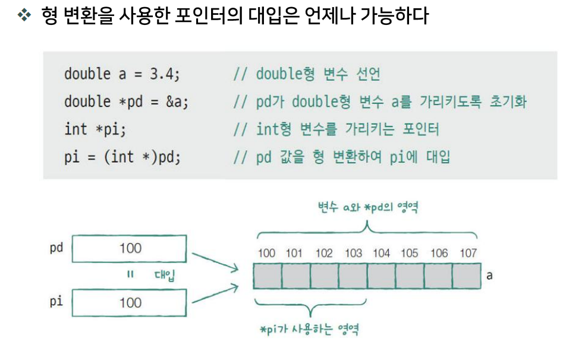
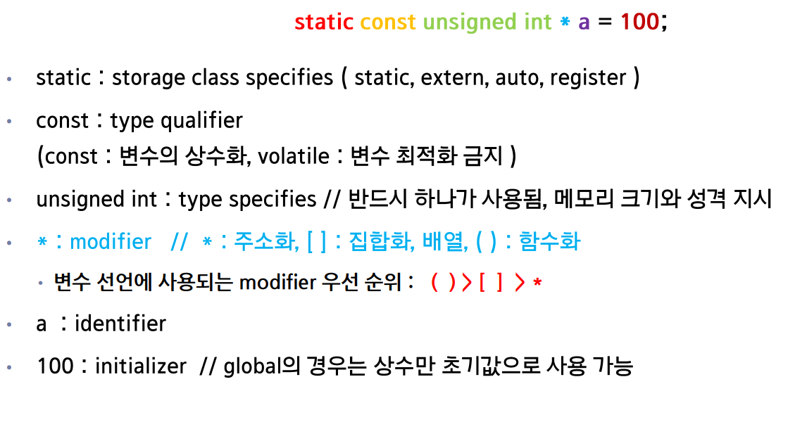
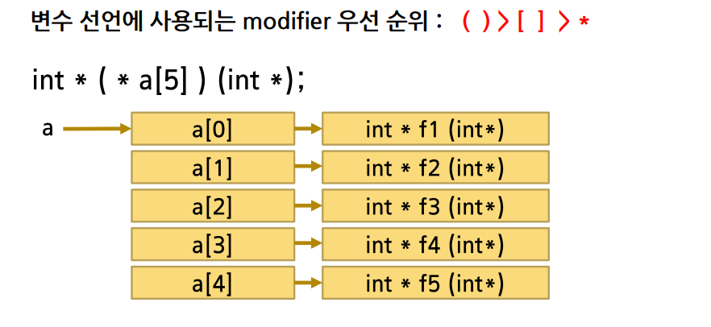
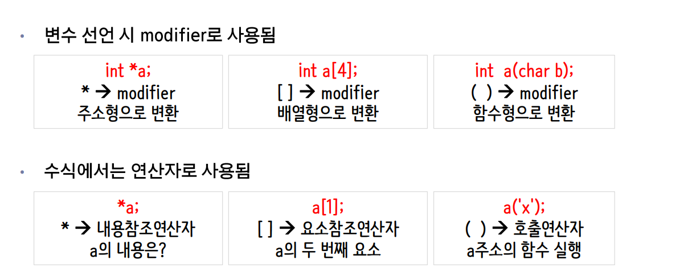
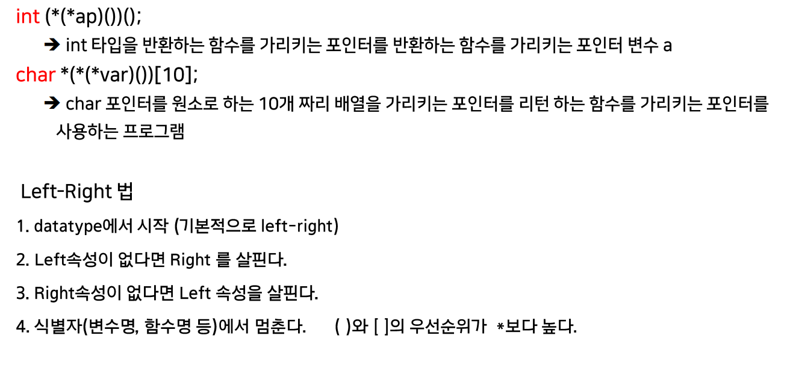
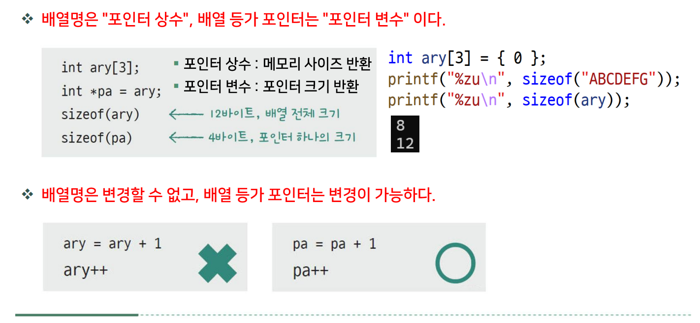
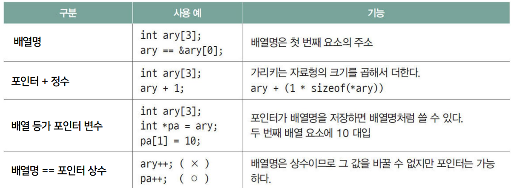

# DAY 03 — C 배열과 포인터

## 1. 배열 이름과 첫 번째 요소의 주소

```c
int a[5] = {10, 20, 30, 40, 50};
int *p = a; // &a[0]과 같은 주소
```

배열 `a` 자체의 자료형은 `int[5]`이다. 다만 **대부분의 식에서 배열 이름은 첫 번째 요소를 가리키는 포인터로 변환**된다.

- `a`가 포인터로 변환되면 자료형은 `int *`이고, 값은 `&a[0]`과 같다.
- `a[i]`는 `*(a + i)`와 같은 의미이다.
- `a`는 배열이므로 `a = p`나 `a++`처럼 배열 이름을 변경할 수 없다.

> `a = &a[0]`은 대입문으로 쓸 수 없다. 주소가 같다는 설명은 `a == &a[0]`로 표현한다.

## 2. `a`, `&a[0]`, `&a`의 차이

| 표현 | 자료형 | 의미 | 1을 더했을 때 이동 크기 |
| --- | --- | --- | --- |
| `a` (포인터로 변환된 경우) | `int *` | 첫 번째 요소를 가리킴 | `sizeof(int)` 바이트 |
| `&a[0]` | `int *` | 첫 번째 요소를 가리킴 | `sizeof(int)` 바이트 |
| `&a` | `int (*)[5]` | 원소 5개짜리 배열 전체를 가리킴 | `sizeof(a)` 바이트 |

`&a`에서는 배열이 첫 번째 요소의 포인터로 변환되지 않는다. 세 표현은 같은 시작 위치를 나타내지만, **가리키는 대상의 자료형이 달라 포인터 연산 결과도 다르다.**

```c
int *p = a;
int (*pa)[5] = &a; // 배열 포인터

// p + 1  : a[1]을 가리킴
// pa + 1 : 배열 전체 바로 다음 위치를 가리킴
```

배열 바로 다음 위치의 포인터는 만들 수 있지만, 그 위치의 값을 읽거나 쓸 수는 없다.

## 3. `sizeof`와 배열 크기

`sizeof(a)`에서는 배열이 포인터로 변환되지 않으므로 **배열 전체의 크기**를 구한다.

```c
int a[5];
int *p = a;

sizeof(a);                // 5 * sizeof(int)
sizeof(a[0]);             // 원소 하나의 크기
sizeof(a) / sizeof(a[0]); // 원소 개수: 5
sizeof(p);                // 포인터 변수 자체의 크기
```

`sizeof` 결과의 자료형은 `size_t`이고, 출력할 때는 `%zu`를 사용한다. `int`가 4바이트인 환경이라면 `sizeof(a)`는 20바이트이다.

> 함수 매개변수의 `int a[]`는 `int *a`로 조정된다. 따라서 함수 안에서 해당 매개변수에 `sizeof(a)`를 적용하면 포인터 크기가 나오므로, 배열의 원소 개수를 별도로 전달해야 한다.

## 4. 포인터 덧셈과 뺄셈

포인터에 정수를 더하거나 빼면 **가리키는 자료형의 크기 단위**로 이동한다.

```c
int a[5] = {10, 20, 30, 40, 50};
int *p = &a[0];
int *q = &a[4];

// p + 1은 &a[1]
// q - p는 4: 두 포인터 사이의 원소 간격
// p - q는 -4
```

포인터끼리 뺀 결과는 바이트 수가 아니라 **원소 단위의 거리**이다. 결과의 자료형은 `size_t`가 아니라 **`ptrdiff_t`**이며, `<stddef.h>`에 정의되어 있다.

### 주소로 이해하기

`sizeof(int) == 4`이고, 같은 배열의 두 원소 주소가 각각 `0x1000`, `0x1010`이라고 가정하면 다음과 같다.

```text
주소 차이: 0x1010 - 0x1000 = 0x10 = 16바이트
원소 간격: 16 / 4 = 4
```

단, 임의의 정수 주소를 포인터로 형 변환해 빼는 코드는 이 결과를 보장하지 않는다. **포인터 뺄셈은 같은 배열 내부 또는 그 배열의 바로 다음 위치를 가리키는 포인터 사이에서만 사용한다.** 결과는 `ptrdiff_t`로 표현할 수 있어야 한다.

### 실행 예제

```c
#include <stdio.h>
#include <stddef.h>

int main(void) {
    int a[5] = {10, 20, 30, 40, 50};
    int *p = &a[0];
    int *q = &a[4];
    ptrdiff_t distance = q - p;

    printf("원소 개수: %zu\n", sizeof(a) / sizeof(a[0])); // 5
    printf("다음 원소: %d\n", *(p + 1));                 // 20
    printf("원소 간격: %td\n", distance);                // 4

    return 0;
}
```

## 핵심 정리

- 배열은 포인터와 다른 자료형이지만, 대부분의 식에서 첫 번째 요소의 포인터로 변환된다.
- `&a`는 배열 전체를 가리키는 포인터이다.
- 포인터 연산의 이동 크기는 가리키는 자료형의 크기에 따라 달라진다.
- `sizeof`의 결과는 `size_t` (`%zu`), 포인터 뺄셈의 결과는 `ptrdiff_t` (`%td`)이다.

## 04-01 배열

### 배열을 함수에 전달하기

배열을 함수에 전달하면 배열 전체가 복사되는 것이 아니라, **첫 번째 요소의 주소가 전달**된다.

```c
void func(int *b, int n) {
    for (int i = 0; i < n; ++i) {
        b[i] = 0;
    }
}

int main(void) {
    int a[5] = {10, 20, 30, 40, 50};

    func(a, 5); // a의 첫 번째 요소 주소와 원소 개수를 전달
    // 원래 배열 a의 모든 원소가 0으로 바뀜

    return 0;
}
```

- `b`는 전달받은 주소를 저장하는 포인터 매개변수이다.
- `b`를 위한 포인터 변수의 저장 공간은 있지만, 배열 전체를 저장하는 새 공간이 만들어지는 것은 아니다.
- `b[i]`로 호출한 쪽 배열의 원소를 읽거나 수정할 수 있다.
- **포인터만으로는 배열의 원소 개수를 알 수 없으므로** `n`도 함께 전달한다.
- 함수 매개변수에서 `int b[]`라고 작성해도 `int *b`와 같은 의미이다.


### 배열의 접근 범위

```c
int a[5] = {10, 20, 30, 40, 50};

// 올바른 인덱스: 0 ~ 4
// a[-1], a[5]는 배열 범위를 벗어난 접근
```

배열 `a`의 원소 개수가 `n`이라면 **`0 <= i && i < n`인 인덱스**로 접근해야 한다.

C는 배열 접근 시 범위를 자동으로 검사하지 않는다. 범위를 벗어나도 컴파일될 수 있으며, 실행 중에도 반드시 오류 메시지가 나오는 것은 아니다. 엉뚱한 값이 나오거나 다른 메모리를 덮어쓰거나 프로그램이 종료될 수 있는 **정의되지 않은 동작**이다.

따라서 반복문의 조건은 `i <= n`이 아니라 **`i < n`**으로 작성하고, 함수에 전달하는 `n`도 실제 배열의 원소 개수를 넘지 않도록 해야 한다.

### 실습 — 배열 입력과 출력

배열의 원소 개수를 구해 함수에 전달하고, 포인터 연산으로 각 원소에 접근한다. 아래 예제는 정수 5개가 정상적으로 입력된다고 가정한다.

```c
#include <stdio.h>

#define SIZE(x) (sizeof(x) / sizeof((x)[0]))

void input_data(int *arr, int n) {
    for (int i = 0; i < n; i++) {
        // &arr[i] == &*(arr + i) == arr + i
        // &와 *가 상쇄되므로 arr + i로 쓸 수 있다.
        scanf("%d", arr + i);
    }
}

void print_data(int *arr, int n) {
    for (int i = 0; i < n; i++) {
        printf("%d ", *(arr + i)); // arr[i]와 같은 값
    }
    printf("\n");
}

int main(void) {
    int score[5] = {0};
    input_data(score, SIZE(score));
    print_data(score, SIZE(score));

    return 0;
}
```

#### `SIZE(x)` — 배열의 원소 개수

- 배열 전체 크기를 원소 하나의 크기로 나누므로 `SIZE(score)`는 `5`이다.
- 매크로는 전달한 내용을 그대로 치환하므로, 식이 들어와도 의도대로 묶이도록 괄호를 사용한다.
- **실제 배열에 사용해야 한다.** 함수 안의 `arr`는 포인터이므로 `SIZE(arr)`로 원소 개수를 구할 수 없다.

#### 함수 매개변수의 배열 크기

함수 매개변수에서는 `int *arr`, `int arr[]`, `int arr[100]` 모두 포인터 매개변수로 처리된다. `int arr[100]`이라고 써도 배열 100개가 새로 만들어지거나, 전달한 배열의 크기를 자동으로 검사하지 않는다.

이 실습에서는 `int *arr`로 주소를 받고, `n`으로 처리할 원소 개수를 따로 받는다.

#### `&arr[i]`를 `arr + i`로 쓸 수 있는 이유

`arr[i]`는 `*(arr + i)`와 같으므로 다음과 같이 표현할 수 있다.

```c
&arr[i]          // i번째 원소의 주소
&*(arr + i)      // arr[i]를 *(arr + i)로 풀어 쓴 표현
arr + i         // &와 *가 상쇄되어 같은 주소를 나타냄
```

여기서 `&*`는 실제로 값을 읽은 뒤 다시 주소를 구하는 연산을 수행하지 않고, 두 연산자를 생략한 것과 같은 결과가 된다. 따라서 아래 두 입력문은 같은 동작을 한다.

```c
scanf("%d", &arr[i]);
scanf("%d", arr + i);
```

출력에서도 `arr[i]` 대신 `*(arr + i)`로 같은 원소의 값을 사용할 수 있다.


## 04-6 문자를 저장하는 배열

| 선언 | 의미 |
| --- | --- |
| `char str[5];` | `char` 원소 5개를 저장하는 배열 |
| `char *p[5];` | `char *` 포인터 5개를 저장하는 **포인터 배열** |
| `char (*p)[5];` | `char` 원소 5개짜리 배열 하나를 가리키는 **배열 포인터** |

`[]`가 `*`보다 먼저 묶이므로, 배열 포인터를 선언할 때는 `(*p)`처럼 괄호가 필요하다.

```c
char str[5] = "ABCD"; // 마지막 칸은 문자열의 끝을 나타내는 '\0'
char (*p)[5] = &str;  // str 배열 전체를 가리킴
```

문자열은 끝에 `\0`이 필요하므로, `char str[5]`에는 일반적인 영문자 기준 최대 4글자를 문자열로 저장할 수 있다.



문자열에 입출력 흐름도
```c
char str1[80] = "cat";
    char str2[80];

    strcpy(str1,"tiger");
    strcpy(str2,str1);
    printf("%s, %s\n",str1,str2);
    //I am a boy [Enter]
    char str[80] = {0};
    // %s -> char *
    // str -> char *,&str -> char(*)[80]
    scanf_s("%s",str); // "I"-> 'I','\0'
    printf("Enter: %s\n",str); // I출력
    gets(str); // " am a boy \0 , 입력내용을 모두 읽어 Buffer에는 내용이 없음, [Enter]대신 \0가 str에 저장됨"
    char ch;
    scanf("%c",&ch); // 'a'
    printf("%s, %c\n",str,ch);
    scanf("%c",&ch); // '[Enter]'을 가져감
    printf("-%c-",ch); 
```

### 포인터 변수와 배열 이름의 차이

```c
int a[5] = {0};
int b[5] = {0};
int *p = a; // p에 a의 첫 번째 원소 주소를 저장

p = b;      // 가능: p가 저장한 주소를 변경
// a = b;   // 불가능: 배열 이름에 다른 주소를 대입할 수 없음
```

- **포인터 변수 `p`**: 주소를 저장하는 별도 공간이 있으며, 다른 주소로 변경할 수 있다.
- **배열 이름 `a`**: 대부분의 식에서 첫 번째 원소의 주소로 변환되지만, 다른 주소를 대입하거나 `a++`를 할 수 없다.

배열 이름을 **포인터 상수처럼** 설명하기도 하지만, 정확히는 배열이며 포인터 변수와는 다르다.

### 문자열 배열과 문자열 리터럴의 차이

```c
char str[10] = "apple"; // 배열 안에 'a', 'p', 'p', 'l', 'e', '\0'을 저장
char *p = str;         // 수정 가능한 배열을 가리킴
char *p2 = "apple";    // 문자열 리터럴을 직접 가리킴

p[1] = 'a';           // 가능: str의 원소를 수정
// p2[2] = 'a';       // 불가능: 문자열 리터럴 수정은 정의되지 않은 동작
```

- `str`은 문자열 내용으로 초기화된 **별도의 배열**이므로 원소를 수정할 수 있다. 초기화는 컴파일러가 처리하며, `str`에 리터럴의 주소를 대입하는 것이 아니다.
- `p2`는 **문자열 리터럴 자체**를 가리킨다. 리터럴은 보통 읽기 전용 영역(`.rodata` 등)에 저장되며, 저장 위치에 관계없이 수정하면 안 된다.
- `p2` 자체는 포인터 변수이므로 다른 주소를 대입할 수 있다. 변경할 수 없는 것은 리터럴의 내용이다.

문자열 리터럴은 포인터 상수가 아니라 문자 배열이다. 직접 가리킬 때는 **`const char *p2 = "apple";`**로 선언하면 `p2`를 통한 수정을 컴파일 단계에서 막을 수 있다.


### 포인터

```c
int a = 10;
int *pa = &a;

// pa  : a의 주소
// *pa : pa가 가리키는 곳의 값, 즉 a의 값인 10
```

- 선언의 `*`는 `pa`가 **포인터 변수**라는 뜻이다.
- `int`는 **가리키는 대상의 자료형**이다. `int *pa`는 `int`형 변수의 주소를 저장한다.
- 식에서 `*pa`는 그 주소에 있는 값에 접근하는 **역참조**이다. `*pa = 20;`이면 `a`도 20으로 바뀐다.

#### 포인터 형 변환



`double *`를 `int *`로 형 변환해도 **원래 메모리의 크기나 저장된 값이 바뀌지 않는다.** 포인터가 대상을 해석하는 자료형이 달라지는 것이다.

예를 들어 `double`이 8바이트, `int`가 4바이트인 환경에서는 `*pd`는 `double`, `*pi`는 `int`로 접근하려 한다. 그러나 실제 `double` 객체를 `int *`로 읽는 것은 정의되지 않은 동작이므로, 원래 자료형에 맞는 `double *`로 접근해야 한다.

> `malloc`은 동적 메모리를 할당하고 그 시작 주소를 반환한다. 반환된 주소를 포인터에 저장해 사용하며, 힙과 동적 메모리는 추후 정리한다.

#### 포인터로 두 변수의 값 교환하기

```c
void swap(int *pa, int *pb) {
    int temp = *pa;
    *pa = *pb;
    *pb = temp;
}

// 사용 예시 (함수 안에서)
// int a = 10, b = 20;
// swap(&a, &b); // a는 20, b는 10
```

주소를 전달받아 **원래 변수의 값**을 바꾼다. `*pa`는 `int` 값이므로 임시 변수도 `int temp`로 선언한다.


### 변수의 구성

#### 1. `extern` — 다른 파일의 변수 사용



`extern`은 **다른 곳에 정의된 전역 변수를 사용하기 위한 선언**에 사용한다.

```c
// lib.c: 변수 정의
int count = 10;

// 사용하는 파일 또는 헤더: 외부 변수 선언
extern int count;
```

정의는 한 곳에 두고, 필요한 파일에서 선언해 사용한다. 자료형을 가져오는 기능은 아니며, 구현 `.c` 파일은 함께 빌드해야 한다.

#### 2. 함수 포인터 배열 읽기



```c
int *(*a[5])(int *);
```

변수 이름 `a`부터 읽는다.

| 구성 | 의미 |
| --- | --- |
| `a[5]` | 원소 5개짜리 배열 |
| `(*a[5])` | 각 원소는 포인터 |
| 뒤의 `(int *)` | 가리키는 함수는 `int *`를 인자로 받음 |
| 맨 앞의 `int *` | 함수의 반환형은 `int *` |

즉, **`int *`를 받아 `int *`를 반환하는 함수의 포인터 5개를 저장하는 배열**이다.

#### 3. 배열 포인터의 주소 이동

```c
int x[5];
int (*a)[5] = &x; // int 원소 5개짜리 배열 전체를 가리킴
```

`int`가 4바이트이고 `a`가 저장한 주소가 `0x1000`이라면 다음과 같다.

```text
가리키는 배열의 크기: 5 × 4 = 20바이트 = 0x14
a + 1의 주소:        0x1000 + 0x14 = 0x1014
```

**포인터 자체의 크기가 아니라, 가리키는 배열의 크기만큼 이동한다.** `a + 1`은 주소를 계산할 뿐 `a`를 변경하지 않는다. 이 예제에서는 배열 바로 다음 위치이므로 역참조하면 안 된다.






#### 4. 함수 포인터를 반환하는 함수의 포인터

```c
int (*(*ap)())();
```

**`ap`가 가리키는 함수의 반환값은 함수 포인터**이고, **맨 앞 `int`는 반환받은 포인터가 가리키는 함수의 반환형**이다.

`ap`부터 바깥쪽으로 읽으면 다음과 같다.

1. `(*ap)()` → `ap`는 함수를 가리키는 포인터이다.
2. 그 함수는 또 다른 **함수의 포인터**를 반환한다.
3. 반환받은 포인터가 가리키는 함수를 호출하면 **`int` 값**이 나온다.

```text
ap → 함수 A → 함수 B의 포인터를 반환
                      ↓ 함수 B 호출
                    int 값 반환
```

두 함수 모두 인자가 없다면 `(void)`로 명확하게 작성할 수 있다.

```c
int (*(*ap)(void))(void);

// ap가 올바른 함수를 가리키도록 설정되어 있다고 가정
int (*fp)(void) = ap(); // 함수 A 호출 → 함수 B의 포인터를 받음
int result = fp();     // 함수 B 호출 → int 값을 받음

char *(*(*var)())[10];
```

## 07-1 배열과 포인터

### 1. 배열과 포인터의 크기·변경 여부



```c
int ary[3] = {10, 20, 30};
int *p = ary;

p++;       // 가능: p가 다음 원소를 가리키도록 변경
// ary++;  // 불가능: 배열 이름 자체는 변경할 수 없음
```

**배열을 가리키는 포인터가 배열 전체의 크기를 갖는 것은 아니다.**

| 표현 | 의미 |
| --- | --- |
| `sizeof(ary)` | 배열 전체 크기: `3 * sizeof(int)` |
| `sizeof(p)` | 포인터 변수 자체의 크기 |
| `ary + 1` | 원소 하나만큼 이동한 주소: `&ary[1]` |
| `&ary + 1` | 배열 전체 크기만큼 이동한 주소 |

배열 이름에는 다른 주소를 대입할 수 없지만, 포인터 변수에는 다른 주소를 저장할 수 있다.



### 2. 함수 포인터 배열로 여러 함수 호출하기

같은 반환형과 매개변수형을 가진 함수들을 배열에 모으면, 반복문으로 선택해 호출할 수 있다. 아래 코드는 기존 `score`, `SIZE` 매크로와 함수 선언이 있는 상태에서 사용한다.

```c
int (*farr[3])(int *, int) = {sum_data, findmin_ary, findmax_ary};
const char *fname[] = {"total", "min", "max"};

for (int i = 0; i < SIZE(farr); ++i) {
    printf("%s = %d\n", fname[i], farr[i](score, SIZE(score)));
}
```

- `farr[i]`: i번째 함수의 포인터
- `farr[i](score, SIZE(score))`: 해당 함수를 호출
- `fname[i]`: 해당 함수의 출력 이름

이 방식은 함수를 추가·삭제할 때 **함수 배열과 이름 배열을 함께 수정**해야 한다.

### 3. 구조체로 함수와 이름 묶기

함수 포인터와 이름을 하나의 구조체로 묶으면, 항목 한 곳만 추가·삭제하면 된다.

```c
struct myfunc_t {
    int (*fp)(int *, int);
    const char *fname;
};

struct myfunc_t myfarr[] = {
    {sum_data, "total"},
    {findmin_ary, "min"},
    {findmax_ary, "max"}
};

for (int i = 0; i < SIZE(myfarr); ++i) {
    printf("%s = %d\n", myfarr[i].fname,
           myfarr[i].fp(score, SIZE(score)));
}
```

`myfarr[i].fname`은 이름, `myfarr[i].fp`는 함수 포인터이다. 반복 범위도 **현재 사용하는 배열의 원소 개수인 `SIZE(myfarr)`**를 기준으로 한다.


```c
extern int num;
void Increment(){
    num++;

}
int GetNum(){
    return num;
}

이때 extern int num에 값을 넣지않도록 주의하자
물론 초기값이 없을때는 넣어도 문제가되지않지만
추후에 초기값을 세팅할때 문제가 생길수있다
그러므로 해당 전역변수를 세팅한 파일에서 초기값을 주도록하자. 그러면 다른 파일에서의 실수를 방지할 수 있다.
```