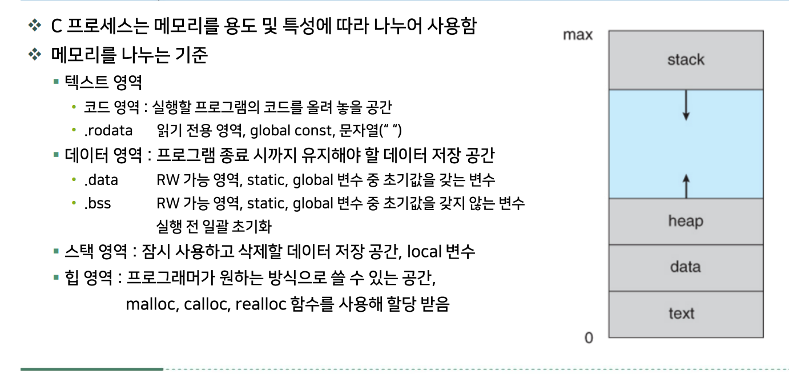
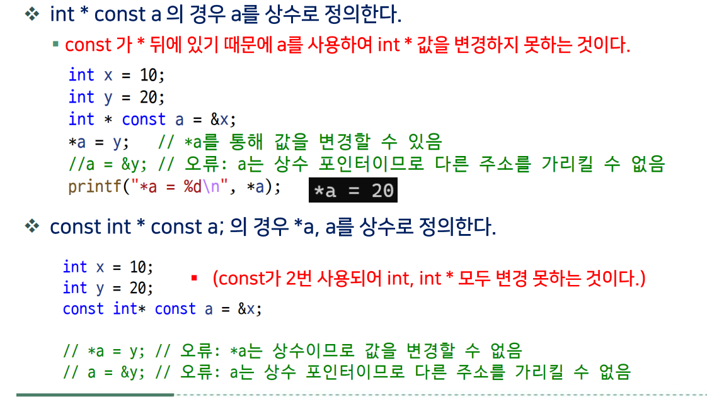
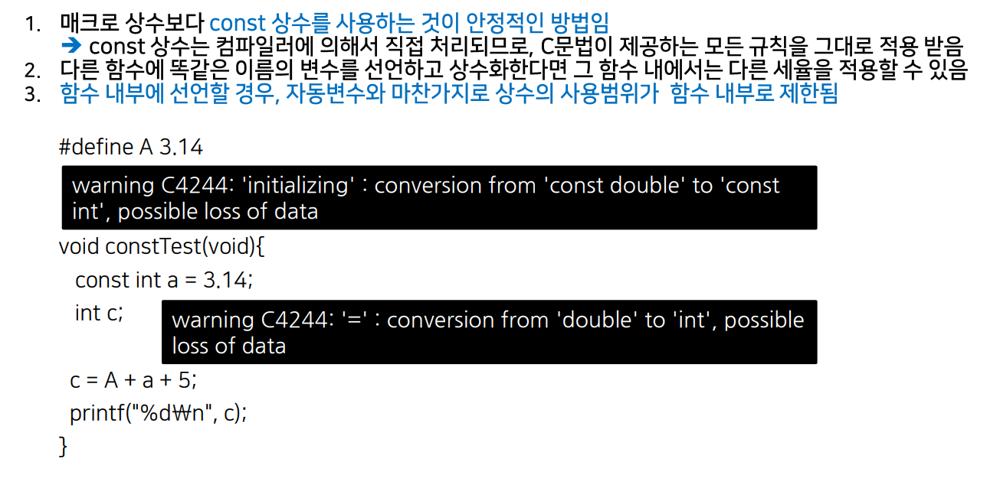
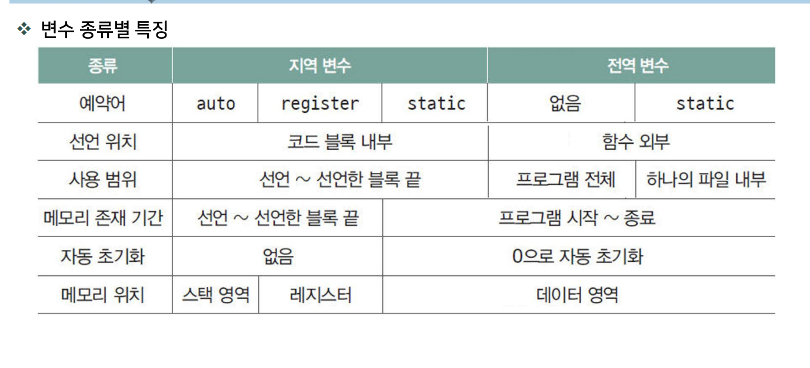
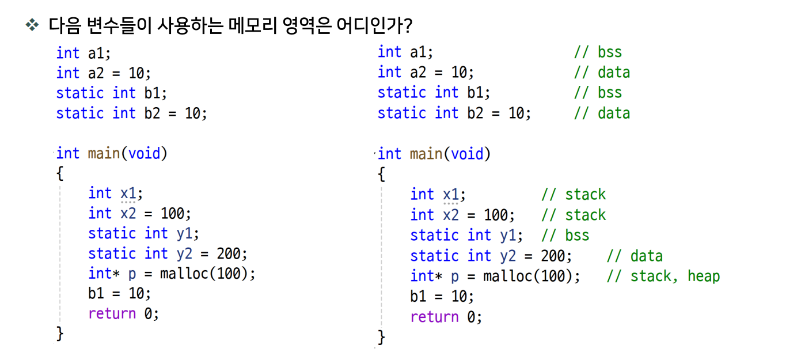

# DAY 04 — 문자열과 리터럴

## 08-5 문자 배열 입출력


### 1. `%c`와 공백 처리

`%c`는 공백·탭·개행 문자도 문자 하나로 읽는다. **앞쪽 공백 문자를 건너뛰려면 `%c` 앞에 공백을 넣는다.**

```c
char ch;

scanf("%c", &ch);  // 공백·탭·개행도 그대로 읽음
scanf(" %c", &ch); // 앞쪽 공백·탭·개행을 건너뛰고 문자 하나를 읽음
```

서식 문자열의 공백·탭·개행은 연속된 공백 문자를 건너뛰라는 의미이다. 단, **엔터를 검사하려면 `"%c"`를 사용**해야 한다. `" %c"`는 엔터도 건너뛴다.

### 2. 직접 만든 `my_gets`

# 
[my_gets 구현](./src/lib/day4_lib.c)
# 
한 글자씩 입력받아 공백을 포함한 한 줄을 저장한다. `n`은 배열의 전체 크기이며, 마지막 한 칸은 문자열 끝을 나타내는 `\0`을 위해 남긴다.

```c
void my_gets(char *str, int n) {
    if (n <= 0) return;

    int i = 0;
    for (; i < n - 1; i++) {
        int c = getchar();
        if (c == '\n' || c == EOF) break;
        *(str + i) = (char)c;
    }

    str[i] = '\0';
}
```

- 최대 `n - 1`글자를 저장하고, 마지막에 반드시 `\0`을 넣는다.
- 엔터는 저장하지 않는다. `*(str + i)`와 `str[i]`는 같은 원소이다.
- 길이 제한에 도달하면 나머지 입력은 입력 스트림에 남는다.

```c
char str[30];
my_gets(str, sizeof(str));
printf("%s\n", str);
```

### 3. `getchar()`를 `int`로 받는 이유

`getchar()`는 문자 값뿐 아니라 **입력 끝 또는 읽기 오류를 뜻하는 `EOF`**도 반환하므로, 둘을 구분하려면 `int`로 받는다. 정상 문자임을 확인한 뒤 `char`로 저장한다.

| 반환값 | 의미 |
| --- | --- |
| `'\n'` | 엔터로 입력된 줄바꿈 문자 |
| `EOF` | 더 읽을 입력이 없거나 읽기 오류가 발생함 |

**엔터와 `EOF`는 다르다.** 엔터는 한 줄의 끝이고, `EOF`는 문자가 아닌 입력 상태를 알리는 값이다.

`scanf("%c", &ch)`로도 한 글자씩 받을 수 있다. 이때 `ch`는 `char`로 선언하고, **`scanf`의 반환값이 `1`인지 확인**해 문자 하나를 성공적으로 읽었는지 판단한다.


## 문자열의 소문자를 대문자로 변환하기

[대문자 변환 구현](./src/lib/day4_lib.c)

ASCII 기준으로 문자열의 각 문자를 확인해 **`'a'`부터 `'z'`까지만 대문자로 변경**한다. 표준 함수 `int toupper(int)`와 이름이 겹치지 않도록 아래 예제에서는 `my_toupper`를 사용한다.

```c
char *my_toupper(char *str) {
    char *start = str; // 원래 문자열의 시작 주소 보관

    while (*str != '\0') {
        if (*str >= 'a' && *str <= 'z') {
            *str = (*str - 'a') + 'A';
        }
        str++;
    }

    return start;
}
```

### 핵심 동작

- **범위 검사**: `&&`로 두 조건을 모두 만족하는 소문자만 선택한다. 대문자·숫자·공백·기호는 그대로 둔다.
- **문자 변환**: `*str - 'a'`로 알파벳 순서를 구하고, `'A'`를 더한다. 예를 들어 `'b' - 'a' + 'A'`는 `'B'`이다.
- **시작 주소 반환**: 반복문에서 `str`은 끝으로 이동하므로, 처음에 보관한 `start`를 반환한다.

### 사용 예시

```c
char str[40] = "Tom & Jerry!!";
printf("%s\n", my_toupper(str)); // TOM & JERRY!!
```

**원본 배열을 직접 수정**하는 함수이다. 따라서 수정 가능한 `char str[]`를 전달해야 하며, `my_toupper("Tom & Jerry!!")`처럼 문자열 리터럴을 직접 전달하면 안 된다.


## 09-0 C 프로세스의 메모리 사용



### 1. 메모리 영역 구분

| 영역 | 저장 내용 | 특징 |
| --- | --- | --- |
| 코드 (`.text`) | 실행할 기계어 명령 | 일반적으로 읽기·실행 가능 |
| 읽기 전용 데이터 (`.rodata` 등) | 문자열 리터럴 등 | 문자열 리터럴은 수정 불가 |
| 초기화 데이터 (`.data`) | 주로 0이 아닌 값으로 초기화한 전역·`static` 변수 | 프로그램 실행 동안 유지 |
| 0 초기화 데이터 (`.bss`) | 초기값이 없거나 0으로 초기화한 전역·`static` 변수 | 실행 시작 시 0으로 초기화, 프로그램 실행 동안 유지 |
| 스택 (Stack) | 일반적인 지역 변수·매개변수 등 | 보통 함수 호출·반환에 따라 공간 관리 |
| 힙 (Heap) | `malloc` 등으로 동적 할당한 메모리 | 함수가 끝나도 유지되며, 필요 없으면 `free`로 해제 |

위 표는 일반적인 구현 기준이다. 실제 배치는 운영체제·컴파일러·최적화에 따라 달라지며, 모든 지역 변수가 반드시 스택에 놓이는 것은 아니다.

### 2. `strcpy`, `memcpy`, `memmove` 차이

세 함수는 `<string.h>`에 선언되어 있다.

| 함수 | 복사 기준 | 원본·대상 영역이 겹칠 때 |
| --- | --- | --- |
| `strcpy(dest, src)` | 문자열 끝의 `\0`까지 포함해 복사 | 사용 불가 |
| `memcpy(dest, src, n)` | 자료형과 관계없이 `n`바이트 복사 | 사용 불가 |
| `memmove(dest, src, n)` | 자료형과 관계없이 `n`바이트 복사 | 사용 가능 |

**`memmove`가 항상 더 좋은 것이 아니라, 영역이 겹칠 수 있을 때 사용하는 함수**이다. 세 함수 모두 대상 공간이 충분해야 하며, `memcpy`·`memmove`는 `\0`을 따로 붙여주지 않는다.

#### `strcpy`의 동작을 직접 구현하기

```c
char *my_strcpy(char *to, const char *from) {
    char *save = to;

    for (; (*to = *from); ++from, ++to) {
        // 복사와 포인터 이동을 for 문에서 수행
    }

    return save;
}
```

`(*to = *from)`은 **문자를 대입한 뒤 그 값을 조건으로 검사**한다. 따라서 `\0`도 복사하고, 그 값이 0이므로 반복을 끝낸다. 반환값은 복사 대상의 시작 주소이다.

### 3. 포인터의 주소 변경과 값 변경

아래 `str`은 함수 안에 선언된 수정 가능한 지역 배열이라고 가정한다.

```c
char str[10] = "apple";

char *dessert1 = str;
dessert1[0] = 'K';        // 가능: str의 원소 수정
dessert1 = "banana";      // 가능: 포인터가 저장한 주소 변경
// dessert1[0] = 'k';     // 불가: 지금은 문자열 리터럴을 가리킴

const char *dessert2 = str;
dessert2 = "banana";      // 가능: 주소 변경
// dessert2[0] = 'k';     // 불가: 이 포인터를 통한 값 변경 제한

char *const dessert3 = str;
dessert3[0] = 'k';        // 가능: str의 원소 수정
// dessert3 = "banana";   // 불가: 포인터가 저장한 주소 변경 제한
```

**포인터 변수 자체의 저장 위치와, 그 포인터가 가리키는 대상의 위치는 별개**이다. `dessert1 = "banana"`는 배열에 문자열을 복사하는 것이 아니라, 리터럴을 가리키도록 주소를 바꾸는 것이다.



### 4. `const` 위치에 따른 차이

| 선언 | 주소 변경 (`p = ...`) | 가리키는 값 변경 (`*p = ...`) |
| --- | --- | --- |
| `char *p` | 가능 | 대상이 수정 가능하면 가능 |
| `const char *p` 또는 `char const *p` | 가능 | 이 포인터를 통해서는 불가 |
| `char *const p` | 불가 | 대상이 수정 가능하면 가능 |
| `const char *const p` | 불가 | 이 포인터를 통해서는 불가 |

`const char *p`가 수정 가능한 배열을 가리켜도, **배열 자체가 상수가 되는 것은 아니다.** `p`를 통한 수정만 제한되며 원래 배열 이름으로는 수정할 수 있다.

### const 상수와 매크로 상수



| 구분 | 매크로 상수 (`#define`) | `const` 상수 |
| --- | --- | --- |
| 처리 방식 | 전처리 단계에서 이름을 값이나 식으로 치환 | 컴파일러가 자료형을 가진 변수로 처리 |
| 자료형 | 치환된 값이나 식에 따라 결정 | 선언할 때 명시 |
| 사용 범위 | 함수의 `{}`와 무관하며, 정의 이후 `#undef` 또는 파일 끝까지 적용 | 선언한 블록 등 C의 범위 규칙을 따름 |

#### 매크로는 함수 안에 써도 그 함수에만 적용되지 않는다

```c
#define Tax_Rate 0.11

double TaxA(int income) {
    #define Tax_Rate 0.03 // 재정의 경고 발생: 이후 코드에서는 0.03으로 치환
    return income * Tax_Rate;
}

double TaxB(int income) {
    return income * Tax_Rate; // 여기에도 0.03 적용
}

// TaxA(1000000) → 30000.0
// TaxB(1000000) → 30000.0 (의도했던 11%가 아님)
```

전처리기는 함수 호출 순서가 아니라 **소스에 적힌 순서대로 치환**한다. 따라서 `TaxA` 안에서 재정의한 매크로가 뒤에 있는 `TaxB`에도 영향을 준다.

#### `const`는 함수 안과 밖의 값을 구분할 수 있다

위 매크로 예제와 별개로 사용하는 코드이다.

```c
const double Tax_Rate = 0.11;

double TaxA(int income) {
    const double Tax_Rate = 0.03; // 이 함수 안에서만 바깥쪽 이름을 가림
    return income * Tax_Rate;
}

double TaxB(int income) {
    return income * Tax_Rate; // 바깥쪽의 0.11 사용
}

// TaxA(1000000) → 30000.0
// TaxB(1000000) → 110000.0
```

**일반적인 값에는 자료형과 사용 범위가 명확한 `const`가 관리하기 쉽다.** 다만 전처리 조건이나 함수형 매크로처럼 `#define`이 필요한 경우도 있다.

## 10-1 변수 종류별 특징



### 전역 변수 사용

- 전역 변수는 함수 밖에 정의하며, **여러 함수나 파일에서 같은 데이터를 공유해야 할 때** 사용한다.
- 다른 파일에서 사용하려면 `extern`으로 선언하고, 변수를 정의한 `.c` 파일과 함께 빌드한다.
- 한 파일 안에서만 공유하려면 전역 변수에 `static`을 붙여 다른 파일에서 직접 접근하지 못하게 한다.

공유할 필요가 없다면 지역 변수를 우선 사용한다.


