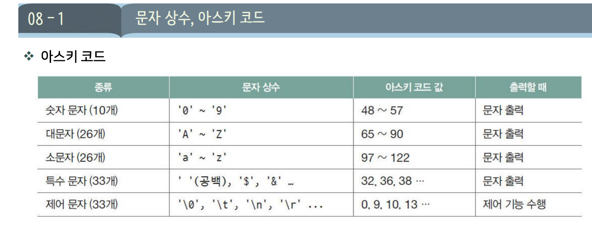

# DAY 04 — 문자열과 리터럴

## 08-5 문자 배열 입출력



### 1. `%c`와 공백 처리

`%c`는 공백·탭·개행 문자도 문자 하나로 읽는다. **앞쪽 공백 문자를 건너뛰려면 `%c` 앞에 공백을 넣는다.**

```c
char ch;

scanf("%c", &ch);  // 공백·탭·개행도 그대로 읽음
scanf(" %c", &ch); // 앞쪽 공백·탭·개행을 건너뛰고 문자 하나를 읽음
```

서식 문자열의 공백·탭·개행은 연속된 공백 문자를 건너뛰라는 의미이다. 단, **엔터를 검사하려면 `"%c"`를 사용**해야 한다. `" %c"`는 엔터도 건너뛴다.

### 2. 직접 만든 `my_gets`

한 글자씩 입력받아 공백을 포함한 한 줄을 저장한다. `n`은 배열의 전체 크기이며, 마지막 한 칸은 문자열 끝을 나타내는 `\0`을 위해 남긴다.

```c
void my_gets(char *str, int n) {
    if (n <= 0) return;

    int i = 0;
    for (; i < n - 1; i++) {
        int c = getchar();
        if (c == '\n' || c == EOF) break;
        *(str + i) = (char)c;
    }

    str[i] = '\0';
}
```

- 최대 `n - 1`글자를 저장하고, 마지막에 반드시 `\0`을 넣는다.
- 엔터는 저장하지 않는다. `*(str + i)`와 `str[i]`는 같은 원소이다.
- 길이 제한에 도달하면 나머지 입력은 입력 스트림에 남는다.

```c
char str[30];
my_gets(str, sizeof(str));
printf("%s\n", str);
```

### 3. `getchar()`를 `int`로 받는 이유

`getchar()`는 문자 값뿐 아니라 **입력 끝 또는 읽기 오류를 뜻하는 `EOF`**도 반환하므로, 둘을 구분하려면 `int`로 받는다. 정상 문자임을 확인한 뒤 `char`로 저장한다.

| 반환값 | 의미 |
| --- | --- |
| `'\n'` | 엔터로 입력된 줄바꿈 문자 |
| `EOF` | 더 읽을 입력이 없거나 읽기 오류가 발생함 |

**엔터와 `EOF`는 다르다.** 엔터는 한 줄의 끝이고, `EOF`는 문자가 아닌 입력 상태를 알리는 값이다.

`scanf("%c", &ch)`로도 한 글자씩 받을 수 있다. 이때 `ch`는 `char`로 선언하고, **`scanf`의 반환값이 `1`인지 확인**해 문자 하나를 성공적으로 읽었는지 판단한다.
