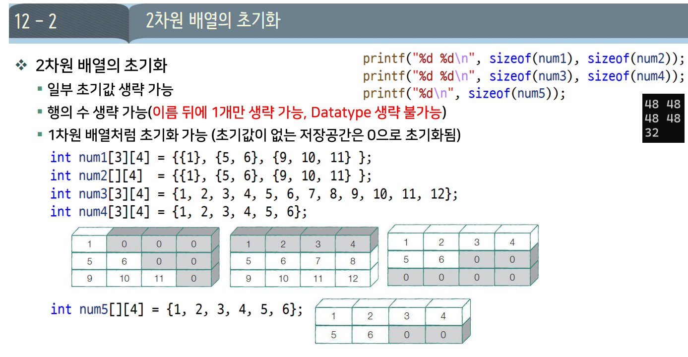

# DAY 05 — 2차원 배열

## 12-1 2차원 배열의 선언과 함수 전달

[실습 코드](./src/5_C_2D_Arrays.c)

### 1. 배열의 자료형과 크기

```c
char str[5][10] = {0}; // char 원소 10개짜리 행 배열 5개
```

| 표현 | 의미 | 자료형 또는 크기 |
| --- | --- | --- |
| `str` | 2차원 배열 자체 | `char[5][10]`, 전체 50바이트 |
| `str[0]`, `*str`, `*(str + 2)` | 각각 한 행 배열 | `char[10]`, 각 10바이트 |
| `str`이 포인터로 변환된 경우 | 첫 번째 행의 주소: `&str[0]` | `char (*)[10]` |
| `str[0]`이 포인터로 변환된 경우 | 첫 번째 문자의 주소: `&str[0][0]` | `char *` |
| `&str` | 2차원 배열 전체의 주소 | `char (*)[5][10]` |

**`sizeof` 안에서는 배열이 포인터로 변환되지 않는다.** 따라서 `sizeof(str)`은 50, `sizeof(str[0])`은 10이다. `&str`은 배열 전체를 가리키는 포인터이며, 3차원 배열이 되는 것은 아니다.

### 2. 함수 매개변수의 `sizeof`

함수에 전달된 포인터는 **주소를 저장하는 변수**이다. `sizeof(p)`는 행 개수나 배열 전체 크기가 아니라 포인터 자체의 크기이며, 보통 32비트 환경에서는 4바이트, 64비트 환경에서는 8바이트이다.

```c
#include <stdio.h>

void func(char (*p)[10]) {
    printf("%zu %zu\n", sizeof(p), sizeof(*p));
}

void func2(char (*p)[5][10]) {
    printf("%zu %zu\n", sizeof(p), sizeof(*p));
}

// 매개변수에 char *p[5][10]으로 적어도 아래 포인터형으로 처리된다.
void func3(char *(*p)[10]) {
    printf("%zu %zu\n", sizeof(p), sizeof(*p));
}

int main(void) {
    char str[5][10] = {0};
    char *str2[5][10] = {0}; // 각 원소가 char *인 2차원 배열

    printf("%zu %zu %zu\n",
           sizeof(str[0]), sizeof(*str), sizeof(*(str + 2)));
    func(str);
    func2(&str);
    func3(str2);
    return 0;
}
```

`sizeof` 결과는 `size_t`이므로 `%zu`로 출력한다. 현재 64비트 실습 환경의 출력은 다음과 같다.

```text
10 10 10
8 10
8 50
8 80
```

| 함수 | `p`가 가리키는 대상 | `sizeof(*p)` |
| --- | --- | --- |
| `func` | `char` 10개짜리 행 배열 | 10바이트 |
| `func2` | `char` 5행 10열짜리 배열 전체 | 50바이트 |
| `func3` | `char *` 포인터 10개짜리 행 배열 | `10 * sizeof(char *)`, 여기서는 80바이트 |

### 3. 문자열 저장 방식과 공간 사용

- **`char str[5][10]`**: 문자열 길이에 관계없이 항상 50바이트를 확보한다. 각 행에 짧은 문자열을 저장하면 사용하지 않는 칸이 남는다. `{0}` 초기화는 그 공간을 0으로 채우는 것이지 추가 공간을 만드는 것은 아니다.
- **`char *str[10]`**: 포인터 10개를 저장하므로 `10 * sizeof(char *)`가 필요하다. 64비트 환경에서는 보통 80바이트이며, **가리키는 문자열을 저장할 공간은 별도**이다.

따라서 어느 방식이 공간을 덜 쓰는지는 문자열의 길이와 개수, 포인터 크기를 함께 고려해야 한다.

### 4. 포인터 배열을 `char **`로 받기

```c
void func4(char **p) {
    printf("%zu %zu %zu\n", sizeof(p), sizeof(*p), sizeof(**p));
}
```

호출하는 함수 안에서는 다음과 같이 사용한다.

```c
char *str[5] = {"apple", "banana", "kiwi"};
func4(str); // 현재 64비트 환경: 8 8 1
```

| 표현 | 자료형 | 크기 (현재 환경) |
| --- | --- | --- |
| `p` | `char **` | 8바이트 |
| `*p` | `char *` | 8바이트 |
| `**p` | `char` | 1바이트 |

`str`은 **문자열의 주소를 저장하는 포인터 배열**이므로 `char **`로 받을 수 있다. `char str[5][10]`처럼 문자를 직접 저장하는 2차원 배열과는 다르다. 문자열 리터럴의 내용은 수정하면 안 된다.

### 5. 2차원 배열의 첫 행 주소 반환하기

```c
char (*func5(void))[10] {
    static char str[5][10] = {
        "apple", "banana", "kiwi", "melon", "orange"
    };
    return str; // 반환형: char (*)[10]
}
```

`func5`는 **`char` 10개짜리 행 배열을 가리키는 포인터를 반환하는 함수**이다. `static` 배열은 함수가 끝나도 유지되므로 반환한 주소로 계속 접근할 수 있다. 일반 지역 배열의 주소를 반환하면 함수 종료 후 사용할 수 없다.

호출하는 함수 안에서 반환값을 받는다.

```c
char (*p)[10] = func5();
printf("%s\n", p[0]); // apple
```

**반환형에는 한 행의 크기인 10은 있지만, 전체 행 개수인 5는 없다.** 따라서 `p`만으로 행 개수를 알 수 없으며, 반복해서 처리하려면 행 개수를 별도로 전달받거나 약속해야 한다.


## 배열 초기화



### 지정한 위치부터 초기화하기

```c
// 여러 위치 지정
int a[100] = {[10] = 1, [71] = 5, [99] = 9};

// 지정 위치 다음부터 순서대로 초기화
int b[100] = {[71] = 5, 6, 7}; // b[71]=5, b[72]=6, b[73]=7
```

`[인덱스] = 값`은 C99부터 지원하는 지정 초기화 문법이다. **초기화 목록에서 생략한 나머지 원소는 0**으로 채워진다.

```c
// GCC 확장: 범위 안의 모든 원소를 같은 값으로 초기화
int c[100] = {[70 ... 75] = 5}; // c[70]~c[75]는 5, 나머지는 0
```

범위 지정 문법은 표준 C가 아닌 **GCC 확장**이므로 다른 컴파일러에서는 지원하지 않을 수 있다. [GCC 문서](https://gcc.gnu.org/onlinedocs/gcc/Designated-Inits.html)

## 실습 — 2차원 배열 순회와 형태 변경

### 1. 행 개수를 전달해 배열 출력하기

```c
#include <stdio.h>

void func1(int (*p)[4], int r) {
    int c = sizeof(*p) / sizeof((*p)[0]); // 한 행의 원소 개수: 4

    for (int i = 0; i < r; i++) {
        for (int j = 0; j < c; j++) {
            printf("%d ", p[i][j]);
        }
        printf("\n");
    }
}

int main(void) {
    int arr[3][4] = {
        {1, 2, 3, 4},
        {5, 6, 7, 8},
        {9, 10, 11, 12}
    };

    func1(arr, 3);
    return 0;
}
```

`p`의 자료형에는 열 개수 `4`가 있지만 행 개수는 없으므로, `r`로 따로 전달한다. `arr`는 `int (*)[4]`로 변환되므로 **`(int *)arr`로 바꾸지 않고 그대로 전달**한다.

원래 코드의 `*(*p + i)`는 첫 번째 행을 기준으로 접근한다. **`i`가 4 이상이면 그 행의 범위를 벗어나므로**, 메모리가 연속이어도 전체 배열을 순회하는 방법으로 사용하면 안 된다. 한 반복문으로 출력하려면 `p[i / c][i % c]`처럼 행과 열을 계산할 수 있다.

### 2. 형 변환만으로 실제 배열의 형태가 바뀌지는 않는다

```c
int (*p2)[6] = (int (*)[6])p;
int (*p3)[2][3] = (int (*)[2][3])p;
```

위 코드는 포인터의 자료형만 바꾼다. **실제 `int[3][4]` 배열이 `int[2][6]`이나 `int[2][2][3]`으로 재구성되는 것은 아니다.** 따라서 전체 원소 개수가 같다는 이유만으로 새로운 모양의 인덱스 접근이 올바르다고 볼 수 없다.

실제로 다른 형태의 배열이 필요하다면, 별도의 배열을 만들고 값을 복사할 수 있다. 아래 코드는 `arr`가 선언된 함수 안에서 사용한다.

```c
// <string.h> 필요
int arr2[2][6];
int arr3[2][2][3];

memcpy(arr2, arr, sizeof(arr));
memcpy(arr3, arr, sizeof(arr));
```

세 배열은 모두 `int` 12개를 저장하므로 전체 크기가 같다. 복사 후에는 각각의 실제 배열 형태에 맞춰 `arr2[i][j]`, `arr3[i][j][k]`로 접근한다.
