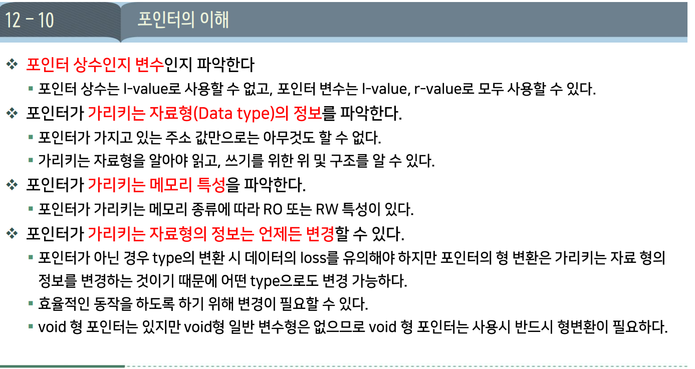
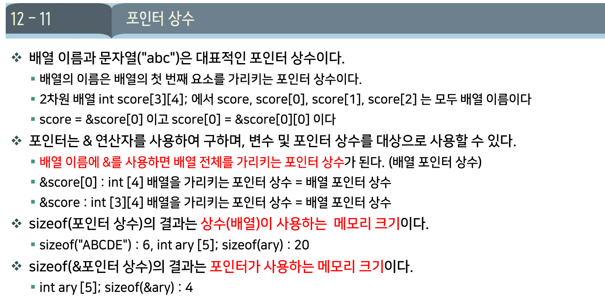
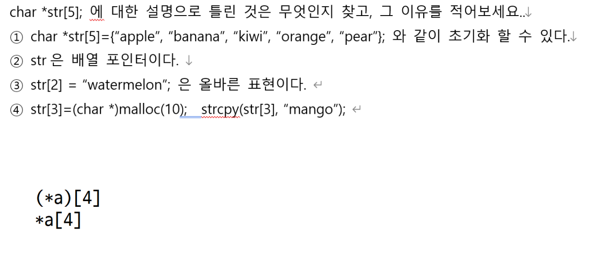
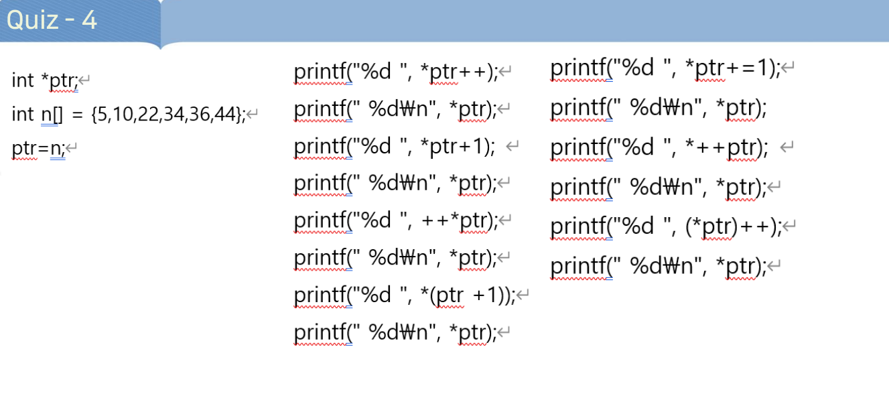
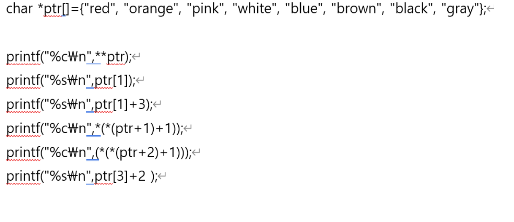
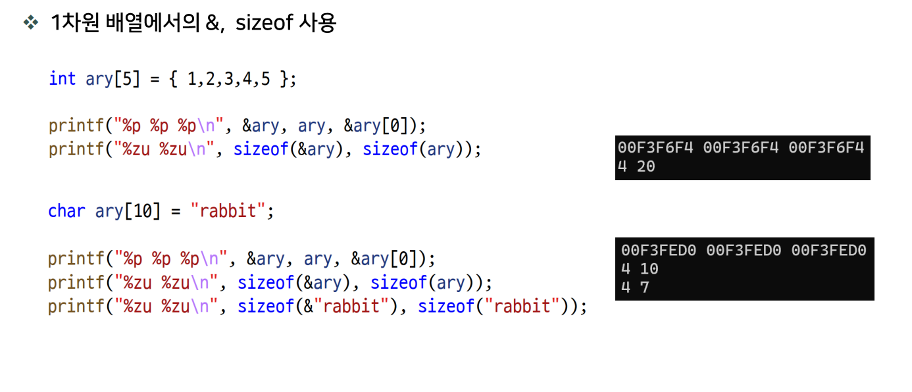

# DAY 06 — 다중 포인터

## 포인터 복습 5문제

### 계산 기준

시작 주소는 **10진수 1000**, `sizeof(int)`는 4바이트, 포인터 크기는 8바이트라고 가정한다.

```c
int a[3][4] = {
    {1, 2, 3, 4},
    {5, 6, 7, 8},
    {9, 10, 11, 12}
};

int (*p)[4] = a + 1; // 두 번째 행을 가리킴: 주소 1016
int *q = &a[1][2];   // 값 7인 원소를 가리킴: 주소 1024
```

| 행 | 원소 값 | 각 원소의 주소 |
| --- | --- | --- |
| `a[0]` | 1, 2, 3, 4 | 1000, 1004, 1008, 1012 |
| `a[1]` | 5, 6, 7, 8 | 1016, 1020, 1024, 1028 |
| `a[2]` | 9, 10, 11, 12 | 1032, 1036, 1040, 1044 |

### 문제와 풀이

아래 형 변환식은 위 메모리 배치를 기준으로 주소를 계산한 것이다. 형 변환만으로 원래 배열의 경계가 바뀌는 것은 아니므로, 실제 코드에서는 행·열로 접근하는 방법을 우선 사용한다.

| 번호 | 식 | 결과 | 핵심 |
| --- | --- | --- | --- |
| 1 | `sizeof(a + 1)` | **8** | `a + 1`의 자료형은 `int (*)[4]`. 포인터 자체의 크기 |
| 2 | `*((int *)(&a + 1) - 1)` | 주소 계산상 **12** | 끝 다음 주소 1048에서 정수 한 칸을 빼면 1044. 그곳의 값은 12 |
| 3 | `*(int *)((char *)a + 20)` | 주소 계산상 **6** | 20바이트 이동한 1020의 값. 원소 표기는 `a[1][1]` |
| 4 | `1[a][2]` | **7** | `1[a]`는 `a[1]`과 같으므로 `a[1][2]` |
| 5 | `2[*a]` | **3** | `2[*a]`는 `(*a)[2]`, 즉 `a[0][2]` |

**주소 1044와 그 주소에 저장된 값 12를 구분하자.** 마지막의 `*`가 값을 읽는지 확인하면 된다.

### 추가 문제 — 바이트 단위 주소 차이

```c
(char *)q - (char *)a
```

위 배치에서 두 주소의 바이트 간격은 **1024 - 1000 = 24바이트**이다. `char *`는 한 칸이 1바이트이므로 바이트 단위 차이를 계산하려는 식이다. 단, 포인터 뺄셈은 같은 배열의 범위 안에서 해야 하며, 단순 형 변환만으로 그 조건을 보장하는 것은 아니다.

### 디버거로 확인하기

`F9`로 중단점을 설정하고 `F5`로 실행한 뒤, **조사식(Watch)**에 식을 넣어 확인한다. 디버거에서 값이 보이는 것만으로 C 표준상 올바른 접근이 보장되는 것은 아니다.


## 포인터의 이해




### 1. 배열 원소에 입력받기

```c
int ages[5] = {10, 20, 30, 40, 50};
int *ap = ages;
```

| 보기 | 가능 여부 | 이유 |
| --- | --- | --- |
| `scanf("%d", &ages[i]);` | 가능 | i번째 원소의 주소 전달 |
| `scanf("%d", ap + i);` | 가능 | i번째 원소의 주소 전달 |
| `scanf("%d", ap++);` | 가능 | 현재 주소를 전달하고 `ap`를 다음 원소로 이동 |
| `scanf("%d", ages++);` | **불가** | 배열 이름 자체는 변경할 수 없음 |

정답은 **④**이다. 가능한 보기들도 주소가 실제 배열 원소를 가리키는 범위에서 사용해야 한다.

### 2. `sizeof` 결과에 1 더하기

```c
int nums[2][4] = {0};
printf("%zu-%zu\n", sizeof(nums) + 1, sizeof(nums[0])); // 33-16
```

`int`가 4바이트일 때 전체 배열은 32바이트, 한 행은 16바이트이다. **`sizeof(nums) + 1`은 크기 값 32에 1을 더하는 정수 연산**이다.

### 3. 2차원 배열을 받는 매개변수

```c
int arr[3][4];
// 호출: array_prn(arr, 3, 4);
```

| 보기 | 매개변수 선언 | 함수 매개변수로 처리되는 자료형 | 가능 여부 |
| --- | --- | --- | --- |
| ① | `int ary[][4]` | `int (*)[4]` | 가능 |
| ② | `int ary[3][4]` | `int (*)[4]` | 가능 |
| ③ | `int *ary[4]` | `int **` | **불가** |
| ④ | `int (*ary)[4]` | `int (*)[4]` | 가능 |

정답은 **③**이다. `arr`는 첫 행의 주소인 `int (*)[4]`로 변환된다. **함수 매개변수에서만** 배열 표기가 포인터로 조정되는 것이며, 실제 2차원 배열 자체가 `int **`인 것은 아니다.

### 4. 문자열 리터럴과 포인터 변경

```c
char *str = "elephant";
```

| 보기 | 코드 | 판단 |
| --- | --- | --- |
| ① | `*(str + 4) = 'a';` | 리터럴의 내용을 수정하므로 잘못된 사용 |
| ② | `str = "rabbit";` | **가능: 포인터가 다른 문자열을 가리키도록 변경** |
| ③ | `str[2] = 'k';` | 리터럴의 내용을 수정하므로 잘못된 사용 |
| ④ | `scanf("%s", str);` | 리터럴이 있는 공간에 입력을 저장하려 하므로 잘못된 사용 |

정답은 **②**이다. 나머지는 컴파일되더라도 실행 시 동작이 보장되지 않는다.

### 5. 포인터 배열과 배열 포인터 구분



정답은 **②**이다. `char *str[5]`는 **`char *` 포인터 5개를 저장하는 포인터 배열**이다.

```c
char *str[5];     // 포인터 배열
char (*p)[5];     // 배열 포인터
```

`str[2] = "watermelon";`은 배열 원소에 저장된 주소를 바꾸므로 가능하다. ④의 `malloc` 예제는 메모리 할당에 성공했다고 가정하면 올바르다.

### 6. 포인터 증가와 값 증가



```c
int n[] = {5, 10, 22, 34, 36, 44};
int *ptr = n;
```

**사진의 왼쪽 열을 위에서 아래로 실행한 뒤, 오른쪽 열을 이어서 실행**한다. 중간에 `ptr`이나 배열 값을 초기화하지 않는다. 각 식의 출력과 바로 다음 `*ptr` 출력은 다음과 같다.

| 순서 | 식 | 식의 출력 | 다음 `*ptr` 출력 | 변경 내용 |
| --- | --- | --- | --- | --- |
| 1 | `*ptr++` | 5 | 10 | 기존 값을 읽고 `ptr`이 `n[1]`로 이동 |
| 2 | `*ptr + 1` | 11 | 10 | 계산만 하며 원본은 그대로 |
| 3 | `++*ptr` | 11 | 11 | `n[1]`을 11로 변경한 뒤 사용 |
| 4 | `*(ptr + 1)` | 22 | 11 | 다음 원소를 읽으며 `ptr`은 그대로 |
| 5 | `*ptr += 1` | 12 | 12 | 현재 원소 `n[1]`에 1을 더해 저장 |
| 6 | `*++ptr` | 22 | 22 | `ptr`이 `n[2]`로 이동한 뒤 값을 읽음 |
| 7 | `(*ptr)++` | 22 | 23 | 기존 값을 사용한 뒤 `n[2]`를 23으로 변경 |

`*ptr++`는 **`*(ptr++)`**이고, `(*ptr)++`는 **가리키는 값의 증가**이다. 괄호 위치에 따라 증가하는 대상이 달라진다.

### 7. 문자열 포인터 배열에서 문자·문자열 읽기



```c
char *ptr[] = {"red", "orange", "pink", "white",
               "blue", "brown", "black", "gray"};
```

| 번호 | 식 | 출력 형식 | 결과 |
| --- | --- | --- | --- |
| 1 | `**ptr` | `%c` | `r` |
| 2 | `ptr[1]` | `%s` | `orange` |
| 3 | `ptr[1] + 3` | `%s` | `nge` |
| 4 | `*(*(ptr + 1) + 1)` | `%c` | **`r`** |
| 5 | `*(*(ptr + 2) + 1)` | `%c` | `i` |
| 6 | `ptr[3] + 2` | `%s` | `ite` |

**`%c`는 문자 하나, `%s`는 전달한 주소부터 `\0`까지** 출력한다. ④는 `ptr[1][1]`, 즉 `"orange"`의 두 번째 문자이다.



```c
int A[3][4] = { 0 };

printf("%p %p %p %p %p\n", &A, A, &A[0], A[0], &A[0][0]);

printf("%zu %zu %zu %zu %zu\n",
       sizeof(&A), sizeof(A), sizeof(&A[0]), sizeof(A[0]), sizeof(&A[0][0]));

printf("%p %p %p %p %p\n", &A+1, A+1, &A[0]+1, A[0]+1, &A[0][0]+1);

//실행 결과

008FF820 008FF820 008FF820 008FF820 008FF820
4 48 4 16 4
008FF850 008FF830 008FF830 008FF824 008FF824
```c


## 13-1 다중 포인터

- 포인터의 포인터 개념으로 포인터 변수에 대한 call by reference개념을 적용할 수 있다.

```c
//다중포인터를 사용한 Call by refernce 실습


```
