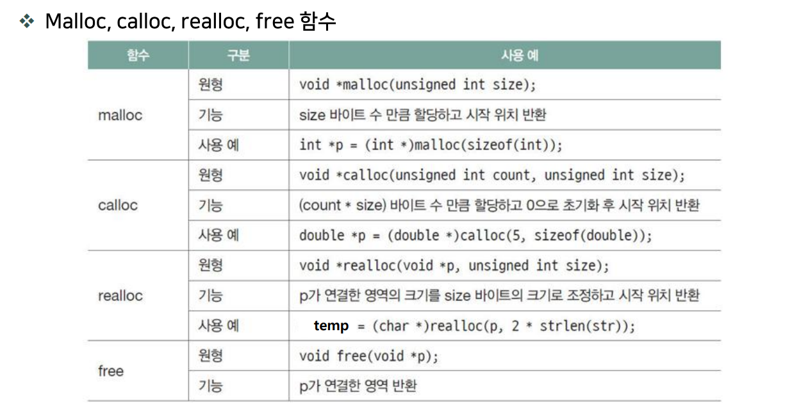
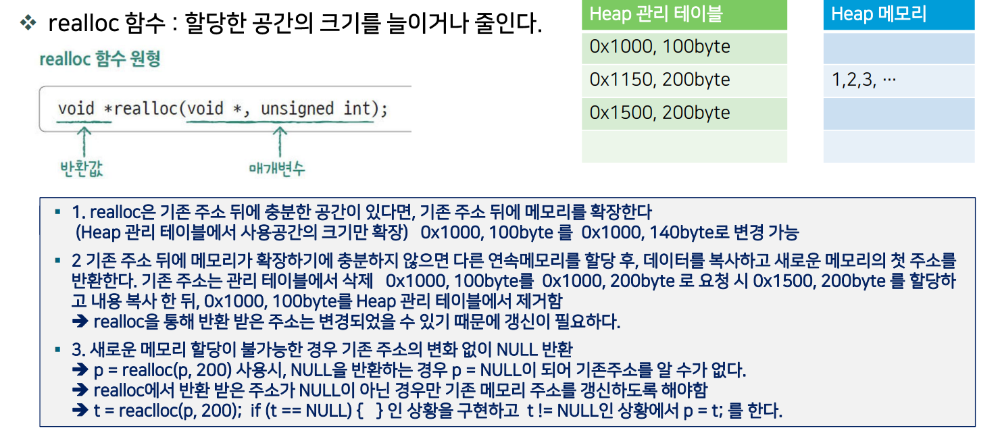
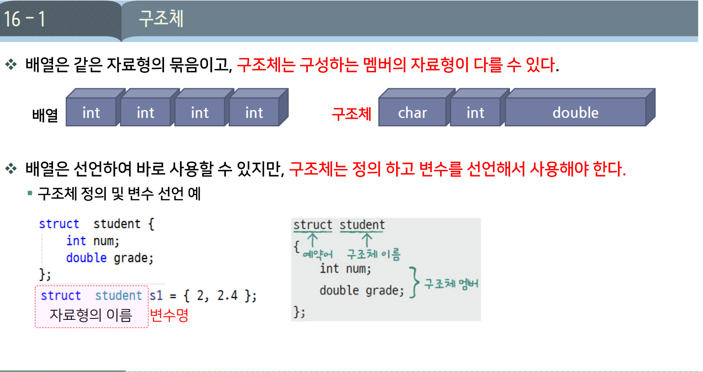

# DAY 08 — 동적 메모리 할당

## 1. 동적 메모리 관리 함수



`<stdlib.h>`에 선언된 함수를 사용한다. 할당에 실패하면 `NULL`을 반환한다.

| 함수 | 역할 |
| --- | --- |
| `malloc(바이트 수)` | 공간만 확보하며, 저장된 값은 초기화하지 않음 |
| `calloc(개수, 원소 크기)` | 공간을 확보하고 모든 바이트를 0으로 초기화 |
| `realloc(기존 주소, 새 바이트 수)` | 기존 할당 공간의 크기를 변경 |
| `free(주소)` | 할당받은 공간 해제. `free(NULL)`은 아무 동작도 하지 않음 |

### 할당과 해제 예제

```c
#include <stdio.h>
#include <stdlib.h>

int *pi;
double *pd;

int main(void) {
    pi = (int *)malloc(10 * sizeof(int));
    if (pi == NULL) {
        printf("메모리 부족\n");
        exit(1);
    }

    pd = (double *)malloc(10 * sizeof(double));
    if (pd == NULL) {
        printf("메모리 부족\n");
        free(pi);
        exit(1);
    }

    printf("%p %p\n", (void *)pi, (void *)pd); // 할당받은 주소
    free(pi);
    free(pd);

    return 0;
}
```

## 2. 주소·값·크기 구분

**`int`가 4바이트라는 것은 저장 공간의 크기이며, 저장되는 값이 4라는 뜻이 아니다.**

| 표현 | 의미 | 현재 실습 환경 |
| --- | --- | --- |
| `pi` | 할당받은 공간의 주소 | `%p`로 출력 |
| `*pi`, `pi[0]` | 첫 번째 공간에 저장된 정숫값 | 사용하기 전에 직접 초기화해야 함 |
| `sizeof(*pi)` | 가리키는 `int` 하나의 크기 | 4바이트 |
| `sizeof(pi)` | 포인터 변수 자체의 크기 | 8바이트 |
| `10 * sizeof(int)` | 요청한 전체 할당 크기 | 40바이트 |
| `pi + 1` | 다음 `int`의 주소 | 4바이트 이동한 주소 |

`malloc`으로 확보한 공간은 초기화되지 않는다. 값을 저장하기 전에 읽으면 결과를 보장할 수 없다.

```c
// malloc 성공 후, free 전에 사용
*pi = 1;
printf("%d %zu\n", *pi, sizeof(*pi)); // 값은 1, 크기는 4
```

## 3. 해제 후 포인터를 `NULL`로 바꾸기

`free`는 메모리를 해제하지만 **포인터 변수에 저장된 주소까지 바꾸지는 않는다.** 해제 후 같은 포인터로 다시 해제하면 정의되지 않은 동작이다.

```c
// 할당에 성공한 arr를 정리하는 부분
free(arr);
arr = NULL;
free(arr); // free(NULL)이므로 안전
```

호출한 쪽의 `int *` 변수까지 `NULL`로 바꾸려면 주소를 받아야 하므로 `int **`를 사용한다.

```c
void free_mem(int **p) {
    if (p == NULL) return; // *p로 접근하기 전에 포인터 변수의 주소 확인
    free(*p);
    *p = NULL;
}
```

- `p == NULL`: 포인터 변수의 주소 자체가 널인지 검사한다.
- `*p = NULL`: 호출한 쪽 포인터를 널 포인터로 바꾼다. `free_mem(&pi)`로 호출한다.

## 4. `realloc`으로 크기 변경



**새 크기가 0보다 큰 경우**를 기준으로 한다.

- 기존 공간에서 크기를 조정하거나, 다른 공간으로 데이터를 옮긴 뒤 새 주소를 반환한다.
- 다른 공간으로 옮겨졌다면 **기존 공간은 `realloc`이 해제**하므로 직접 해제하지 않는다.
- 실패하면 `NULL`을 반환하고 기존 공간은 유지된다. 따라서 **임시 포인터로 받은 뒤 성공한 경우에만 원래 포인터를 갱신**한다.
- `realloc(NULL, 크기)`는 `malloc(크기)`처럼 새 공간을 할당한다. 늘어난 부분은 자동으로 0이 되지 않는다.

## 5. 실습 — 정수를 입력받으며 3칸씩 확장

[실습 코드](./src/8_C_Dynamic_Memory.c) · [해제 함수 구현](./src/lib/day8_lib.c)

처음에는 3칸을 확보하고, 공간이 부족하면 3칸씩 늘린다. 0 이하 또는 입력 실패 시 종료하고 저장한 값만 출력한다.

| 변수 | 의미 | `3 10 20 40 0` 입력 후 |
| --- | --- | --- |
| `N` | 저장 가능한 원소 개수(용량) | 6 |
| `count` | 실제 저장한 원소 개수 | 4 |

```c
#include "day8_lib.h"
#include "day3_lib.h"

int main(void) {
    int N = 3;
    int num = 0, count = 0;
    int *pi = (int *)calloc(N, sizeof(*pi));
    if (pi == NULL) {
        printf("메모리 부족\n");
        return 1;
    }

    printf("숫자를 입력해주세요\n");
    for (; scanf("%d", &num) == 1 && num > 0; count++) {
        if (count == N) {
            N += 3;
            int *temp = (int *)realloc(pi, N * sizeof(*pi));
            if (temp == NULL) {
                printf("메모리 부족\n");
                free_mem(&pi);
                return 1;
            }
            pi = temp;
        }
        pi[count] = num;
    }

    print_data(pi, count);
    free_mem(&pi);
    return 0;
}
```

**동적 할당한 원소 개수는 `SIZE(pi)`로 구할 수 없다.** 이 매크로는 현재 환경에서 `sizeof(포인터) / sizeof(int)`, 즉 `8 / 4 = 2`가 된다. 출력할 개수는 `count`로 관리한다.

## 6. 실습 — 파일에서 문자열 읽기

`freopen`으로 표준 입력 `stdin`을 `data.txt`에 연결한다. 파일의 첫 값은 문자열 개수 `N`, 이후 값은 공백으로 구분된 문자열이다.

```c
#include <stdio.h>
#include <stdlib.h>

int main(void) {
    int N;
    if (freopen("data.txt", "r", stdin) == NULL) return 1;
    if (scanf("%d", &N) != 1 || N <= 0) return 1;
    printf("%d\n", N);

    char (*arr)[21] = (char (*)[21])calloc(N, sizeof(*arr));
    if (arr == NULL) return 1;

    for (int i = 0; i < N; i++) {
        if (scanf("%20s", arr[i]) != 1) break;
        printf("%s\n", arr[i]);
    }

    free(arr);
    arr = NULL;
    return 0;
}
```

- `char (*arr)[21]`: `char` 21개짜리 행을 가리키는 포인터이다.
- `sizeof(*arr)`, `sizeof(char[21])`, `21 * sizeof(char)`는 모두 **21바이트**이다. `calloc`으로 그 행을 `N`개 확보한다.
- `arr[i]`는 i번째 행의 시작 주소이다. `%20s`로 최대 20바이트를 읽고 마지막 한 칸은 `\0`에 사용한다.

## 7. 실습 — 이중 포인터로 문자열 저장

문자열의 주소를 저장할 **포인터 배열**과, 실제 문자열을 저장할 **각각의 공간**을 따로 할당한다.

```text
parr → [주소] → "apple"
       [주소] → "banana"
       [주소] → "kiwi"
```

### 1. 할당하고 문자열 복사하기

[실습 코드](./src/8_C_Dynamic_Memory.c)

`data.txt`에서 문자열 개수 `N`을 먼저 읽는다. 아래 예제는 파일에 올바른 개수와 문자열이 들어 있다고 가정한다.

```c
#include "day8_lib.h"
#include "day7_lib.h"

int main(void) {
    int N;
    char str[21] = {0};
    char **parr = NULL;

    freopen("data.txt", "r", stdin);
    scanf("%d", &N);
    printf("%d\n", N);

    parr = (char **)calloc(N, sizeof(char *)); // 주소를 저장할 N칸
    if (parr == NULL) return 12;

    for (int i = 0; i < N; i++) {
        scanf("%20s", str);
        parr[i] = (char *)malloc(strlen(str) + 1); // 문자열과 '\0'의 공간
        if (parr[i] == NULL) {
            free_mem2((void ***)&parr, i); // 지금까지 할당한 i개 정리
            return 12;
        }
        strcpy(parr[i], str); // 주소가 아니라 내용을 복사
    }

    print_strdata(parr, N);
    free_mem2((void ***)&parr, N);
    printf("parr == NULL: %d\n", parr == NULL);
    return 0;
}
```

| 코드 | 역할 |
| --- | --- |
| `calloc(N, sizeof(char *))` | 문자열 주소를 저장할 포인터 N개 확보 |
| `malloc(strlen(str) + 1)` | 문자열 길이와 끝의 `\0`만큼 별도 공간 확보 |
| `strcpy(parr[i], str)` | 입력한 문자열 내용을 각 공간에 복사 |

**`parr[i] = str`은 주소만 복사**하므로 모든 원소가 같은 `str`을 가리킨다. 입력할 때마다 덮어쓰므로 마지막 문자열만 반복 출력된다.

### 2. 문자열부터 해제하고 포인터 배열 해제하기

[해제 함수 구현](./src/lib/day8_lib.c)

```c
void free_mem(void **p) {
    if (p == NULL) return;
    free(*p);
    *p = NULL;
}

void free_mem2(void ***p, int n) {
    if (p == NULL || *p == NULL) return;

    for (int i = 0; i < n; i++) {
        free_mem(&(*p)[i]); // 각 문자열 공간 해제 후 포인터를 NULL로 변경
    }
    free(*p);  // 포인터 배열 공간 해제
    *p = NULL; // 호출한 쪽의 parr를 NULL로 변경
}
```

- `free_mem`: 할당 공간 하나를 해제하고 해당 포인터를 `NULL`로 변경한다.
- `free_mem2`: 문자열들을 먼저 해제한 뒤 포인터 배열을 해제한다. **`free(parr)`만으로는 문자열 공간이 함께 해제되지 않는다.**
- `p == NULL`은 포인터 변수의 주소를 받았는지, `*p == NULL`은 포인터 배열이 이미 널인지 검사한다.

실습에서 사용한 `void ***` 강제 형 변환 표기는 유지했다. 다만 `char ***`와 `void ***`가 자동 호환되는 것은 아니며, 이 방식의 표준 C 이식성은 보장되지 않는다.

### 실행 결과

```text
3
apple banana kiwi
parr == NULL: 1
```

마지막 `1`은 `parr`가 `NULL`로 바뀌었다는 뜻이다.


## 8. 구조체



### 1. 선언과 자료형 별칭

서로 다른 자료형의 데이터를 하나로 묶는다. `typedef`로 자료형에 별칭을 붙일 수 있다.

```c
struct student {
    int num;
    double grade;
    char name[20];
};

typedef struct student my_student;
```

`struct student`와 `my_student`는 같은 자료형이다. 앞서 배운 배열 포인터에도 같은 방식으로 별칭을 붙인다.

```c
typedef int (*ip)[10];
ip x; // int (*x)[10];과 같음
```

### 2. 구조체 대입은 멤버의 값 복사

아래 코드는 함수 안에서 사용한다. 문자열 복사에는 `<string.h>`가 필요하다.

```c
struct student a = {1, 4.3, "Soyoung Yoon"};
my_student b;
b = a; // num, grade, name 배열의 내용까지 복사

b.num = 2;
strcpy(b.name, "yunbin");

printf("%d %.1f %s\n", a.num, a.grade, a.name); // 1 4.3 Soyoung Yoon
printf("%d %.1f %s\n", b.num, b.grade, b.name); // 2 4.3 yunbin
```

`name`은 포인터가 아니라 구조체 안의 `char[20]` 배열이다. **복사한 두 구조체는 각자의 배열을 가지므로, `b.name`을 바꿔도 `a.name`은 바뀌지 않는다.**

### 3. 문자 배열의 초기화와 변경

| 코드 | 가능 여부 | 의미 |
| --- | --- | --- |
| `my_student a = {1, 4.3, "hello"};` | 가능 | 구조체를 만들면서 배열 초기화 |
| `a.name[5] = 'a';` | 가능 | 배열의 문자 한 칸 변경 |
| `strcpy(a.name, "yunbin");` | 가능 | 배열에 문자열 내용 복사 |
| `a.name = "yunbin";` | 불가 | 배열 전체에는 `=`로 대입할 수 없음 |

초기화의 `=`와 선언 후 대입의 `=`는 문법이 다르다. 새 문자열은 **끝의 `\0`까지 20칸 안에 들어가야 한다.**

### 4. 함수에 값 전달과 주소 전달

```c
void print_student(my_student a) {
    printf("%d %.1f %s\n", a.num, a.grade, a.name);
}

void print_studentP(const my_student *p) {
    printf("%d %.1f %s\n", p->num, p->grade, p->name);
}
```

| 호출 | 전달 방식 | 특징 |
| --- | --- | --- |
| `print_student(b)` | 구조체 값 전달 | 복사본을 사용하므로 함수 안에서 바꿔도 원본은 그대로 |
| `print_studentP(&b)` | 구조체의 주소 전달 | 원본을 가리킴. 출력만 하므로 `const`로 수정 제한 |

**`p->num`은 `(*p).num`과 같다.** 구조체가 크면 주소 전달로 복사 부담을 줄일 수 있지만, 값 전달이 항상 낭비이거나 포인터 전달이 항상 빠른 것은 아니다.


### 5. 구조체 배열을 파일에서 입력받기

앞에서 선언한 `my_student`를 사용한다. 다른 예제의 같은 이름 함수와는 구분해 각각 실행한다.

```c
void print_student(my_student *p, int n) {
    for (int i = 0; i < n; i++) {
        printf("%d %.1f %s\n", p[i].num, p[i].grade, p[i].name);
    }
}

void init_student(my_student *p, int n) {
    for (int i = 0; i < n; i++) {
        scanf("%d %lf %19s", &p[i].num, &p[i].grade, p[i].name);
    }
}

int main(void) {
    freopen("student.txt", "r", stdin);
    my_student sarry[4] = {0};
    init_student(sarry, SIZE(sarry));
    print_student(sarry, SIZE(sarry));
    return 0;
}
```

## 9. 구조체 실습 — 학생 프로필과 색상 저장

학생 정보 안에 `profile` 구조체를 넣는다. **`name[20]`에는 문자를 직접 저장하고, `color[3]`에는 문자열의 주소 3개를 저장**한다.

### 공통 구조체와 출력 함수

```c
typedef struct _profile {
    int age;
    char *color[3];
    char name[20];
} profile;

typedef struct _student {
    int num;
    double grade;
    profile prof;
} student;

void print_student(student *p, int n) {
    for (int i = 0; i < n; i++) {
        printf("%d %.1f %d ", p[i].num, p[i].grade, p[i].prof.age);
        printf("%s %s %s ", p[i].prof.color[0],
               p[i].prof.color[1], p[i].prof.color[2]);
        printf("%s\n", p[i].prof.name);
    }
}
```

입력 파일은 다음 순서로 구성한다. 아래 실습은 파일의 내용과 학생 수가 맞는다고 가정한다.

```text
번호 학점 나이 색상1 색상2 색상3 이름
1 4.3 20 blue white green tom
```

### 1. 색상 3개를 한 번에 할당

[실습 코드](./src/8_C_Dynamic_Memory.c)

```c
void init_student(student *p, int n) {
    for (int i = 0; i < n; i++) {
        scanf("%d %lf %d", &p[i].num, &p[i].grade, &p[i].prof.age);

        char (*arr)[10] = (char (*)[10])calloc(3, sizeof(char[10]));
        if (arr == NULL) exit(1);

        p[i].prof.color[0] = arr[0];
        p[i].prof.color[1] = arr[1];
        p[i].prof.color[2] = arr[2];

        scanf("%9s %9s %9s", p[i].prof.color[0],
              p[i].prof.color[1], p[i].prof.color[2]);
        scanf("%19s", p[i].prof.name);
    }
}

void free_mem3(student *p, int n) {
    if (p == NULL) return;
    for (int i = 0; i < n; i++) {
        free(p[i].prof.color[0]); // 시작 주소로 30바이트 전체 해제
        for (int j = 0; j < 3; j++) {
            p[i].prof.color[j] = NULL;
        }
    }
}
```

학생마다 `calloc` 한 번으로 **30바이트짜리 덩어리 하나**를 확보한다. `arr[0]`, `arr[1]`, `arr[2]`는 그 공간 안에서 10바이트씩 떨어진 주소이다.

```text
할당 시작 → [문자 10칸][문자 10칸][문자 10칸]
              ↑           ↑           ↑
           color[0]    color[1]    color[2]
```

**주소를 저장하는 것은 새로 할당하는 동작이 아니다.** `arr + 1`이 10바이트 이동하는 이유는 가리키는 자료형이 `char[10]`이기 때문이다.

해제할 때도 시작 주소인 `color[0]`으로 **한 번만 해제**한다. 중간 주소인 `color[1]`, `color[2]`는 따로 해제하면 안 된다. `free`는 할당기가 관리하는 정보를 이용해 덩어리 전체를 해제한다.

### 2. 색상마다 길이에 맞춰 따로 할당

위 방식 대신 사용할 `init_student`, `free_mem3`이다. 구조체와 출력 함수는 공통 코드를 사용한다.

```c
void init_student(student *p, int n) {
    char str[20];
    for (int i = 0; i < n; i++) {
        scanf("%d %lf %d", &p[i].num, &p[i].grade, &p[i].prof.age);

        for (int j = 0; j < 3; j++) {
            scanf("%19s", str);
            p[i].prof.color[j] = (char *)malloc(strlen(str) + 1);
            if (p[i].prof.color[j] == NULL) exit(1);
            strcpy(p[i].prof.color[j], str);
        }
        scanf("%19s", p[i].prof.name);
    }
}

void free_mem3(student *p, int n) {
    if (p == NULL) return;
    for (int i = 0; i < n; i++) {
        for (int j = 0; j < 3; j++) {
            free_mem((void **)&p[i].prof.color[j]); // 실습에서 사용한 해제 함수
        }
    }
}
```

이 방식은 학생마다 **3번 할당하므로, 색상 공간도 각각 해제**한다. `free_mem`의 강제 형 변환 방식에 대한 설명은 7번 실습과 같다.

### 공통 실행 코드

두 방식 중 **한 가지의 입력·해제 함수를 선택**해 사용한다.

```c
int main(void) {
    freopen("student2.txt", "r", stdin);
    student stu[3] = {0};

    init_student(stu, SIZE(stu));
    print_student(stu, SIZE(stu));
    free_mem3(stu, SIZE(stu));
    return 0;
}
```

| 방식 | 학생 1명당 할당 | 해제 | 공간 사용 |
| --- | --- | --- | --- |
| 한 번에 할당 | 30바이트 한 덩어리 | 시작 주소로 1번 | 색상마다 10칸 고정 |
| 각각 할당 | 문자열별로 3덩어리 | 각 주소로 3번 | 입력한 문자열 길이 + `\0` |
