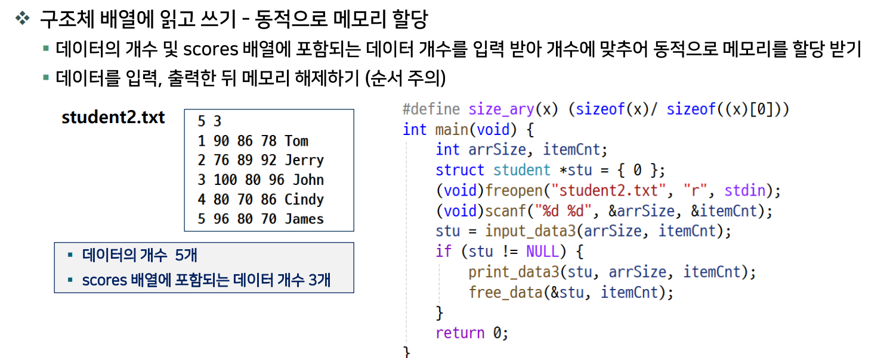
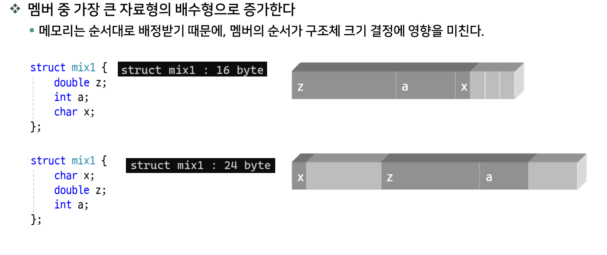
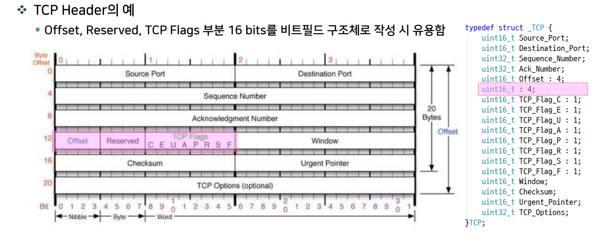
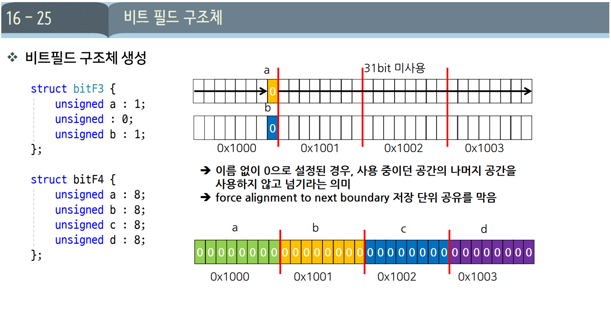
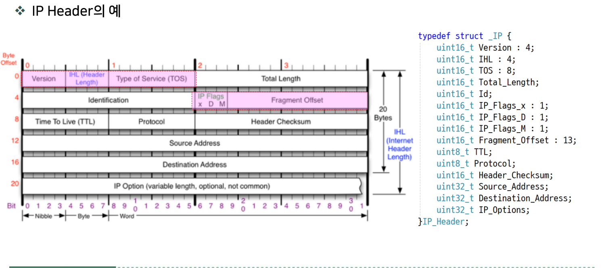
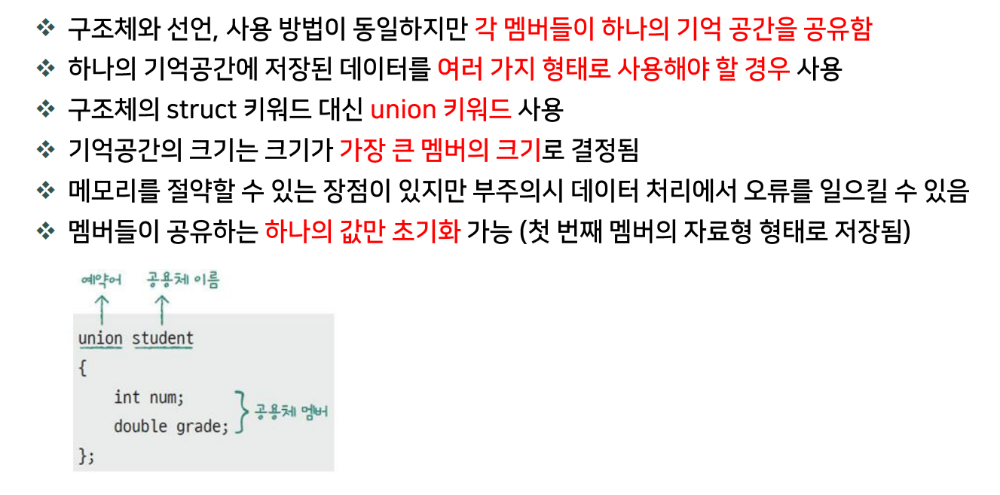
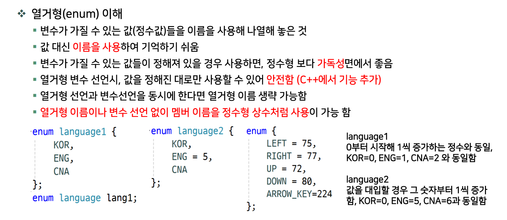
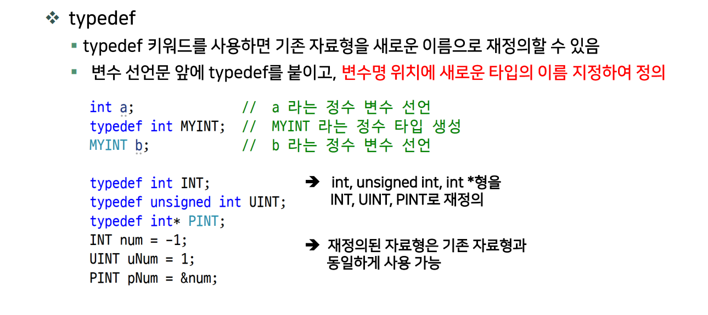

# DAY 09 — 구조체

## 1. 구조체 배열의 동적 할당



- 학생 수만큼 구조체 배열을 할당하고, 각 학생의 점수 개수에 맞춰 점수 배열을 따로 할당한다.
- **구조체 개수와 각 구조체가 가리키는 배열의 원소 개수는 구분**해서 관리한다.
- 해제는 **각 구조체의 동적 할당 멤버 → 구조체 배열** 순서로 진행한다.

## 2. 구조체 멤버 정렬 (Struct Member Alignment)

멤버를 해당 자료형에 맞는 주소 경계에 배치하는 것이다. 정렬되지 않은 접근은 CPU에 따라 추가 작업이 필요할 수 있다.

이때 컴파일러가 멤버 사이 또는 구조체 끝에 넣는 빈 공간을 **패딩(Padding)**이라고 한다. 따라서 `sizeof(구조체)`가 멤버 크기의 합보다 클 수 있다.

### 일반적인 배치 규칙

- 멤버는 선언 순서대로 배치하며, 각 멤버의 **정렬 요구**에 맞춰 패딩을 넣는다.
- 별도 정렬 지정이 없다면 구조체의 정렬은 보통 멤버 중 가장 큰 정렬 요구를 따른다. 중첩 구조체도 자신의 정렬 요구를 가진다.
- 전체 크기는 구조체 정렬의 배수가 되도록 끝에 패딩이 붙을 수 있다.
- **자료형의 크기와 정렬 요구는 다르다.** 예를 들어 `char[20]`이 20바이트라고 해서 20바이트 경계에 배치하는 것은 아니다.

실제 배치는 컴파일러·플랫폼·설정에 따라 달라진다. `char`·`short`만 사용한다고 무조건 패딩이 없는 것도 아니다. [구조체 배치 설명](https://www.gnu.org/software/c-intro-and-ref/manual/html_node/Structure-Layout.html)

### 멤버 순서에 따른 차이

`int`의 크기와 정렬 요구가 모두 4바이트인 일반적인 환경의 예이다.

```c
struct A { char a; int b; char c; }; // 12바이트
struct B { int b; char a; char c; }; // 8바이트
```

멤버의 크기 합은 둘 다 6바이트지만, **순서에 따라 필요한 패딩이 달라진다.**

### `#pragma pack`으로 정렬 제한

`#pragma pack(n)`은 이후 선언하는 구조체 멤버의 **정렬 상한**을 지정하는 컴파일러 기능이다. 최소 할당 단위를 정하는 것이 아니다. 일반적으로 원래 정렬 요구와 `n` 중 작은 값을 적용한다.

```c
#pragma pack(push, 1)
struct Packed { char a; int b; char c; }; // 위 환경에서는 6바이트
#pragma pack(pop) // 이전 설정 복원
```

공간은 줄어들 수 있지만 접근 성능이 좋아진다는 뜻은 아니다. 지원 값과 세부 동작은 컴파일러에 따라 확인한다. [GCC 문서](https://gcc.gnu.org/onlinedocs/gcc/Structure-Layout-Pragmas.html)

## 3. 메모리 축소 후 내부 주소 다시 설정하기

하나의 할당 공간에 **포인터 배열과 문자열을 함께 저장한 실습**이다. `mem`은 전체 공간의 시작 주소, `n`은 문자열 개수, `used`는 실제 사용한 바이트 수이며 0보다 크다고 가정한다.

```c
char *temp = (char *)realloc(mem, used);

if (temp == NULL) {
    // 축소도 실패할 수 있음. 기존 mem과 parr는 그대로 유지됨
} else {
    mem = temp;
    parr = (char **)mem;

    char *p = mem + n * sizeof(char *); // 포인터 배열 뒤의 문자열 시작
    for (int i = 0; i < n; i++) {
        parr[i] = p;
        p += strlen(p) + 1;
    }
}
```

- `realloc`은 축소할 때도 **성공과 주소 유지를 보장하지 않는다.** 임시 포인터로 받은 뒤 성공한 경우에만 갱신한다.
- 공간이 옮겨지면 내부에 저장했던 문자열 주소는 옛 위치를 가리키므로 다시 계산해야 한다. 여기서는 성공할 때마다 모두 다시 설정한다.
- `strlen(p) + 1`만큼 이동하는 것은 문자열 내용과 끝의 `\0`을 건너뛰기 위해서다.

한 번에 할당한 공간이므로 사용이 끝나면 **시작 주소 `mem`으로 한 번만 해제**한다.

## 구조체 멤버 정렬



똑같은 구조체지만 멤버의 순서에따른 구조체의 크기 결정에 영향을 미친다.


## 비트 필드 구조체



### 1. 선언과 저장 범위

멤버 이름 뒤에 **`: 비트 수`**를 붙여 저장에 사용할 비트 폭을 지정한다. 작은 정숫값이나 여러 상태 플래그를 묶어 표현할 때 사용한다.

```c
unsigned int a : 3; // a에 3비트를 사용 → 0~7 저장
```

**부호 없는 n비트의 범위는 `0 ~ 2ⁿ - 1`**이다. `unsigned`는 `unsigned int`와 같은 뜻이다.

| 비트 수 | 저장 범위 |
| --- | --- |
| 1비트 | 0~1 |
| 3비트 | 0~7 |
| 4비트 | 0~15 |
| 8비트 | 0~255 |

### 2. 비트 수의 합과 구조체 크기는 다르다

```c
typedef struct {
    unsigned int a : 3;
    unsigned int b : 3;
    unsigned int c : 3;
} bit_t;

bit_t x = {1, 2, 3};
printf("%d %d %d\n", x.a, x.b, x.c); // 1 2 3
printf("%zu\n", sizeof(x));          // 현재 실습 환경: 4
```

- 각 멤버에 **3비트씩**, 총 **9비트**를 사용한다.
- 현재 환경에서는 세 멤버가 하나의 **4바이트 저장 단위**에 들어가므로 `sizeof(bit_t)`는 **4**다.
- 남은 비트는 패딩으로 남는다. **9비트를 쓴다고 구조체 전체 크기가 9비트 또는 2바이트가 되는 것은 아니다.**

아래 크기 예제는 현재 GCC 실습 환경 기준이다. 저장 단위·정렬·배치 규칙은 컴파일러와 플랫폼에 따라 달라질 수 있다.

### 3. 일반 구조체와 비교

```c
typedef struct {
    unsigned int blue  : 8;
    unsigned int green : 8;
    unsigned int red   : 8;
} color1;
```

```c
typedef struct {
    unsigned char blue;
    unsigned char green;
    unsigned char red;
} color2;
```

현재 실습 환경과 슬라이드 예시 기준으로 비교하면 다음과 같다.

| 구분 | `color1` — 비트 필드 | `color2` — 일반 멤버 |
| --- | --- | --- |
| 각 색상의 값 범위 | 0~255 | 0~255 |
| 색상 데이터에 사용하는 비트 | 8 × 3 = 24비트 | 8 × 3 = 24비트 |
| 구조체 전체 크기 | **4바이트** | **3바이트** |
| 차이 | 나머지 8비트는 패딩으로 남음 | 각 멤버가 1바이트씩 차지 |

**비트 필드라고 항상 메모리를 덜 사용하는 것은 아니다.** 지정한 비트 수의 합과 구조체 전체 크기는 다를 수 있다.

#### 일반 정수 멤버와 비트 필드 — 메모리와 성능 비교

```c
typedef struct {
    unsigned int a;
    unsigned int b;
    unsigned int c;
    unsigned int d;
} normal_t;

typedef struct {
    unsigned int a : 3;
    unsigned int b : 3;
    unsigned int c : 3;
} packed_bits_t;
```

| 비교 항목 | 일반 정수 멤버 | 비트 필드 |
| --- | --- | --- |
| 위 예제의 전체 크기 | **16바이트** | **4바이트** |
| 각 멤버에 사용하는 비트 | 현재 환경에서 32비트 | 지정한 3비트 |
| `x.a = 1` 저장 시 | 해당 정수 멤버에 직접 저장 가능 | 주변 필드를 보존하며 해당 비트만 변경해야 할 수 있음 |
| 생성될 수 있는 명령 | `MOV` 등 | 읽기·`AND`·`OR`·저장 등 |
| 멤버 주소 얻기 | 가능 | 불가능 |

크기는 현재 실습 환경 기준이다. 위 일반 구조체에는 `d`까지 **4개**가 있고, 비트 필드에는 **3개**가 있다. 일반 구조체도 `a, b, c`만 선언하면 **12바이트**다.

비트 필드 하나를 변경할 때 다른 필드의 값을 건드리면 안 되므로, 기존 값을 읽어 필요한 비트만 바꾸는 연산이 추가될 수 있다. 반면 작은 데이터가 촘촘히 모이면 캐시 활용에 유리할 수도 있다.

**메모리 사용량과 접근 연산 사이에 트레이드오프가 생길 수 있다.** 다만 컴파일러 최적화로 여러 대입이 합쳐지거나 사라질 수 있으므로, **일반 멤버는 무조건 `MOV` 한 번, 비트 필드는 항상 느리다고 단정하지 않는다.** 실제 명령은 어셈블리로 확인한다.

#### 비트가 저장된 모습을 확인할 때

**`printf("%X\n", x)`로 구조체 전체를 출력하면 안 된다.** `%X`는 `unsigned int`를 요구하므로 구조체를 넘기면 정의되지 않은 동작이다. 첫 바이트를 확인하려면 구조체의 주소를 `unsigned char *`로 변환해 읽는다.

```c
packed_bits_t x = {1, 2, 3};
const unsigned char *bytes = (const unsigned char *)&x;

printf("%02X\n", (unsigned int)bytes[0]); // 현재 GCC 환경: D1
```

현재 환경에서는 낮은 비트부터 `a`, `b`, `c` 순서로 배치되어 첫 바이트가 다음과 같다.

```text
첫 바이트: 11 010 001 → 11010001₂ → D1₁₆
           c   b   a
```

- `c`는 3비트이므로 첫 바이트의 상위 2비트와 다음 바이트의 하위 1비트에 걸쳐 저장된다. `c = 3`을 대입했으므로 **c의 값은 쓰레기값이 아니다.**
- `char`가 부호 있는 형이면 바이트를 정수로 변환하는 과정에서 부호 확장이 일어날 수 있다. 바이트 확인에는 **`unsigned char`**를 사용한다.
- 이 비트 순서는 현재 환경의 결과이며, 모든 컴파일러에서 같지는 않다. [GCC의 비트 필드 배치 설명](https://gcc.gnu.org/onlinedocs/gcc/Structures-unions-enumerations-and-bit-fields-implementation.html)

### 4. 이름 없는 0비트 필드 — `unsigned : 0`



```c
struct bitF3 {
    unsigned a : 1;
    unsigned   : 0; // 현재 저장 단위를 끝내고 다음 저장 단위에서 시작
    unsigned b : 1;
};

struct bitF4 {
    unsigned a : 8;
    unsigned b : 8;
    unsigned c : 8;
    unsigned d : 8;
};
```

| 구조체 | 현재 실습 환경의 크기 | 이유 |
| --- | --- | --- |
| `bitF3` | **8바이트** | `a`와 `b`가 서로 다른 4바이트 저장 단위를 사용 |
| `bitF4` | **4바이트** | 8비트 × 4개가 하나의 4바이트 저장 단위에 들어감 |

**`: 0`은 값을 0으로 초기화한다는 뜻이 아니다.** 현재 저장 단위의 남은 비트를 건너뛰어, 다음 비트 필드가 같은 저장 단위에 들어가지 않도록 한다. **0비트 필드에는 이름을 붙일 수 없다.**

### 5. 시험에서 주의할 제약

```c
sizeof(x);   // 가능: 구조체 전체 크기
sizeof(x.a); // 불가능: 비트 필드 자체의 크기
&x.a;        // 불가능: 비트 필드의 주소
```

- 비트 필드는 개별 주소를 얻을 수 없으므로 **해당 멤버를 가리키는 포인터도 만들 수 없다.**
- `unsigned int`, `signed int` 등으로 선언한다. 그냥 `int`로 선언한 비트 필드의 부호 여부는 구현에 따라 다르므로 명시하는 편이 분명하다.
- 비트 배치 순서·정렬·전체 크기, 다른 정수형의 비트 필드 지원 여부는 구현에 따라 달라진다. [GCC 문서](https://gcc.gnu.org/onlinedocs/gcc/Structures-unions-enumerations-and-bit-fields-implementation.html)

#### 일반 멤버를 추가하면 주소를 얻을 수 있다

비트 필드도 실제 저장 공간은 있지만 **개별 주소를 얻을 수 없다.** 반면 `: 비트 수` 없이 선언한 멤버는 일반 멤버이므로 주소를 얻을 수 있다.

```c
typedef struct {
    unsigned int a : 3;
    unsigned int b : 3;
    unsigned int c : 3;
    unsigned int d;     // 일반 멤버
} bit_with_d_t;

bit_with_d_t x = {0};

// &x.a;                         // 불가능: 비트 필드
printf("%p\n", (void *)&x.d);    // 가능: d의 주소 출력
printf("%zu\n", sizeof(x.d));   // 현재 환경: 4바이트 (정수)
printf("%zu\n", sizeof(&x.d));  // 현재 환경: 8바이트 (포인터)
printf("%zu\n", sizeof(x));     // 현재 환경: 8바이트 (구조체 전체)
```

| 표현 | 의미 | 현재 64비트 실습 환경 |
| --- | --- | --- |
| `sizeof(x.d)` | `unsigned int` 멤버의 크기 | **4바이트** |
| `sizeof(&x.d)` | `unsigned int *` 포인터의 크기 | **8바이트** |
| `sizeof(x)` | 비트 필드 공간 4바이트 + 일반 멤버 `d` 4바이트 | **8바이트** |

**`%p`는 주소 자체를 출력한다.** 주소의 자릿수나 출력값을 보고 메모리 크기를 판단하지 않고, 크기는 `sizeof`로 확인한다.

### 6. 활용 예시 — IPv4 헤더



아래는 슬라이드의 각 필드를 C 선언으로 표현한 **학습용 예시**다.

```c
#include <stdint.h>

typedef struct {
    uint16_t Version : 4;
    uint16_t IHL     : 4;
    uint16_t TOS     : 8;
    uint16_t Total_length;
    uint16_t Id;
    uint16_t IP_Flags_x : 1;
    uint16_t IP_Flags_D : 1;
    uint16_t IP_Flags_M : 1;
    uint16_t Fragment_Offset : 13;
    uint8_t  TimeToLive;
    uint8_t  Protocol;
    uint16_t Header_Checksum;
    uint32_t source_Address;
    uint32_t Destination_Address;
    uint32_t IP_Option; // 예시에서는 옵션 공간을 4바이트로 표현
} IP_Header;
```

- `Version + IHL + TOS`는 **4 + 4 + 8 = 16비트**다.
- 세 플래그와 `Fragment_Offset`은 **1 + 1 + 1 + 13 = 16비트**다.
- `uint16_t`는 부호 없는 16비트 정수형이다. `: 4`를 붙인 멤버는 그중 **4비트 폭**을 사용한다.
- 실제 IPv4 기본 헤더는 **20바이트**이며, 옵션 길이는 가변이다. 위 코드의 `IP_Option`처럼 항상 4바이트인 것은 아니다. `IHL`은 헤더 길이를 **4바이트 단위**로 나타낸다. [RFC 791](https://www.rfc-editor.org/rfc/rfc791.html)

**그림의 비트 수와 C 구조체의 실제 메모리 배치를 구분하자.** 비트 배치와 바이트 순서를 따로 처리해야 하므로, 이 구조체를 그대로 전송한다고 올바른 패킷이 되는 것은 아니다.


## 공용체(UNION)




### 1. 공용체란?

서로 다른 자료형의 멤버가 **하나의 메모리 공간을 공유**하는 사용자 정의 자료형이다. 모든 멤버의 시작 주소가 같으며, 한 멤버에 값을 쓰면 공유 공간의 내용이 바뀐다.

| 구분 | 구조체 `struct` | 공용체 `union` |
| --- | --- | --- |
| 멤버의 공간 | 멤버마다 별도 공간 | 같은 공간을 공유 |
| 값 보관 | 여러 멤버의 값을 동시에 보관 | 일반적으로 한 시점에 한 멤버의 값을 보관 |
| 전체 크기 | 멤버 크기의 합 + 패딩 | 가장 큰 멤버를 담을 크기 + 필요한 패딩 |

**공용체 크기는 가장 큰 멤버의 크기 이상**이다. 정렬을 위한 패딩 때문에 가장 큰 멤버와 항상 같은 크기인 것은 아니다.

```c
typedef union {
    int number;
    float real;
} value_t;

value_t v;
v.number = 10;
v.real = 1.5f; // 같은 공간에 덮어씀. 이전 number 값 10은 유지되지 않음
```

공용체는 현재 어떤 멤버를 저장했는지 자동으로 기록하지 않는다. 여러 종류의 값을 구분해 저장할 때는 보통 별도의 `enum` 태그를 함께 둔다.

### 2. RGB 예제 — 정수와 비트 필드로 같은 공간 보기

아래 코드는 `uint32_t` 비트 필드를 지원하는 컴파일러에서 사용하는 학습용 예제다.

```c
#include <stdio.h>
#include <stdint.h>

typedef struct {
    uint32_t blue  : 8;
    uint32_t green : 8;
    uint32_t red   : 8;
} rgb_t;

typedef union {
    uint32_t color;
    rgb_t rgb;
} pixel_t;

int main(void) {
    pixel_t x = {.color = 0x123456};

    printf("%X %X %X %X\n",
           (unsigned int)x.rgb.blue, (unsigned int)x.rgb.green,
           (unsigned int)x.rgb.red, (unsigned int)x.color);

    x.color = 0x7722DD;
    printf("%X %X %X %X\n",
           (unsigned int)x.rgb.blue, (unsigned int)x.rgb.green,
           (unsigned int)x.rgb.red, (unsigned int)x.color);

    printf("%zu %zu\n", sizeof(rgb_t), sizeof(pixel_t));
    return 0;
}
```

낮은 비트부터 `blue → green → red` 순서로 배치되고, 두 타입의 크기가 4바이트인 환경에서는 다음과 같이 출력된다.

```text
56 34 12 123456
DD 22 77 7722DD
4 4
```

- `x.color`와 `x.rgb`는 **같은 저장 공간을 서로 다른 형태로 보는 멤버**다.
- `x.color`에 대입하면 **주소가 아니라 그 주소에 저장된 값**이 바뀐다.
- `x.rgb` 자체는 구조체이므로 `%X`로 출력할 수 없다. 개별 필드나 정수 멤버 `x.color`를 출력한다.
- `sizeof`의 결과는 `size_t`이므로 `%zu`로 출력한다.

**비트 필드의 배치 순서와 저장 단위는 구현에 따라 달라진다.** C에서 마지막으로 저장한 멤버와 다른 멤버를 읽으면 저장된 비트 표현을 새 타입으로 해석한다. 일반적인 값 변환이 아니며, 타입에 따라 트랩 표현 문제가 생길 수도 있다. 위 출력은 모든 환경에서 보장되지 않고, C++의 공용체 규칙과도 구분해야 한다.

RGB 값을 일정한 규칙으로 추출하려면 비트 연산으로 위치를 명시할 수 있다.

```c
uint32_t color = 0x123456;
unsigned int blue  = (unsigned int)(color & 0xFFu);
unsigned int green = (unsigned int)((color >> 8) & 0xFFu);
unsigned int red   = (unsigned int)((color >> 16) & 0xFFu);
```

### 3. 16비트 RGB라면 왜 2바이트 또는 4바이트가 나올까?

```c
typedef struct {
    uint16_t blue  : 5;
    uint16_t green : 6;
    uint16_t red   : 5;
} rgb565_t;

typedef struct {
    uint16_t color;
    rgb565_t rgb;
} pixel_struct_t;

typedef union {
    uint16_t color;
    rgb565_t rgb;
} pixel_union_t;
```

`sizeof(uint16_t) == 2`, `sizeof(rgb565_t) == 2`이고 추가 패딩이 필요 없는 환경의 예시다.

| 타입 | 공간 배치 | 크기 |
| --- | --- | --- |
| `rgb565_t` | 5 + 6 + 5비트의 필드 | 2바이트 |
| `pixel_struct_t` | `color` 2바이트 + `rgb` 2바이트 | 4바이트 |
| `pixel_union_t` | 두 멤버가 같은 2바이트 공유 | 2바이트 |

**`typedef`로 붙인 이름이 아니라 `struct` / `union` 키워드가 공간 배치를 결정한다.** 비트 수의 합만으로 전체 크기를 단정하지 말고, 실제 환경에서 `sizeof`로 확인한다.


## 열거형(enum)



### 1. 정수 상수에 이름 붙이기

`enum`은 관련된 정수 상수에 이름을 붙여 코드의 의미를 드러낸다. 값을 생략하면 첫 항목은 0이며, 이후에는 앞 항목보다 1씩 증가한다.

```c
enum { KOR = 1, ENG, MAT }; // KOR=1, ENG=2, MAT=3
int scores[4] = {0, 90, 100, 80};
printf("%d\n", scores[KOR] + scores[MAT]); // 170
```

### 2. 구조체 배열 + 함수 포인터 + switch

메뉴 이름, 연산 기호, 실행할 함수를 하나의 구조체로 묶는다. 메뉴 번호를 배열 인덱스로 사용하면 선택한 함수를 호출할 수 있다.

```c
#include "day7_lib.h" // sum, sub, mul, divi, mod 선언 및 SIZE 매크로

typedef struct {
    int (*fp)(int, int);
    const char *name;
    char op;
} my_t;

enum { EXIT = 0, SUM, SUB, MUL, DIV, MOD };

int get_command_no(const my_t *p, int n) {
    int no;
    for (int i = 1; i < n; ++i) {
        printf("%d. %s\n", i, p[i].name);
    }
    printf("0. EXIT\n");
    if (scanf("%d", &no) != 1) {
        return EXIT; // 숫자가 아니거나 입력이 끝나면 종료
    }
    return no;
}

int main(void) {
    int a = 25, b = 6;
    my_t funcs[] = {
        {0}, // 0번은 종료용. 함수 포인터는 널 포인터
        {sum,  "SUM", '+'},
        {sub,  "SUB", '-'},
        {mul,  "MUL", '*'},
        {divi, "DIV", '/'},
        {mod,  "MOD", '%'}
    };

    int cmd_no;
    while ((cmd_no = get_command_no(funcs, SIZE(funcs))) != EXIT) {
        if (cmd_no < SUM || cmd_no > MOD) {
            printf("1~5 중 선택하세요.\n");
            continue;
        }
        switch (cmd_no) {
            case SUM:
            case SUB:
            case MUL:
            case DIV:
            case MOD: {
                int result = funcs[cmd_no].fp(a, b);
                printf("%d %c %d = %d\n", a, funcs[cmd_no].op, b, result);
                break;
            }
        }
    }
    return 0;
}
```

- `int (*fp)(int, int)`는 **int 인수 두 개를 받아 int를 반환하는 함수의 포인터**다.
- `funcs[cmd_no].fp(a, b)`는 선택한 구조체에 저장된 함수를 호출한다.
- `case`를 연속으로 쓰면 여러 명령이 같은 처리 코드를 공유한다. 여기서는 배열에 함수가 저장되어 있으므로 가능하다. 이 예제에서는 범위 확인 후 `switch` 없이 직접 호출해도 된다.
- `while`의 대입식은 입력값을 `cmd_no`에 저장한다. 비교를 명시하면 0일 때 종료한다는 뜻이 분명해진다.
- `printf("%d %c %d = %d\n", ...)`에는 **a, 기호, b, 결과** 네 인수가 필요하다. 하나라도 빠지면 정의되지 않은 동작이다.
- 변수 `b`를 입력받도록 확장한다면 나눗셈과 나머지 연산 전에 0인지 확인해야 한다.

## 형 재정의(typedef)



### 1. 기존 타입에 별칭 붙이기

`typedef`는 기존 타입에 다른 이름을 붙인다. **형 변환을 수행하거나 별개의 새로운 타입을 만드는 것은 아니다.** 복잡한 선언을 간단하게 표현해 가독성을 높인다.

```c
typedef int *IP;
typedef char C10[10];
typedef C10 C10_5[5];

IP p;          // int *p;
C10 word;      // char word[10];
C10_5 words;   // char words[5][10];
```

### 2. 배열 포인터를 반환하는 함수

```c
char (*func(int a, int b))[10]; // 길이 10인 char 배열의 포인터 반환
C10 *func2(int a, int b);       // 같은 반환 타입을 별칭으로 표현
```

`C10 *`는 `char (*)[10]`과 같은 타입이다. `char **`와는 다르다. 위 코드는 함수 선언이며, 실제 정의에서는 반환 타입에 맞는 포인터를 반환해야 한다.

### 3. 2차원 배열을 함수 포인터로 전달하기

```c
#include <stdio.h>

typedef char C10[10];
typedef void (*PrintFn)(C10 *ary, int size);

void printAry(C10 *ary, int size) {
    for (int i = 0; i < size; ++i) {
        printf("%s ", ary[i]);
    }
    printf("\n");
}

int main(void) {
    C10 fruit[] = {"apple", "melon", "cherry"};
    PrintFn fn = printAry;
    fn(fruit, sizeof(fruit) / sizeof(fruit[0]));
    return 0;
}
```

- `fruit`은 `char fruit[3][10]`과 같은 배열이며 전체 크기는 30바이트다.
- 함수 인수로 전달될 때 첫 행을 가리키는 `char (*)[10]` 포인터로 변환된다.
- `ary + 1`은 다음 행으로 이동하므로 10바이트만큼 이동한다.
- 함수 안의 `ary`는 포인터이므로 행 개수를 `sizeof(ary)`로 구할 수 없다. 호출할 때 개수도 함께 전달한다.
- 출력만 하는 함수이므로 예제에서는 반환형을 `void`로 사용했다. `int` 반환형을 사용한다면 그에 맞는 반환문을 작성한다.

## typedef와 #define 비교

| 구분 | `typedef` | `#define` |
| --- | --- | --- |
| 처리 | 컴파일러가 타입 별칭으로 해석 | 전처리기가 토큰을 치환 |
| 용도 | 타입 선언 간소화 | 상수·매크로 등의 치환 |
| 포인터 여러 개 선언 | 각 변수에 포인터 타입 적용 | 치환된 선언 문법에 따라 결정 |

```c
#define IP_MACRO int *
typedef int *IP_TYPE;

IP_MACRO a, b; // int *a, b; → a는 포인터, b는 int
IP_TYPE c, d;  // int *c, *d; → 둘 다 포인터
```

**타입에 이름을 붙일 목적이라면 `typedef`를 사용하면 선언 의도를 명확하게 표현할 수 있다.**
