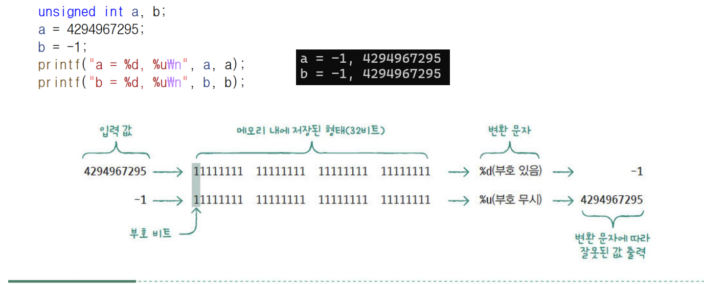
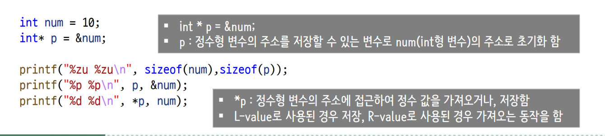

# C 자료형

## 01-5b 문자 상수와 ASCII 코드

C언어에서 `'A'`처럼 작은따옴표로 감싼 문자를 **문자 상수(문자 리터럴)**라고 한다.
일반 문자 상수의 자료형은 `int`이며, `char` 변수에 저장해 문자로 사용할 수 있다.

**ASCII(아스키) 코드**는 문자에 숫자를 대응시킨 문자 코드이다.
ASCII를 사용하는 환경에서 대문자와 소문자는 서로 다른 값을 가진다.

| 문자 | 10진수 | 16진수 |
| --- | ---: | ---: |
| `'A'` | 65 | `0x41` |
| `'a'` | 97 | `0x61` |

```c
char upper = 'A';
char lower = 'a';
```

## 2. 진법 변환

### 10진수 197을 2진수로 변환

197은 다음과 같이 2의 거듭제곱의 합으로 나타낼 수 있다.

```text
197 = 128 + 64 + 4 + 1
    = 1100 0101 (2진수)
```

### 2진수 → 16진수: 오른쪽부터 4자리씩 묶기

```text
1100 0101
  C    5

197(10) = C5(16)
```

### 2진수 → 8진수: 오른쪽부터 3자리씩 묶기

부족한 왼쪽 자리는 0으로 채운다.

```text
011 000 101
 3   0   5

197(10) = 305(8)
```

### C 코드에서 정수 상수 표기

| 진법 | 표기 방법 | 197을 나타내는 예 |
| --- | --- | --- |
| 10진수 | 접두사 없이 작성 | `197` |
| 8진수 | 앞에 `0`을 붙임 | `0305` |
| 16진수 | 앞에 `0x`를 붙임 | `0xC5` |

```c
int decimal = 197;
int octal = 0305;
int hexadecimal = 0xC5;
// 세 변수에 저장되는 값은 모두 같다.
```

## 01-6 변수(Variable)


### 배열과 포인터 선언 구분

변수 이름을 기준으로 괄호를 먼저 확인한다. `[]`와 `()`는 `*`보다 우선순위가 높으므로, 괄호 위치에 따라 선언의 의미가 달라진다.

| 선언 | 구분 | 의미 |
| --- | --- | --- |
| `int *a[5];` | 포인터 배열 | `int`를 가리키는 포인터 5개를 담는 배열 |
| `int (*b)[5];` | 배열 포인터 | `int` 원소 5개로 이루어진 배열을 가리키는 포인터 |
| `int (*a[5])[4];` | 배열 포인터의 배열 | `int` 원소 4개로 이루어진 배열을 가리키는 포인터 5개를 담는 배열 |

각 선언은 서로 독립적인 예시이다.

```c
int *a[5];       // 포인터 배열
int (*b)[5];     // 배열 포인터
int (*a[5])[4];  // 배열 포인터의 배열
```

### 함수 선언과 반환형

함수 이름 뒤의 괄호에는 매개변수 자료형을 작성한다. 다음 두 함수는 모두 `int`형 인자 2개를 받지만 반환형이 다르다.

| 선언 | 반환형 |
| --- | --- |
| `int func(int, int);` | `int` |
| `int *f(int, int);` | `int *` (`int`를 가리키는 포인터) |

```c
int func(int, int);  // int 값을 반환하는 함수
int *f(int, int);    // int 포인터를 반환하는 함수
```

> `int *f(int, int);`는 포인터를 반환하는 함수 선언이다. 함수 포인터 선언인 `int (*f)(int, int);`와 괄호 위치를 구분한다.

### 주의: 포인터를 여러 개 선언할 때

`*`는 각 변수 이름에 따로 붙여야 한다. `int* p1, p2;`에서 **`p1`만 포인터이고, `p2`는 일반 `int` 변수**이다.

```c
int n1 = 10, n2 = 20;
int *p1, p2;

p1 = &n1;    // 정상: int 포인터에 n1의 주소 저장
// p2 = &n2; // 잘못된 대입: int 변수에 주소를 저장하려고 함
```

두 변수 모두 포인터로 사용하려면 다음처럼 선언한다.

```c
int *p1 = &n1;
int *p2 = &n2;
```

한 줄로 작성할 때도 `int *p1 = &n1, *p2 = &n2;`처럼 각각 `*`를 붙인다.

### 형변환



형변환은 값을 다른 자료형으로 변환하는 것이다. **암시적 형변환**과 **명시적 형변환**으로 구분한다.

| 구분 | 의미 | 예시 |
| --- | --- | --- |
| 암시적 형변환 | 대입이나 연산 과정에서 자동으로 변환 | `double value = 10;` |
| 명시적 형변환 | `(자료형)`을 붙여 직접 변환 | `int value = (int)3.14;` |

#### 암시적 형변환

```c
double value = 10; // int 값 10이 double 값 10.0으로 변환됨
int number = 3.14; // 소수 부분이 버려져 3이 저장됨
```

암시적 형변환 자체를 무조건 피해야 하는 것은 아니다. 다만 **소수 부분 손실, 표현 범위, 부호 유무**에 따라 값이 달라질 수 있으므로 주의한다.

#### 명시적 형변환과 출력 서식

```c
unsigned int a = 'A';

printf("%u\n", a);      // unsigned int에 맞는 서식: ASCII 환경에서 65 출력
printf("%d\n", (int)a); // int로 변환했으므로 %d 사용 가능
```

`unsigned int`는 부호 없는 정수형이며, `unsign int`가 아니라 **`unsigned int`**로 작성한다. `printf`를 사용하려면 `#include <stdio.h>`가 필요하다.

> `printf`의 서식 지정자는 전달하는 인자의 자료형과 맞춰야 한다. `unsigned int`는 `%u`, `int`는 `%d`를 사용한다. 위 예시의 65는 `int`로 표현할 수 있지만, 큰 `unsigned int` 값을 `int`로 변환할 때는 범위를 확인해야 한다.

#### 나눗셈에서 형변환 위치

```c
int x = 5, y = 2;

double result1 = x / y;         // 정수 나눗셈 후 변환: 2.0
double result2 = (double)x / y; // 나눗셈 전에 변환: 2.5
```

소수 부분까지 계산하려면 **연산 전에** 피연산자 중 하나를 실수형으로 변환한다.

## 배열의 양면성

배열은 여러 원소를 연속해서 저장하는 자료형이다. **대부분의 식에서 배열 이름은 첫 번째 원소를 가리키는 포인터로 변환**되지만, 배열 자체와 포인터는 서로 다르다.

### 배열 자체로 사용되는 경우: `sizeof`, `&`

```c
int arr[5] = {10, 20, 30, 40, 50};
```

| 표현 | 의미 | 결과 또는 자료형 |
| --- | --- | --- |
| `sizeof arr` | 배열 전체의 크기 | `5 * sizeof(int)`바이트 |
| `&arr` | 배열 전체를 가리키는 주소 | `int (*)[5]` |
| `arr` (포인터로 변환되는 문맥) | 첫 번째 원소를 가리키는 주소 | `int *` |
| `&arr[0]` | 첫 번째 원소의 주소 | `int *` |

`sizeof`는 자료형이나 객체의 크기를 바이트 단위로 구하는 연산자이다. 이 예시에서는 `int`가 4바이트인 환경이라면 `sizeof arr`은 20이다.

`&`는 주소를 구하는 연산자이다. `&arr`과 `&arr[0]`은 같은 메모리 시작 위치를 가리키지만, **가리키는 대상의 자료형과 크기**가 다르다.

### 포인터로 변환되는 경우

```c
int *p = arr; // arr이 첫 번째 원소의 주소로 변환됨

printf("%d\n", arr[0]); // 10
printf("%d\n", *(p + 1)); // 20
```

배열 이름을 **포인터 상수 자체라고 설명하는 것은 정확하지 않다.** 배열은 배열 자료형이며, 대부분의 식에서 포인터로 변환될 뿐이다. 배열 이름에 다른 주소를 대입하거나 `arr++`처럼 증가시킬 수는 없다.

### `arr + 1`과 `&arr + 1`의 차이

| 표현 | 이동 단위 |
| --- | --- |
| `arr + 1` | `int` 원소 1개 크기만큼 이동 |
| `&arr + 1` | `int` 원소 5개로 이루어진 배열 전체 크기만큼 이동 |

> `&arr + 1`은 배열 전체의 바로 다음 위치를 가리킨다. 이 위치를 계산할 수는 있지만, 역참조해서 값을 읽거나 쓰면 안 된다.

### 배열의 원소 개수 구하기

```c
size_t count = sizeof arr / sizeof arr[0]; // 5
printf("원소 개수: %zu\n", count);
```

함수의 매개변수로 작성한 `int arr[]`는 `int *arr`로 조정된다. 따라서 함수 안에서 매개변수에 `sizeof arr`을 사용하면 **배열 전체 크기가 아니라 포인터 크기**가 나온다. 원소 개수는 별도로 전달해야 한다.

위 출력 예시에는 `#include <stdio.h>`가 필요하다. `sizeof`의 결과 자료형은 `size_t`이며, 출력할 때 `%zu`를 사용한다.

### 수업 참고 이미지



### sizeof

`sizeof`는 **자료형이나 객체가 차지하는 크기를 바이트 단위로 구하는 연산자**이다. 함수가 아니며, 결과의 자료형은 부호 없는 정수형인 `size_t`이다.

#### 사용 방법

| 대상 | 예시 | 설명 |
| --- | --- | --- |
| 자료형 | `sizeof(int)` | 자료형 이름에는 괄호가 필수 |
| 변수 | `sizeof ch`, `sizeof(ch)` | 식에 사용할 때는 괄호 생략 가능 |
| 배열 | `sizeof arr` | 실제 배열이라면 전체 원소의 크기를 합한 값 |
| 리터럴 | `sizeof('A')` | 리터럴의 자료형에 해당하는 크기 |
| 구조체·공용체 | `sizeof(struct Example)` | 정렬을 위한 패딩까지 포함한 전체 크기 |

- 일반적으로 크기는 컴파일 시 결정된다. 다만 가변 길이 배열(VLA)은 실행 시 크기가 결정될 수 있다.
- 일반적인 고정 크기 자료형의 식은 평가하지 않는다. 예를 들어 `sizeof(int)`와 같은 크기를 구하는 `sizeof(n++)`에서 `n`은 증가하지 않는다.
- 구조체는 멤버 배치 순서에 따라 패딩과 전체 크기가 달라질 수 있다. 공용체는 멤버들이 저장 공간을 공유하며, 정렬 때문에 가장 큰 멤버보다 전체 크기가 클 수도 있다.
- `size_t`는 `<stddef.h>` 등에 정의되며, `<stdio.h>`를 포함해도 사용할 수 있다. 출력 서식은 **`%zu`**이다.

#### 문자 변수와 문자 상수의 크기

```c
#include <stdio.h>

char ch = 'A';

printf("%zu %zu\n", sizeof ch, sizeof('A'));
```

`int`가 4바이트인 환경의 출력:

```text
1 4
```

| 표현 | 자료형 | 크기 |
| --- | --- | --- |
| `ch` | `char` | 항상 1바이트 |
| `'A'` | `int` (C의 일반 문자 상수) | `sizeof(int)` |

> C에서는 `'A'`의 자료형이 `int`이다. C++에서는 `char`이므로 결과가 다를 수 있다.

### const를 사용한 변수와 포인터

`const`는 **해당 대상을 수정하지 못하도록 제한하는 한정자**이다. 포인터 선언에서는 `const`의 위치에 따라 수정할 수 없는 대상이 달라진다.

#### const 변수는 수정할 수 없다

```c
const double value = 0.14;
const double *dp = &value;

printf("%f\n", *dp); // 읽기는 가능
// value = 0.25;    // 오류: const 변수 수정 불가
// *dp = 0.25;      // 오류: 이 포인터를 통한 값 수정 불가
```

`double *dp = &value;`처럼 작성하면 `const` 한정자를 제거하는 잘못된 포인터 초기화에 대한 진단이 발생한다. 강제로 형변환하더라도 **원래 const로 정의한 객체를 수정하면 정의되지 않은 동작**이다. 따라서 “포인터로 접근하면 const 변수도 변경할 수 있다”는 설명은 잘못된 것이다.

#### 포인터가 가리키는 값과 포인터 자체 구분

| 선언 | 가리키는 값 수정 | 다른 주소 대입 |
| --- | --- | --- |
| `const char *cp` | `cp`를 통해 수정 불가 | 가능 |
| `char const *cp` | 위와 동일 | 가능 |
| `char *const cp` | 가능 (수정 가능한 객체를 가리킬 때) | 불가 |
| `const char *const cp` | `cp`를 통해 수정 불가 | 불가 |

#### 문자열 리터럴을 가리키는 경우

```c
const char *cp = "rabbit";

cp = "cat";    // 가능: 포인터가 다른 문자열을 가리키게 변경
// cp[0] = 'd'; // 오류: const char 포인터를 통한 문자 수정 불가
```

`cp`는 주소를 저장하는 변수이고, `cp[0]`은 가리키는 문자열의 첫 번째 문자이다. **주소를 바꾸는 것과 그 주소에 있는 문자를 바꾸는 것은 서로 다르다.**

> C에서는 문자열 리터럴을 `char *`로 가리켜도, 리터럴 자체를 수정하면 정의되지 않은 동작이다. 문자열 리터럴은 `const char *`로 가리키는 습관을 들인다.

#### 문자를 수정하려면 배열로 저장

```c
char word[] = "rabbit";
char *const cp = word;

cp[0] = 'R'; // 가능: 수정 가능한 배열의 원소 변경
// cp = "cat"; // 오류: const 포인터에 다른 주소 대입 불가
```
### 정리
| 선언 | 제한 |
|---|---|
| `const char *cp` | 이 포인터로 내용 수정 금지 |
| `char *const cp` | 저장된 주소 변경 금지 |
| `const char *const cp` | 둘 다 금지 |


각 코드 블록은 서로 독립적인 예시이다. 출력 코드를 실행하려면 함수 내부에 작성한다.
