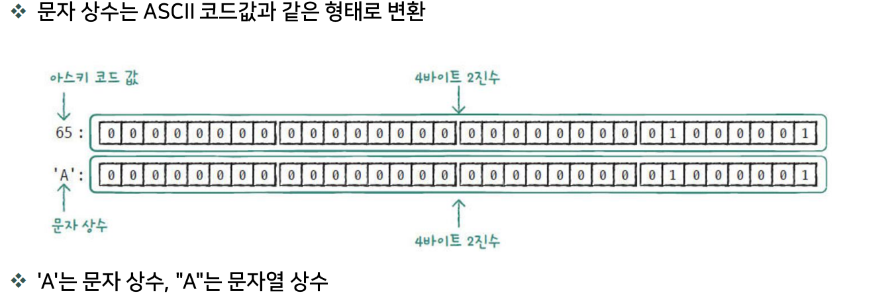
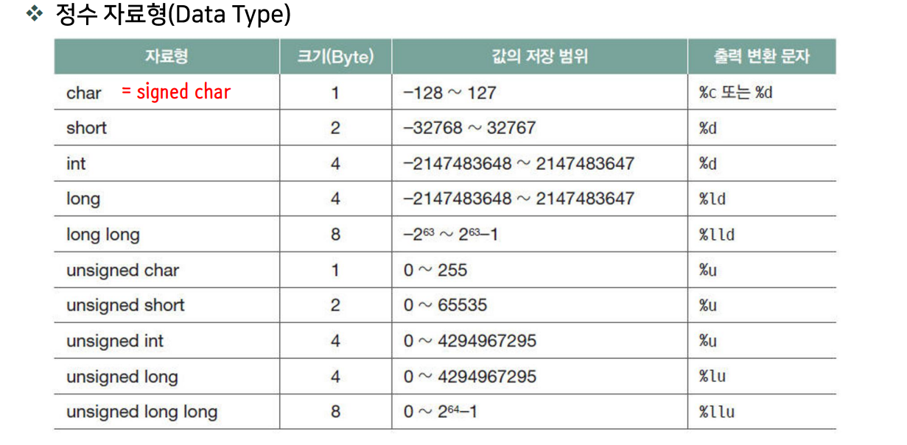

# C 자료형

## 01-5b 문자 상수와 ASCII 코드

C언어에서 `'A'`처럼 작은따옴표로 감싼 문자를 **문자 상수(문자 리터럴)**라고 한다.
일반 문자 상수의 자료형은 `int`이며, `char` 변수에 저장해 문자로 사용할 수 있다.

**ASCII(아스키) 코드**는 문자에 숫자를 대응시킨 문자 코드이다.
ASCII를 사용하는 환경에서 대문자와 소문자는 서로 다른 값을 가진다.

| 문자 | 10진수 | 16진수 |
| --- | ---: | ---: |
| `'A'` | 65 | `0x41` |
| `'a'` | 97 | `0x61` |

```c
char upper = 'A';
char lower = 'a';
```

## 2. 진법 변환

### 10진수 197을 2진수로 변환

197은 다음과 같이 2의 거듭제곱의 합으로 나타낼 수 있다.

```text
197 = 128 + 64 + 4 + 1
    = 1100 0101 (2진수)
```

### 2진수 → 16진수: 오른쪽부터 4자리씩 묶기

```text
1100 0101
  C    5

197(10) = C5(16)
```

### 2진수 → 8진수: 오른쪽부터 3자리씩 묶기

부족한 왼쪽 자리는 0으로 채운다.

```text
011 000 101
 3   0   5

197(10) = 305(8)
```

### C 코드에서 정수 상수 표기

| 진법 | 표기 방법 | 197을 나타내는 예 |
| --- | --- | --- |
| 10진수 | 접두사 없이 작성 | `197` |
| 8진수 | 앞에 `0`을 붙임 | `0305` |
| 16진수 | 앞에 `0x`를 붙임 | `0xC5` |

```c
int decimal = 197;
int octal = 0305;
int hexadecimal = 0xC5;
// 세 변수에 저장되는 값은 모두 같다.
```

## 01-6


