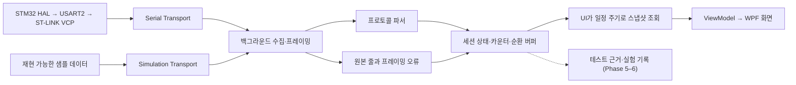

# Embedded Lab Monitor 설계안

`TheSSEN_TIL/MVVM/STM32_Monitoring` · 1차 설계 · 2026-11-19

## 1. 목표와 요구사항

STM32 실습 중 LED와 버튼 상태를 Windows PC에서 확인하고, UART 원본과 이벤트 기록을 대조해 펌웨어 동작을 설명할 수 있게 한다. 첫 번째 실제 실습에서는 NUCLEO-F411RE의 LD2와 B1을 사용한다. 보드 없이도 동일한 수신·해석·표시 경로를 Simulation Mode로 연습한다.

| 영역 | 요구사항 | 첫 적용 |
| --- | --- | --- |
| 하드웨어 상태 | GPIO 입력·출력 상태와 버튼 이벤트를 표시한다. ADC, Timer, PWM, 인터럽트 카운터는 펌웨어가 제공하는 값부터 추가한다. | GPIO Phase 1–3, 계측 채널 Phase 4 |
| 시각화 | 채널별 그래프와 최근값·최솟값·최댓값, 수신 시각과 갱신 간격을 표시한다. 화면을 일시정지해도 수집은 계속한다. | GPIO 타임라인과 ADC 그래프 Phase 4 |
| 통신·디버깅 | COM 목록, 설정, 연결·해제, 원본과 해석된 값, 송수신 및 오류 기록을 제공한다. | Phase 2, 실보드 검증 Phase 3 |
| 테스트 | 조건·기대값·실제 근거·실행 시각을 기록하고 PASS / FAIL / NOT RUN / ERROR로 판정한다. | Phase 5 |
| 실험 기록 | 수신·테스트 이력에 실험명과 메모를 연결하고 CSV 내보내기·불러오기와 세션 비교를 제공한다. | 최근 로그 Phase 1–3, 영구 저장 Phase 5–6 |

## 2. 기술 스택

기존 솔루션 `STM32_Monitoring.slnx`에는 `net10.0-windows` WPF 프로젝트와 `CommunityToolkit.Mvvm`이 있다. `MainWindow`는 빈 템플릿이며, 작업 PC에는 .NET 10 SDK가 설치되어 있다. 현재 프로젝트를 확장해 XAML과 데이터 바인딩 실습을 이어간다. .NET 10은 LTS다. [WPF 개요](https://learn.microsoft.com/en-us/dotnet/desktop/wpf/overview/) · [.NET 지원 정책](https://dotnet.microsoft.com/en-us/platform/support/policy/dotnet-core) · [MVVM Toolkit](https://learn.microsoft.com/en-us/dotnet/communitytoolkit/mvvm/)

| 선택지 | 적용 판단 |
| --- | --- |
| **WPF + MVVM** | Windows 대상과 기존 프로젝트에 부합한다. XAML 리소스로 공통 테마를 만들고 ViewModel의 상태와 명령을 바인딩한다. |
| Avalonia | Windows·Linux·macOS에서 실행해야 할 때 검토한다. 현재 솔루션에서 전환하려면 UI 스타일과 플랫폼별 동작을 다시 검증해야 한다. [Avalonia 지원 플랫폼](https://docs.avaloniaui.net/docs/supported-platforms) |

Phase 1은 기존 MVVM Toolkit과 WPF 컨트롤로 시작한다. Phase 2에 `System.IO.Ports`를 연결하고, Phase 4에서 계단형 GPIO 그래프와 ADC 성능 요구에 맞춰 차트 의존성을 결정한다. 실험과 테스트 결과는 버전이 있는 로컬 파일에 기록하는 구성을 우선한다. [SerialPort API](https://learn.microsoft.com/dotnet/api/system.io.ports.serialport)

## 3. 아키텍처

초기에는 단일 WPF 앱 안에서 폴더로 역할을 나눈다. 앱 시작점에서 구성 요소를 연결한다. 프레이머·파서·판정 로직은 WPF와 COM 포트 없이 테스트할 수 있게 작성한다.

| 구성 | 책임 |
| --- | --- |
| `Views/`, `Themes/` | 창 레이아웃, 페이지, 공통 색·문자 크기·간격, 그래프 및 표 |
| `ViewModels/` | 페이지 이동, 연결·해제 명령, 표시 상태 및 사용자 메시지 |
| `Models/` | 세션, 텔레메트리, GPIO 이벤트, 값의 단위와 출처, 연결 상태 |
| `Transport/` | `ITransport` 뒤의 Simulation 및 Serial 구현. 바이트 송수신, 연결 수명과 I/O 오류 처리 |
| `Parsing/` | 바이트를 줄로 조립하는 프레이머와, 완성된 줄을 모델로 변환하는 프로토콜 파서 |
| `Services/` | 세션 단위 수집, 수신 시각 기록, 유효 데이터와 오류 분류, 화면용 스냅샷 |
| `Testing/`, `Storage/` | Phase 5부터 조건 검증과 근거 기록. Phase 6에서 CSV 및 세션 비교 추가 |



- **수집과 UI** · 포트 열기·읽기·쓰기·닫기와 파싱은 백그라운드에서 처리한다. 전용 읽기 루프는 유한한 읽기 타임아웃으로 취소 여부를 확인한다. 타임아웃 한 번은 유휴 상태로 처리하고, I/O 오류는 연결 오류로 표시한다. UI는 최대 10Hz로 스냅샷을 묶어 반영한다. 연결·해제 요청은 직렬화하고, 이전 세션의 작업 정리 후 새 세션을 시작한다. [SerialPort 읽기 API](https://learn.microsoft.com/en-us/dotnet/api/system.io.ports.serialport.read)
- **보관량** · 초기 한도는 최근 로그 2,000행과 채널별 샘플 1,200개다. 가득 차면 오래된 항목부터 덮어쓰고 보관 범위와 덮어쓴 개수를 표시한다. 송신 대기열과 원본 로그 필드 길이도 제한한다. 향후 영구 기록은 별도 쓰기 작업에서 처리하고, 저장이 밀리거나 실패하면 기록 누락을 표시한다.
- **시각과 출처** · 각 레코드에 세션 ID, Simulation 또는 Device, PC의 UTC 수신 시각, 가능한 경우 MCU 가동 시간과 시퀀스를 기록한다. UI에서는 현지 시각을 표시하며 세션 시간과 수신 간격은 PC의 단조 시계로 계산한다. MCU 가동 시간과 PC 수신 시각만으로 단방향 지연을 계산할 수 없으므로, 기본 지표는 PC 수신 간격과 프레임 누락이다. 동기화나 지연 측정이 필요해지면 별도 실험으로 검증한다.
- **값의 의미** · GPIO 출력은 펌웨어가 보고한 값으로 표시한다. 실제 핀 전압·파형은 별도 계측 근거가 있을 때 기록한다. ADC는 원시 카운트와 전압 환산값을 각각 표시하고 환산 위치, 기준전압과 분해능을 함께 보관한다. MCU의 타이머·PWM 설정값과 캡처로 얻은 측정값도 출처를 명시한다.

## 4. 화면 구성

상단에는 모드, 선택한 장치 프로필, COM 포트, 연결 상태, 마지막 정상 수신 시각, 세션 경과 시간을 둔다. `포트 열림`과 `수신 정상`은 별도 상태다. 유효한 텔레메트리가 오기 전에는 `수신 대기`, 마지막 정상 텔레메트리 후 2초가 지나면 `수신 지연`을 표시한다. 수신 지연 중이거나 연결이 종료되면 상태 카드의 기존 값에 `마지막 수신값`을 붙인다. 채널을 받은 적이 없으면 `—`를 표시한다.

| 좌측 메뉴 | 메인 영역 |
| --- | --- |
| Overview | 연결 상태, GPIO 요약, 버튼 이벤트 수, 마지막 수신 시각과 최근 이벤트 |
| GPIO Monitor | PA5·PC13의 HIGH/LOW, 버튼 눌림 상태, 업데이트 시각. Phase 4부터 계단형 타임라인 |
| ADC / Signal Monitor | 지원 채널, 원시값·환산값·단위, 그래프·채널 선택·일시정지·최근값·최솟값·최댓값 |
| UART Console | RX/TX 시각, 원본 값과 해석 결과, 제한된 진단 명령 |
| Test Runner | 테스트 조건·기대값·대기 시간, 실행·판정, 수신 근거와 결과 이력 |
| Logs | 시각·모드·방향·심각도·메시지, 검색과 필터, 이후 파일 저장 및 불러오기 |
| Settings | 모드 선택, COM 재검색, UART 속도·데이터 비트·패리티·정지 비트·흐름 제어 |

하단에는 최근 이벤트와 오류 요약을 표시한다. 다크 테마에서 정상·지연·오류는 색과 텍스트로 함께 구분한다. 좁은 창에서는 상태 카드를 줄바꿈하고 표 영역을 스크롤할 수 있게 한다. Phase 1에서는 Overview·GPIO Monitor·최근 Logs와 모드 전환을 작동시키고, 구현 예정 메뉴에는 해당 단계와 사용 가능 조건을 표시한다. 그래프의 최소·최대는 선택한 표시 구간을 기준으로 계산하며 일시정지는 화면 스냅샷에만 적용한다.

## 5. NUCLEO-F411RE 통신과 메시지 형식

1. 보드 표기와 회로 구성을 확인한다. 표준 MB1136 VCP 구성에서는 STM32의 USART2 TX/RX가 각각 PA2/PA3을 통해 ST-LINK에 연결된다. LD2는 PA5, B1은 PC13을 사용한다. ST-LINK 쪽 USB에 데이터 케이블을 연결하고 Windows 장치 관리자에서 COM 번호를 확인한다. 포트가 보이지 않으면 케이블·드라이버와 보드 리비전의 브리지 설정을 확인한다. [NUCLEO-F411RE 제품 페이지](https://www.st.com/en/evaluation-tools/nucleo-f411re.html) · [ST UM1724 보드 매뉴얼](https://www.st.com/resource/en/user_manual/dm00105823-stm32-nucleo64-boards-mb1136-stmicroelectronics.pdf)
2. STM32CubeIDE에서 USART2를 Asynchronous, **115200 bps, 8N1, 흐름 제어 없음**으로 설정한다. PA5는 GPIO 출력, PC13은 보드 회로에 맞는 GPIO 입력으로 설정한다. LD2는 예를 들어 500ms마다 토글한다. 버튼은 초기 목표 30ms의 안정 구간을 거쳐 눌림·해제 변화를 기록한다. 송신은 메인 루프에서 스케줄하고, 비동기 전송이 끝날 때까지 송신 버퍼를 유지한다. 인터럽트에서는 상태나 완료 플래그만 갱신한다.
3. 펌웨어를 올린 뒤 시리얼 터미널에서 200ms마다 상태 프레임이 들어오는지 보고, B1을 눌러 이벤트 줄을 확인한다. 터미널을 닫은 후 모니터의 Device Mode에서 같은 포트와 설정으로 연결한다. LD2가 보이는 상태, 수신된 PA5 값, 버튼 이벤트 시각을 대조한다. USB를 뽑았다 다시 연결해 오류 표시와 수동 재연결도 확인한다.

**프로토콜 초안**은 ASCII 쉼표 구분 필드와 줄 끝 LF를 사용한다. 수신기는 CRLF도 허용한다. MCU는 고정 길이 버퍼와 정수 필드를 사용하며 전송과 GPIO 처리의 주기를 분리한다.

```text
V1,S,41,8200,1,0,0,17
V1,B,42,8231,1,1,18
V1,Q,7,PING
V1,R,7,PONG
```

| 유형 | 필드 순서 |
| --- | --- |
| `S` 상태 | 버전, 유형, 시퀀스, MCU 가동 시간(ms), PA5 레벨, PC13 레벨, 눌림 여부(0/1), 누적 버튼 전환 수 |
| `B` 버튼 전환 | 버전, 유형, 시퀀스, MCU 가동 시간(ms), PC13 레벨, 눌림 여부(0/1), 누적 버튼 전환 수 |
| `Q` 진단 요청 | 버전, 유형, 요청 ID, 명령 |
| `R` 진단 응답 | 버전, 유형, 요청 ID, 응답 |

- **프레이밍** · SerialPort의 읽기 1회에는 줄 일부나 여러 줄이 들어올 수 있다. 읽은 바이트를 LF까지 누적한다. LF를 제외한 줄이 128바이트를 초과하면 다음 LF까지 버리고 오류를 기록한다. 버전·유형·필드 수·값 범위·ASCII를 확인한 뒤 상태를 갱신한다. 원본 로그에는 제어 문자를 이스케이프해 표시한다. 오류 이후 다음 정상 줄부터 복구한다.
- **누락** · 상태·버튼 프레임은 같은 32비트 시퀀스를 쓴다. 생성한 프레임이 송신 대기열에서 유실되어도 시퀀스는 증가시킨다. 재연결 시 비교 기준을 초기화하고, 시퀀스와 MCU 시간의 정상 롤오버를 고려한다. 재부팅이나 순서 이상으로 판별이 모호하면 누락 개수를 확정하지 않고 기준을 다시 잡는다. 펌웨어 송신 누락과 PC 수신 경로의 누락은 시퀀스만으로 구별할 수 없으므로, 필요 시 송신 큐 유실 카운터를 추가한다.
- **대역폭** · 8N1에서 115200 bps의 이론 상한은 11,520바이트/초다. 보수적으로 줄당 64바이트를 잡으면 상태 프레임 5Hz는 초당 320바이트로 약 2.8%를 사용한다. 이 계산에는 버튼 이벤트와 명령 응답이 포함되지 않는다. 실제 부하는 수신 로그의 바이트 수와 MCU 송신 큐 상태로 확인한다.
- **명령** · 읽기 전용 모니터링이 기본이다. UART Console에서는 사용자가 선택해 보내는 `PING`을 먼저 지원한다. 한 번에 하나의 요청을 진행하며, 같은 세션에서 송신 후 제한 시간 안에 같은 요청 ID의 응답이 들어오면 처리한다. 명시적 `UNSUPPORTED` 응답과 무응답 타임아웃을 구분한다. 임의 문자열 송신 기능은 보류한다. GPIO 출력 제어가 필요해지는 단계에는 허용할 명령, 값 범위, 명령 타임아웃을 별도로 정의한다.

## 6. 단계별 로드맵

| 단계 | 산출물 | 확인할 동작 |
| --- | --- | --- |
| 1 · 기반 | 기존 WPF 창에 레이아웃·다크 테마·페이지 내비게이션, Simulation Transport, GPIO 요약과 최근 로그 | 보드 없이 시작·중지·재시작을 반복하고 같은 샘플 시퀀스가 표시된다. Simulation 배지가 탭 이동 중에도 보인다. |
| 2 · UART | COM 검색, 수동 연결·해제, 백그라운드 수신·파서, 원본·해석 Console, 오류 로그와 진단 송신 | 분할·연속 프레임, 포트 점유, 잘못된 설정, 무응답을 재현한다. 포트가 열려도 정상 텔레메트리가 없으면 수신 대기 또는 지연 상태가 보인다. |
| 3 · STM32 연동 | CubeIDE/HAL 최소 예제, PA5 상태 및 PC13 버튼 이벤트, 실제 데이터 확인 기록 | 실제 NUCLEO에서 LED·버튼·진단 응답을 확인하고 USB 분리·재연결을 반복한다. 여기까지가 GPIO·UART MVP다. |
| 4 · 시각화 | GPIO 타임라인, ADC·Timer·PWM 채널, 채널 선택·일시정지, 갱신 주기·시퀀스 누락 | 일시정지 중 수집 지속, 통계 범위, 값의 출처, 장시간 실행 중 보관량 한도를 검증한다. |
| 5 · 테스트 | 테스트 케이스·오차·시간·근거·이력, 설정 및 결과 로컬 저장 | GPIO 상태, LED 주기, 버튼, ADC 범위, UART 응답, 세션 유지에 대해 근거와 판정을 재현한다. |
| 6 · 기록과 확장 | 실험명·메모, CSV 내보내기·불러오기, 세션 비교, 선택적 재연결, BLE 적합성 검토, 테스트·사용 설명서 확충 | 파일 왕복 후 단위·시각·출처가 보존된다. 이전 파일을 읽을 수 있고 불러온 세션에는 기록 데이터 표기가 나타난다. |

테스트 실행기는 시작 이후 같은 세션에서 들어온 증거로만 판정한다. LED 주기는 같은 방향의 연속 두 전환을 MCU 시간으로 비교하고, Phase 5에서 전환 시점이 필요한 경우 펌웨어가 전환 이벤트를 제공하게 한다. 연결 유지 테스트는 포트 상태와 정상 프레임의 허용 수신 간격을 함께 확인한다. 테스트 기록에는 조건·허용오차·기대값·관측값·실행 시작과 종료 시각·세션 ID·출처·관련 프레임을 남긴다.

| 결과 | 판정 기준 |
| --- | --- |
| PASS | 필요한 관측 근거가 있고 조건을 충족했다. |
| FAIL | 유효한 관측값이 조건을 벗어났거나, 정상 수집이 확인된 지정 관측 구간 내 기대 이벤트·응답이 도착하지 않았다. 연결 유지 테스트에서 관측된 연결 종료도 이 경우에 해당한다. |
| NOT RUN | 아직 실행하지 않았거나, 실보드·지원 채널·계측 근거 등 실행 전제조건이 충족되지 않았다. |
| ERROR | 다른 조건을 관측하던 중 연결이 끊기거나, 처리 오류 또는 필요한 프레임 유실로 결과를 판정할 수 없다. |

## 7. MVP 완료 조건

- [ ] Windows에서 기존 솔루션을 빌드·실행하고, 보드 없이 Simulation Mode에서 GPIO 상태와 버튼 이벤트, 수신 원본 및 해석 결과를 확인할 수 있다. 각 화면과 로그에서 Simulation 출처를 확인한다.
- [ ] Device Mode에서 COM 목록과 통신 설정이 작동한다. 실제 NUCLEO-F411RE에서 60초 동안 정상 상태 프레임을 확인하고 보드의 LED 변화와 PA5 표시를 대조한다. B1을 5회 눌렀다 떼어 초기 검증 조건에서 눌림과 해제 이벤트 각 5건을 확인한다.
- [ ] 사용자 명령 `PING`을 전송하고 `PONG`을 RX 로그에서 확인한다. 명령 미지원·응답 타임아웃을 화면에서 확인할 수 있다.
- [ ] 프레임을 여러 읽기로 나누거나 여러 프레임을 한 번에 전달해도 값이 올바르게 해석된다. 초과 길이·깨진 값·알 수 없는 버전 뒤에 정상 프레임을 붙이면 오류 기록 후 다음 정상 값을 표시한다.
- [ ] 포트 점유, 열린 포트의 무응답, USB 분리를 확인하고 명확한 상태와 오류가 표시된다. UI에서 연결·해제·수동 재연결이 가능하며 이전 세션 이벤트가 새 세션에 나타나지 않는다.
- [ ] 30분 모의 수신 동안 페이지 이동과 연결 제어가 동작한다. 로그와 샘플 수가 설계 한도에 머무르고, 장시간 샘플링 중 메모리가 계속 증가하는 징후가 있는지 확인한다. 실보드 여부, 펌웨어 설정, 재현 절차와 실제 확인 결과를 남긴다.

## 8. 위험과 대응

| 위험 | 대응 |
| --- | --- |
| COM 포트를 찾지 못하거나 다른 앱이 사용함 | 장치 관리자 확인, COM 목록 새로고침, 포트 점유와 무응답을 구별하는 오류 표시 |
| 프레임이 잘리거나 연속으로 들어옴 | 바이트 기반 프레이밍, 줄 길이 제한, LF에서 복구하는 테스트 |
| 보드 리셋·시계 롤오버가 큰 누락으로 기록됨 | 세션 기준 초기화, 모듈러 비교, 모호한 경우 순서 이상 표시 및 누락 집계 보류 |
| 버튼 바운스, UART 과부하가 실습 결과를 왜곡함 | 디바운스, TX 버퍼 수명 관리, 제한된 송신 큐, 누락 지표와 보드 대조 |
| 수신 폭주나 로그 렌더링이 UI를 멈추게 함 | 수집 루프와 UI 분리, UI 갱신 주기·보관 크기 제한, 장시간 모의 데이터 검증 |
| 모의 값·계산값을 실측값으로 해석함 | 모드·값별 출처, 단위와 관측 기준, 오래된 값 표시, 보드 미연결 시 미지원 필드에 `—` 표시 |
| CSV를 불러온 뒤 출처가 사라지거나 세션이 섞임 | 스키마 버전·세션 ID·원래 출처를 파일에 포함하고, 불러온 기록에는 재생 상태 표기 |

구현 단계별 기록에는 단계 목표, 변경 파일, 구현 기능, 핵심 코드의 동작 원리, 실행·테스트 방법, 실제 검증 결과, 한계와 다음 작업을 남긴다. 위 수치와 프로토콜은 초기 설계 값이며, 실제 보드와 장시간 검증에서 얻은 수치로 보완한다.
